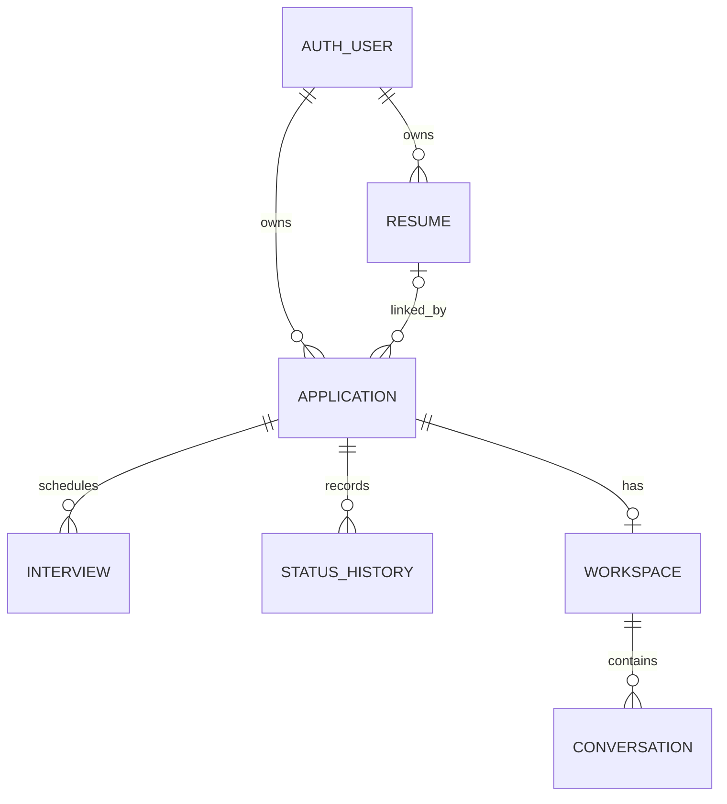
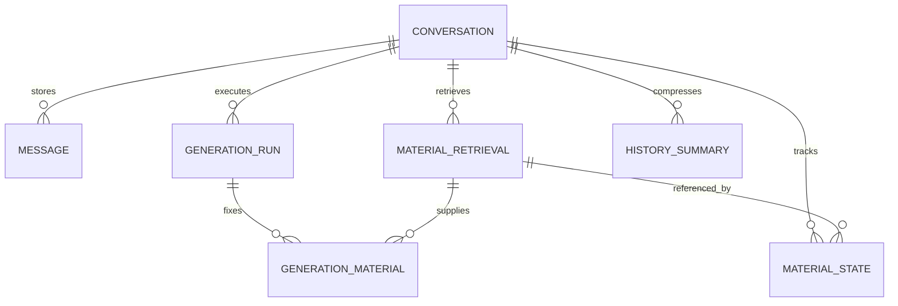

# JobFlow AI Database Design

<a id="reading-guide"></a>

## Added Reading Guide

The dated supplements below carry forward the relevant reading paths, authentication database proposal and shared-identity contract from `backup/database-design-local` (document v1.3), while retaining the current base document's wording, tables, code, section numbers and v1.2 metadata. The supplements are integration guidance and proposed implementation details; they do not approve new product rules or demonstrate implementation.

**Current API snapshot:** the checked-out `endpoints.json` at commit `89d0c4e` is version **1.3.0**. The original §9 preserves the earlier 1.2.0 review. Read [Appendix A](#current-integration-status) before treating a historical gap as still outstanding. Product requirements continue to follow the original source precedence.

| Reader | Start here | Original implementation reference |
|---|---|---|
| Justin Smith — non-AI frontend and OpenAPI | [Current API status](#current-integration-status), [Justin guide](#justin-guide), [shared identity](#shared-identity) | §5.1–5.5, §7.1–7.3, §8.1–8.3/8.5, and relevant §11–12 cases |
| Jianye Zhou — storage/PDF and AI frontend/backend | [Current API status](#current-integration-status), [Jianye guide](#jianye-guide), [shared identity](#shared-identity) | §5.2–5.3, §5.6–5.11, §6.1, §7.2–7.4, §8.4, and relevant §11–12 cases |
| Rongxin Bi — business database, SQL and migrations | Role guides, [identity contract](#shared-identity), [auth migration handoff](#auth-integration-handoff) | Full schema, constraints, lifecycle, SQL, migration and acceptance sections |
| Authentication/authorization owner | [Confirmed auth flows](#authentication-boundary), [identity proposal](#shared-identity), [auth schema](#auth-schema), [handoff](#auth-integration-handoff) | §5.1 and the protected-access/auth checks in §11 |
| Zishi Yang — application APIs | Justin guide, shared identity, current API status | Application/resume schema, ownership, update transactions and counting semantics |

**Status convention for additions:** **CONFIRMED** identifies existing product requirements; **PROPOSED** identifies candidate storage/integration mechanisms; **OPEN** identifies decisions needed before dependent implementation. Actual user-key approval, SDK integration, migration execution and flow evidence remain separate work. Jianye retains AI frontend/backend ownership; Justin coordinates non-AI pages, resume controls, AI entry points and OpenAPI.

## 1. Purpose, Sources, and Decision Status

This document defines the proposed PostgreSQL schema, relationships, constraints, transaction boundaries, query patterns, and migration plan for JobFlow AI. It is a design deliverable, not a claim that the database or features have been implemented.

### 1.1 Requirements Baseline

The requirements baseline is:

- [PRD.md, version 1.2](https://github.com/ECE1724-Team/ECE_1724_finalproject/blob/main/PRD.md): authoritative product requirements, including confirmed authentication rules and database responsibilities.
- [AI_Design.md](https://github.com/ECE1724-Team/ECE_1724_finalproject/blob/main/AI_Design.md): workspace isolation, material retrieval and versioning, context assembly, and conversation persistence. Its §6 recommendations are confirmed requirements through the PRD.
- [endpoints.json, version 1.2.0](https://github.com/ECE1724-Team/ECE_1724_finalproject/blob/main/endpoints.json): API integration reference from the 2026-11-09 review. The alignment notes in §9 retain that review's scope; the API contract is not a requirements override.

Repository links point to mutable `main` files. PRD 1.2 and AI_Design.md were reviewed for the AI persistence design on 2026-11-10. Apply PRD §8.1 precedence: the requester's latest explicit confirmation, confirmed PRD requirements, then AI Design details. Database and API designs implement those requirements. Unresolved product choices remain open; implementation details must not silently decide them.

### 1.2 Scope and Responsibility

This deliverable documents schema, relationships, constraints, access patterns, transaction boundaries, and a migration plan. It contains no executed migrations, implementation code, or test results.

| Area | Responsibility / integration contract |
|---|---|
| Business database | Rongxin Bi: business tables, SQL design and migrations; coordinate API and AI integration |
| Authentication database | Authentication/authorization owner: Better Auth schema, credential issuance/replacement state, verification, sessions, authentication migrations and associated atomic flows |
| Shared identity | Authentication owner supplies the actual user table/key type and migration dependency; business tables reference that identity |
| Application APIs | Coordinate field names, update semantics and ownership checks with Zishi Yang |
| Storage, parsing and AI | Coordinate persisted records and lifecycle contracts with Jianye Zhou |

### 1.3 Requirement Versus Design Decision

Confirmed product rules are treated as requirements. Table names, revision columns, generation records, cleanup outbox and transaction mechanisms below are proposed database solutions, not additional product features or uniquely required implementations. AI persistence details require agreement with the AI owner. Remaining PRD decisions stay explicitly open and block only dependent work.

**Stack:** PostgreSQL; parameterized SQL through `pg`; versioned business migrations through `node-pg-migrate`; no business ORM. Authentication uses Better Auth with PostgreSQL-backed sessions, with physical schema determined by the selected configuration. Original PDFs reside in private S3-compatible storage; extracted text and metadata reside in PostgreSQL. The actual storage provider remains open.

<a id="design-rules"></a>

## 2. Design Rules

1. All protected business access requires a valid session, currently verified email, and resource ownership. All business data belongs to one authenticated user. A foreign key proves relationship integrity; backend ownership checks prove authorization. Both are required.
2. An application links to zero or one usable resume. A resume belongs to the user's personal library and may serve multiple applications. Deleting an application never deletes its resume.
3. One application has at most one persisted workspace, created/reused on entry. Entering a workspace does not create a conversation or call the model.
4. A conversation is permanently bound to its workspace. Messages, retrieval records, and summaries stay within that conversation.
5. Current AI materials remain in application fields and parsed resume records. Retrieval snapshots are historical evidence and reusable per-conversation retrieval results, not another authoritative workspace-memory store.
6. Material revisions are explicit, independent counters. Timestamps alone do not identify material versions.
7. Every generation fixes its material identities and revisions at its start. Later edits apply on the next turn.
8. Dashboard totals are derived from current application/interview records. They are not separately maintained counters.
9. Personal notes, application status, interviews, applied date, and job-posting URL are not automatically included in AI base materials. The approved list is resume text, JD, company, position, company website URL, and company notes.
10. No RAG/vector index, mock-interview session state machine, feedback table, or separate report table is introduced.

<a id="entity-map"></a>

## 3. Entities and Relationships

| Entity | Purpose | Cardinality |
|---|---|---|
| Better Auth user | Account identity and verification state | User owns many applications and resumes |
| Better Auth session/account/verification records | Sessions, credentials, verification and password-reset support | Managed by the configured auth adapter |
| `resumes` | Library item, private object identity, parsing result and extracted text | One resume may be linked by many applications |
| `applications` | Current application fields and individual material revisions | Belongs to one user; links to 0–1 resume |
| `application_status_history` | Actual chronological status transitions | Many per application |
| `interviews` | Individual interview arrangements | Many per application |
| `ai_workspaces` | Unique AI entry for an application | 0–1 persisted row per application, created lazily |
| `conversations` | Independent chat thread | Many per workspace |
| `generation_runs` | A generation attempt, its fixed material manifest, execution state | Many per conversation; at most one active |
| `messages` | Ordered user, assistant, and tool messages | Many per conversation |
| `material_retrievals` | Saved result of retrieving one material revision | Many per conversation |
| `conversation_material_state` | Latest successfully saved retrieval for each material kind | At most six rows per conversation |
| `generation_materials` | Exactly which saved retrievals supplied a generation | Six rows after successful material preparation, including unavailable materials; none required for an attempt that fails before preparation commits |
| `conversation_summaries` | Internal compressed history and coverage boundary | Many per conversation; full messages retained |
| `storage_cleanup_jobs` | Reliable cleanup after DB/object-store boundary failures | Internal operational records |

Relationship diagram for business data:



Conversation persistence:



<a id="shared-conventions"></a>

## 4. Shared Conventions

**Added identity clarification:** the physical auth key remains dependent on the selected, reviewed Better Auth configuration. The original TEXT wording below is not a finalized schema contract; [Appendix D's explicitly configured UUID candidate](#shared-identity) is still a proposal. Match every business user FK to the accepted actual key.

| Convention | Design |
|---|---|
| Business primary keys | UUID, generated by backend or agreed DB mechanism; do not prescribe an extension/version yet |
| Auth primary keys | Preserve the exact type produced by Better Auth; proposed business `user_id` uses matching type, normally `TEXT`; never assume auth IDs are UUIDs |
| Time | `TIMESTAMPTZ` for instants; serialize ISO 8601 with offset/UTC |
| Applied date | Nullable `DATE`; represents the user's actual submission date, not creation time |
| Audit timestamps | `created_at`, `updated_at` non-null where applicable; update explicitly in SQL |
| Revision counters | `BIGINT NOT NULL DEFAULT 1 CHECK (> 0)`; increment on actual changes only |
| Nullable text | Missing optional materials are `NULL`; normalize empty optional input consistently before comparison |
| Required text | `TEXT NOT NULL CHECK (length(btrim(column)) > 0)` for company, position, and upload-time resume name |
| Flexible structured content | `JSONB` for application message parts, version manifests and tool metadata, with explicit SDK/UI adapters; not for applications or interview arrays |
| SQL safety | Bind values with `$1`, `$2`, etc.; allowlist sort expressions and identifiers |
| BIGINT API boundary | Serialize revisions/sequence numbers losslessly, preferably decimal strings; do not silently exceed JavaScript safe integers |

No detailed field-length, URL-length, or pagination limit is established here. Those remain PRD decisions. Validation must not invent new required application fields.

## 5. Data Dictionary

Legend: **NN** = NOT NULL; **PK** = primary key; **FK** = foreign key. All child foreign-key columns receive appropriate indexes. Physical auth names are resolved during integration.

<a id="authentication-boundary"></a>

### 5.1 Authentication Boundary — Owned by Authentication/Authorization

The authentication owner designs and maintains the schema generated for the installed Better Auth version, selected adapter and plugins, together with project-specific state required by the confirmed credential rules. Business migrations must not introduce a competing password/session/token system or independently modify auth tables.

| Logical record / state | Required database responsibility |
|---|---|
| User | Stable identity, email and persistent verified state |
| Account/credential | Supported email/password credential storage linked to the user |
| Session | Server-side session identity, expiry and authoritative revocation |
| Verification/reset credential | User, purpose, issuance/expiry, current/replaced state and consumption semantics, using supported library integration |
| Current issuance state | Enforce the latest credential separately for each `(user, purpose)` under concurrent issuance/use; exact physical representation belongs to the auth owner |

Confirmed authentication contract:

1. Registration sends a verification email, returns `token: null`, and creates neither a login session nor a login-session cookie.
2. Unverified users cannot sign in, even with the correct password, or use protected business features.
3. First successful email verification persists verified state and automatically establishes a session. The frontend loads that session and navigates to Dashboard. Reopening a current link for an already verified account does not guarantee another session.
4. Verification and password-reset credentials each expire 900 seconds after issuance. Session lifetime is a separate, unresolved setting.
5. Issuing a replacement invalidates every earlier credential for that user and purpose immediately. Verification and reset purposes are isolated. Default Better Auth link behavior must not be assumed to satisfy this rule without verification and necessary integration.
6. A reset-link GET only validates and redirects; it does not consume the credential or extend expiry. Password submission rechecks latest issuance, expiry and unused state authoritatively.
7. Successful reset atomically updates the password, consumes the reset credential and revokes every existing user session before success is reported. It creates no new session. Concurrent submissions cannot both succeed. Requesting/resending a reset email alone does not revoke sessions.
8. Protected business APIs check valid session, current verified status and ownership. Session caching must not allow revoked sessions to remain usable. Logout invalidates the relevant server-side session.

The business database consumes a trusted, verified-user identity from the authorization layer. It preserves the generated auth key type, normally `TEXT`, and references the exact provided user PK. It does not determine verification by a client-supplied flag. Passwords and raw email credentials never enter business tables or logs.

Remaining auth decisions: email provider, session lifetime, resend cooldown/rate limits, and issuance/retry behavior when email delivery fails. The authentication owner provides the physical user-table/key contract and ordered auth migrations before dependent business FKs are finalized.

<a id="resume-schema"></a>

### 5.2 `resumes`

| Column | Type / nullability | Purpose |
|---|---|---|
| `id` | UUID PK | Immutable library-file identity |
| `user_id` | Auth ID type NN FK | Owner |
| `name` | TEXT NN, nonblank | User's upload-time name; no later rename |
| `original_filename` | TEXT NN | Original filename; never use as a storage path |
| `object_key` | TEXT nullable, unique when present | Private object identity; no public or signed URL persisted |
| `mime_type` | TEXT NN | Accepted type is `application/pdf` |
| `size_bytes` | BIGINT NN | Actual size, positive and at most 2,097,152 for an accepted upload |
| `page_count` | INTEGER nullable | Parsed page count; successful file has 1–2 pages |
| `extracted_text` | TEXT nullable | Saved parsed text used by AI |
| `non_whitespace_chars` | INTEGER nullable | Extraction validation evidence; at least 100 for success |
| `parse_status` | TEXT NN | Proposed internal values `pending`, `processing`, `succeeded`, `failed` |
| `parse_error_code` | TEXT nullable | Stable parse/validation failure reason for UI mapping |
| `content_version` | BIGINT NN default 1 | Explicit extraction-content revision |
| `deleted_at` | TIMESTAMPTZ nullable | Access tombstone during deletion/cleanup; not a recovery feature |
| `created_at`, `updated_at` | TIMESTAMPTZ NN | Upload/processing audit |

Use `UNIQUE(id, user_id)` for ownership-safe resume links. A new resume version is a new row with a new UUID; a V1→V2 link change is detected by application resume revision and identity, even if both rows have `content_version = 1`.

For a live row (`deleted_at IS NULL`) with `parse_status = succeeded`, require a non-null object key/text, 1–2 pages and at least 100 non-whitespace characters. Express conditional CHECKs with explicit `IS NOT NULL` terms so SQL NULL does not accidentally satisfy validation. Deleted rows are exempt from live-success completeness requirements, allowing extracted text to be cleared while retaining historical parse status. File-size and basic metadata-domain checks still apply. The parser must also validate every page has extractable nonblank text, a genuine readable PDF, and exact size limits. DB metadata checks cannot establish those content properties. Reject oversize bodies before accepting a library item. Failed items may retain error metadata for the upload result, but their object/text must be cleaned up and they cannot be selected. Reprocessing policy is not a user-facing feature; if internal re-extraction changes saved usable text, increment `content_version` atomically.

<a id="application-schema"></a>

### 5.3 `applications`

| Column | Type / nullability | Purpose |
|---|---|---|
| `id` | UUID PK | Application identity |
| `user_id` | Auth ID type NN FK | Owner |
| `company_name` | TEXT NN, nonblank | Required company |
| `position_title` | TEXT NN, nonblank | Required position |
| `status` | TEXT NN default `saved` | Six-value CHECK below |
| `applied_date` | DATE nullable | No automatic default |
| `job_description` | TEXT nullable | Shared AI material |
| `resume_id` | UUID nullable | Selected valid library item |
| `job_url` | TEXT nullable | Original job posting, separate from company website |
| `company_website_url` | TEXT nullable | URL only; not proof of a website read |
| `company_notes` | TEXT nullable | Shared AI material |
| `personal_notes` | TEXT nullable | Excluded from automatic AI context |
| `offer_received` | BOOLEAN NN default false | Correctable historical receipt flag |
| `company_revision` | BIGINT NN default 1 | Company material version |
| `position_revision` | BIGINT NN default 1 | Position material version |
| `jd_revision` | BIGINT NN default 1 | JD material version |
| `website_revision` | BIGINT NN default 1 | Company website URL material version |
| `company_notes_revision` | BIGINT NN default 1 | Company notes material version |
| `resume_revision` | BIGINT NN default 1 | Resume selection version; advances on link/unlink/delete |
| `row_version` | BIGINT NN default 1 | Optimistic update conflict detection |
| `created_at`, `updated_at` | TIMESTAMPTZ NN | Audit and newest-first sorting |

Status mapping:

| UI label | DB/API canonical value |
|---|---|
| Saved | `saved` |
| Applied | `applied` |
| OA / Online assessment | `oa` |
| Interview | `interview` |
| Offer | `offer` |
| Rejected | `rejected` |

No stage-transition restriction. Creating in Offer or transitioning into Offer sets `offer_received = true`. Leaving Offer preserves the flag. The flag can be explicitly corrected independently; it must not be permanently constrained to match current status. If a request combines a transition into Offer with a conflicting false flag, the transition sets it true; coordinate this contract with the API owner.

Use `FOREIGN KEY (resume_id, user_id) REFERENCES resumes(id, user_id)` and a single nullable resume column, rather than a many-to-many link table. A transaction must additionally check parse success and non-deleted state; a normal FK cannot enforce those conditions. Use `RESTRICT`/`NO ACTION` for physical resume removal and explicitly unlink first, so deletion cannot bypass revision increments. Same-owner links are enforced by the composite FK.

Do not deduplicate by company/position: users may legitimately keep several applications for the same role/company. A company is stored directly on an application; a separate company entity would add sharing behavior not required by the PRD.

**Deletion policy gate:** The final hard/soft deletion and chat retention strategy is unresolved. Query examples below assume the set of current applications. If soft deletion is approved, add `deleted_at`, filter it in every list/count/access path, and exclude associated interviews/workspaces from active access. If hard deletion is approved, decide child-history retention/cascades before enabling it. Neither option authorizes resume deletion.

### 5.4 `application_status_history`

| Column | Type / nullability | Purpose |
|---|---|---|
| `id` | UUID PK | Timeline event |
| `application_id` | UUID NN FK | Parent |
| `sequence_no` | BIGINT NN | Stable per-application chronology |
| `old_status` | TEXT NN | Previous status |
| `new_status` | TEXT NN | New status |
| `changed_at` | TIMESTAMPTZ NN | Event instant |

CHECK both values against the six statuses and `old_status <> new_status`. UNIQUE `(application_id, sequence_no)`. Lock the application when allocating the next sequence and changing status. Insert a history row only for an actual transition, in the same transaction as the application update. Creating an application is not a fabricated transition. A separate creation event can be added only after timeline scope is agreed. Actor identity is derived through the application owner; no admin/collaborator roles are added.

### 5.5 `interviews`

| Column | Type / nullability | Purpose |
|---|---|---|
| `id` | UUID PK | Individual interview identity |
| `application_id` | UUID NN FK | Parent |
| `interview_name` | TEXT nullable pending validation decision | Type/name shown in schedule |
| `starts_at` | TIMESTAMPTZ nullable pending validation decision | Scheduled instant |
| `created_at`, `updated_at` | TIMESTAMPTZ NN | Audit |

Use independent rows for add/edit/delete. Do not store the interview schedule as an application JSON array or maintain a conflicting single interview date. Until the PRD's required-field decision is made, nullability is provisional, not permission to expose incomplete scheduling behavior. Unscheduled rows are excluded from the upcoming list. Cancellation/completion states, their effects on counts, and extra interview fields are not invented here.

<a id="ai-schema"></a>

### 5.6 `ai_workspaces` and `conversations`

| Table | Columns | Constraints / behavior |
|---|---|---|
| `ai_workspaces` | `id UUID PK`, `application_id UUID NN FK`, `created_at TIMESTAMPTZ NN` | UNIQUE application; contains no copied materials |
| `conversations` | `id UUID PK`, `workspace_id UUID NN FK`, `title TEXT nullable`, `next_sequence_no BIGINT NN DEFAULT 1`, `created_at`, `updated_at` | Workspace is mandatory and immutable; sequence allocation under row lock |

A title supports the conversation list but does not authorize rename/delete controls; those remain open. Ownership is obtained through workspace→application→user. Do not duplicate `user_id` on every chat table without a consistency constraint.

Create/reuse workspace with an ownership-scoped insert and conflict handling on `application_id`. Repeated entry must return the existing row without inserting a conversation. Only an explicit New conversation action inserts the thread, initially with no messages, summaries, or material state.

### 5.7 `generation_runs`

| Column | Type / nullability | Purpose |
|---|---|---|
| `id` | UUID PK | One generation attempt |
| `conversation_id` | UUID NN FK | Parent conversation |
| `input_message_id` | UUID NN | User message that this attempt answers; same-conversation FK to `messages` |
| `status` | TEXT NN | `preparing`, `streaming`, `completed`, `failed`, `interrupted` |
| `material_manifest` | JSONB nullable until preparation commits | Six-material identity/revision/availability summary derived from the fixed retrieval associations |
| `request_key` | TEXT nullable | Request deduplication key; request identity and reuse rules require the retry contract below |
| `lease_expires_at` | TIMESTAMPTZ nullable, required while active | Operational recovery from crashed workers |
| `model_metadata` | JSONB nullable | Actual provider/model/configuration identifiers; no secrets |
| `error_code` | TEXT nullable | Failure metadata |
| `started_at` | TIMESTAMPTZ NN | Request acceptance and attempt creation |
| `snapshot_at` | TIMESTAMPTZ nullable until preparation commits | Audit time of the logical material-snapshot boundary; versions remain authoritative |
| `completed_at` | TIMESTAMPTZ nullable | Terminal state time |

Use a composite FK `(input_message_id, conversation_id)` to `messages(id, conversation_id)`; the backend also verifies that the referenced message has role `user`. One user message can support multiple attempts without changing the identity or history of earlier attempts.

`generation_materials` and its referenced retrievals are authoritative for the materials actually supplied. Derive `material_manifest` from those associations in the same preparation transaction; never update it independently. It records each kind and revision, plus resume identity/content version where relevant, without copying base-material text. The manifest and associations become immutable when preparation commits.

| Lifecycle stage | Material and persistence requirements |
|---|---|
| `preparing` | The attempt owns the conversation slot; manifest and snapshot time may be NULL until preparation commits |
| `streaming` | Preparation has committed a manifest, snapshot time, and exactly six material associations before any answer generation begins |
| `completed` | Complete material associations and the final assistant answer are saved; final answer and terminal transition commit atomically |
| `failed` / `interrupted` | May terminate before or after preparation; preserve any successfully committed material snapshot and tool records |

Apply row CHECKs for required snapshot fields in `streaming`/`completed` and a non-null lease while active. Validate the six-kind association set in the preparation transaction, since a row CHECK cannot count child rows. A failure before preparation commits leaves no partial material associations or advanced sync pointers.

Enforce a partial unique index on conversation for status in `('preparing','streaming')`. Renew the lease only for the same active attempt while preparing or generating. Recovery atomically marks an expired run terminal before another attempt can acquire the slot and requests cancellation of the old worker. Cancellation is best-effort; conditional database writes enforce ownership. Preparation commits and final-answer writes must lock/recheck that the run is still active and its lease is valid. A stale worker cannot publish or advance sync state after recovery. Lease duration/heartbeat parameters remain implementation decisions. Do not hold a DB transaction open during a model request or stream.

**Proposed retry contract, pending resolution of PRD §11:** retain the original user message and create a new attempt for an explicit retry, checking current materials again. Repeated delivery of the same accepted request identifies the existing attempt rather than creating another user message or answer. An explicit retry has a new request identity. Before implementing deduplication, define key scope, payload-mismatch handling, retention, and retry eligibility; if `request_key` identifies an attempt within a conversation, enforce uniqueness on `(conversation_id, request_key)` for non-null keys. Partial-output persistence remains open. The schema supports this proposal without treating it as a confirmed product rule.

### 5.8 `messages`

| Column | Type / nullability | Purpose |
|---|---|---|
| `id` | UUID PK | Message identity |
| `conversation_id` | UUID NN FK | Scope |
| `generation_id` | UUID nullable | Attempt for generated assistant/tool records; user input is referenced by `generation_runs.input_message_id` |
| `sequence_no` | BIGINT NN | Stable conversation order |
| `role` | TEXT NN | `user`, `assistant`, or `tool` |
| `parts` | JSONB NN | Validated application text/tool parts; converted to SDK and UI formats by explicit adapters |
| `created_at` | TIMESTAMPTZ NN | Persisted time |

UNIQUE `(conversation_id, sequence_no)` and `(id, conversation_id)`. Use a composite FK `(generation_id, conversation_id)` to the corresponding unique pair in `generation_runs`; no message can refer to a different conversation's generation. User input has a NULL `generation_id`, allowing it to be inserted before its attempt and referenced by later retries. Validate the internal parts structure in backend code and test its SDK/UI adapters. Do not assume a provider's raw response is directly replayable UI JSON.

User input is saved before model work. Complete assistant responses are saved after streaming finishes. Tool calls/results retain ordering, call identifiers, arguments, success/failure and retrieval references. Feedback and user-requested summaries are ordinary assistant messages. Internal compression summaries go in `conversation_summaries`.

Tool parts use a stable internal envelope containing `tool_name`, `execution_id`, `arguments`, `status`, and a result or safe `error_code`. Base-material results contain `retrieval_ids`; other tools may store a validated inline result, such as optional website content and its source metadata. Record a provider call ID only when an actual provider tool call exists. One material-tool execution may return several retrievals, but all must belong to the same conversation and preparation attempt. Failed executions have no successful retrieval references. Validate execution IDs and result references when saving and loading records.

Application tool execution and provider tool-message exchange are distinct. Backend-controlled material tools must actually execute; their persisted records do not by themselves establish a model-issued function call. The AI adapter converts genuine provider exchanges using their actual call IDs and valid ordering. For backend-controlled retrieval, it supplies saved material content through the base-material context without fabricating provider tool calls. A tool message's stored result references are resolved within its conversation from immutable retrievals, never from current application fields. No additional tool-execution table is required.

System prompts are server configuration, not user-editable message rows. Retry behavior follows the proposed contract in §5.7 only after the open product decisions are resolved; a `request_key` alone does not define user-visible behavior.

### 5.9 Material Retrieval and Per-Generation Provenance

The six material kinds are `resume`, `jd`, `company`, `position`, `company_website_url`, `company_notes`. The website material contains only the saved URL, not retrieved page content.

For each kind, compare its application material revision and availability with the conversation's saved state. For resumes, compare the full tuple `(resume_revision, source_resume_id, source_content_version, availability)`; identical content-version numbers on different resume rows do not imply identical materials. Compare nullable identities with null-safe semantics. Determine versions and availability before reading changed current text, using the same consistent database snapshot for both operations.

`material_retrievals`:

| Column | Type / nullability | Purpose |
|---|---|---|
| `id` | UUID PK | Saved retrieval result |
| `conversation_id` | UUID NN FK | Independent conversation scope |
| `kind` | TEXT NN | One of six material kinds |
| `material_revision` | BIGINT NN | Application field/link revision read |
| `source_resume_id` | UUID nullable | Historical identity value, deliberately not a live FK |
| `source_content_version` | BIGINT nullable | Resume extraction version |
| `availability` | TEXT NN | `available` or `unavailable` |
| `content_text` | TEXT nullable | Exact retrieved content when available |
| `reason_code` | TEXT nullable | E.g. not linked or field missing |
| `tool_message_id` | UUID NN | Tool record referencing this result |
| `retrieved_at` | TIMESTAMPTZ NN | Retrieval time |

CHECK availability/content coherence: available has content; unavailable has no content. A retrieval failure is not a successful unavailable-material record: record the failure as a tool error and do not advance the successful material state.

Use UNIQUE `(id, conversation_id, kind)` and ownership-preserving composite FK `(tool_message_id, conversation_id)` to `messages`. A successful tool message's parts reference this row rather than duplicating its entire text in another field. The backend can reconstruct the saved result for context and history rendering. Historical resume identity must survive file deletion; never use it as permission to download or relink a deleted file.

`conversation_material_state`:

| Column | Type / nullability | Purpose |
|---|---|---|
| `conversation_id` | UUID NN FK | Parent |
| `kind` | TEXT NN | Material kind |
| `retrieval_id` | UUID NN | Most recent successfully saved retrieval |
| `synced_at` | TIMESTAMPTZ NN | Sync audit |

PK `(conversation_id, kind)`. Composite FK `(retrieval_id, conversation_id, kind)` references `material_retrievals(id, conversation_id, kind)`. Revisions/content are read through that FK; they are not maintained as duplicate cache fields. No state rows exist before a conversation's first message.

`generation_materials`:

| Column | Type / nullability | Purpose |
|---|---|---|
| `generation_id` | UUID NN | Generation |
| `conversation_id` | UUID NN | Scope for composite constraints |
| `kind` | TEXT NN | One of six material kinds |
| `retrieval_id` | UUID NN | Saved result actually supplied as base material |

PK `(generation_id, kind)`. Composite FKs to generation `(id, conversation_id)` and retrieval `(id, conversation_id, kind)`. Reuse the same retrieval for unchanged materials across turns. Include unavailable-material results too, so absence is explicit and versioned. Require exactly six kinds before marking the run streaming/completed; ordinary row checks cannot enforce a six-row set, so use one initialization transaction and validate the count there.

These associations preserve the versions behind each historical answer without copying every material on every turn. Old retrievals remain historical after deletion/unlinking and must not be selected as current when the current manifest differs.

An unchanged saved retrieval remains a current base-material source even when its original tool message has left the history window. Only superseded or unavailable former materials are historical-only. Include all currently available material content independently of history selection and compression on every model request; an unavailable result explicitly identifies an absence rather than restoring an older copy.

Optional website reading stores page content, source URL, retrieval time, and access errors as separate conversation tool results. These results do not enter the six-kind material state or replace the URL material. A stable URL is not evidence of fresh page content; a request for current information may require another website read. This extension requires neither a website cache table nor implementation before the core AI flows.

### 5.10 `conversation_summaries`

| Column | Type / nullability | Purpose |
|---|---|---|
| `id` | UUID PK | Internal summary identity |
| `conversation_id` | UUID NN FK | Isolated conversation |
| `through_sequence_no` | BIGINT NN | Inclusive history boundary already summarized |
| `summary_text` | TEXT NN | Compressed historical discussion |
| `previous_summary_id` | UUID nullable | Optional incremental predecessor |
| `created_at` | TIMESTAMPTZ NN | Audit |

UNIQUE `(conversation_id, through_sequence_no)` and `(id, conversation_id)`; predecessor uses a same-conversation composite FK. Summarize only a stable, fully persisted history prefix and do not split an unfinished tool exchange. An incremental summary must incorporate the previous summary plus the newly covered history. Select the latest usable summary and messages strictly after its boundary to avoid double inclusion. Full messages and retrievals are never deleted by compression.

Capture the history prefix and predecessor identity before compression, generate the summary outside a database transaction, then validate and save the result in a short transaction. The new boundary must advance beyond its predecessor and cover only the captured complete prefix. Handle a competing summary for the same boundary without overwriting an existing summary. Compression failure leaves the last usable summary and its coverage unchanged; it must not advance a boundary without saved summary text. Choose a summary whose boundary precedes the current input and the intended recent-message window, including when retrying an earlier input.

Current materials are assembled separately every turn and are never replaced by a summary of the initial tool result. Summaries may retain historical discussion of materials but must identify superseded content as historical; they cannot overwrite current materials. Base materials still consume model context capacity. Compression thresholds, recent-message window, and oversized-base-material handling remain open; do not silently drop materials or uncovered history when context cannot fit.

### 5.11 `storage_cleanup_jobs`

Proposed minimal operational outbox: `id UUID PK`, `object_key TEXT NN`, `reason TEXT NN`, `status TEXT NN`, `attempt_count INTEGER NN DEFAULT 0`, `next_attempt_at TIMESTAMPTZ NN`, `last_error_code TEXT nullable`, `created_at`, `updated_at`. Add a unique deduplication key for the same object cleanup action.

This is a retry mechanism for object cleanup, not a user recovery feature. The object key is opaque and is never returned as a download credential. Exact retry timing and terminal-failure alerting are deployment decisions.

## 6. Ownership, Constraints, and Indexes

<a id="ownership"></a>

### 6.1 Ownership Enforcement

A conversation authorization query must join conversation→workspace→application and filter `applications.user_id = authenticated user`. Tool handlers derive the workspace from the authorized conversation; they do not trust a model-supplied workspace/application ID. A retrieval tool cannot widen scope by changing its arguments.

All application reads/updates/deletes filter by owner. Resume link changes prove both same-owner integrity through the composite FK and current usability under a transaction lock. Download/view endpoints authorize the current resume row and its non-deleted state before streaming private bytes. Prefer a backend-authorized stream for this release: it can reject new downloads immediately after deletion without an already-issued signed URL remaining usable. Do not log extracted text, password/reset tokens, or private object credentials.

Authentication tables and authoritative checks are accessed through supported auth integration owned by the authentication/authorization owner. Protected business access requires valid session and current email verification before resource-ownership checks. Business authorization remains explicit even when using the auth library. DB row-level security may be considered later but is not assumed to protect pooled requests in this design.

<a id="indexes"></a>

### 6.2 Proposed Indexes

| Table | Index / constraint | Main use |
|---|---|---|
| `applications` | `(user_id, created_at DESC, id DESC)` | Default list and recent applications |
| `applications` | `(user_id, status)` | Status counts/filter |
| `applications` | `(user_id, lower(company_name), id)` | Company A–Z stable ordering |
| `applications` | `(resume_id)` | Link count and delete/unlink fan-out |
| `resumes` | `(user_id, created_at DESC, id)` | Personal library |
| `resumes` | UNIQUE `(id, user_id)`, unique non-null `object_key` | Same-owner FK and object identity |
| `interviews` | `(application_id, starts_at, id)`; `(starts_at, application_id)` if useful | Per-application schedule/upcoming range |
| `application_status_history` | UNIQUE `(application_id, sequence_no)` | Ordered actual transitions |
| `ai_workspaces` | UNIQUE `(application_id)` | Race-safe workspace reuse |
| `conversations` | `(workspace_id, updated_at DESC, id)` | Conversation list |
| `messages` | UNIQUE `(conversation_id, sequence_no)` | History loading/order |
| `generation_runs` | UNIQUE `(id, conversation_id)`; partial UNIQUE `(conversation_id)` for active states; `(input_message_id, conversation_id)` | Composite FK; one active generation; attempts for an input message |
| `material_retrievals` | `(conversation_id, kind, material_revision)` plus composite unique above | Version history |
| `conversation_material_state` | PK `(conversation_id, kind)` | Per-conversation sync |
| `generation_materials` | PK `(generation_id, kind)` | Exact per-turn materials |
| `conversation_summaries` | UNIQUE `(conversation_id, through_sequence_no)` | Latest summary boundary |
| `storage_cleanup_jobs` | `(status, next_attempt_at)` | Retry worker |

These are initial access-path proposals, not performance claims. Case-insensitive substring search works with parameterized `ILIKE`; ordinary B-tree indexes do not accelerate arbitrary `%keyword%` matching. A trigram index is optional only if measured need justifies an extension. No vector index is needed.

Add the request-key unique index described in §5.7 only with the agreed deduplication contract; the active-run constraint alone prevents overlapping attempts, not repeated delivery after completion.

Review FK indexes for join, parent-delete/update and lifecycle access paths; use an appropriate leading-column index when needed, and avoid duplicating an existing covering index. PostgreSQL does not automatically create child-side FK indexes, and an FK does not by itself make an index mandatory. Add the composite unique targets explicitly during migration; PostgreSQL does not infer them from a different uniqueness definition.

<a id="lifecycle"></a>

## 7. Transactions and Lifecycle Rules

### 7.1 Create and Edit Applications

Create in one transaction: validate only company/position as mandatory, select default Saved if omitted, validate any selected resume, insert application, and set the offer flag if the initial status is Offer. No workspace or conversation is required at creation.

For updates:

1. Authorize and read the target application and candidate resume identities without taking an application write lock. For link changes, lock the required resume rows first in sorted identity order, then lock the application; revalidate its current link and submitted `row_version`. Restart or report a conflict if the preliminary state changed. For updates without resume interaction, lock the application directly.
2. If linking a resume, verify the locked resume owner, successful parsing, non-deleted state, and storage availability metadata. Do not acquire resume locks after an application lock; if revalidation reveals that further resume locks are needed, restart in the agreed order.
3. Compare normalized values using null-safe comparisons (`IS DISTINCT FROM`). Increment only changed shared-material counters; personal notes/status/date/job URL edits do not bump AI material revisions.
4. Increment `resume_revision` on link/unlink/replacement. Resume text also has its own `content_version`.
5. Apply status/offer rules; add a history event only if status changes.
6. Update `row_version`, `updated_at`, and commit all related changes together.

Use a consistent lock order for resume-link changes and deletion: resume rows first in sorted identity order when needed, then affected application rows in sorted identity order. A link-changing operation may read the candidate first, then lock and revalidate application state; retry on stale state. Coordinate all writers to avoid application→resume versus resume→application deadlocks. No parser or external storage/model call runs inside this transaction.

<a id="file-upload"></a>

### 7.2 Upload and Parsing

1. Authenticate; validate name, upload limit and server-side PDF content. Temporary uploads use random private keys.
2. Create pending metadata only for an accepted-size upload; parse outside a long-lived DB transaction.
3. Check maximum two pages, at least 100 non-whitespace characters across the file, and extractable text on every page. No OCR.
4. On success, atomically save extracted text, page/character metadata, version and succeeded state after the private object is available.
5. On failure, save a safe error reason; the item is unusable. Remove temporary bytes and any saved extracted text. Enqueue cleanup if immediate deletion fails.
6. Uploading never changes application links. Explicitly selecting a successful file changes only that application.

Object storage and PostgreSQL do not share a transaction. Use compensating cleanup for objects uploaded before DB failure and a periodic reconciliation/temporary-key expiry process for crashes before an outbox row can be committed. Cleanup timing does not create a user-facing restoration promise.

<a id="resume-delete"></a>

### 7.3 Delete a Resume

Within one DB transaction:

1. Lock and authorize the resume; make repeated delete handling consistent with the agreed API contract.
2. Mark it inaccessible (`deleted_at`) so no new link/download/parser completion can revive it.
3. Lock affected applications in stable order. Set each `resume_id = NULL`, increment `resume_revision`, `row_version`, and update timestamps. Return the number of links actually removed.
4. Clear the deleted row's live extracted text and insert a cleanup job for the object key. The live-success CHECK is conditional on `deleted_at IS NULL`, so this update does not conflict with a retained `succeeded` parse status. Retain the opaque object identity until cleanup bookkeeping no longer requires it.
5. Commit; the worker removes private bytes with retry. A late parser must recheck the tombstone before marking success.

This tombstone supports immediate access removal and reliable cleanup; long-term metadata retention is not defined. Historical messages and material-retrieval results remain unchanged per FR-16/FR-34. A generation already initialized may finish using its fixed historical snapshot. Subsequent turns observe the new unlinked revision and use an unavailable-material result. Deletion does not delete applications or other resumes.

<a id="turn-initialization"></a>

### 7.4 Initialize a Turn and Fix Material Versions

The backend selects and executes required material retrievals deterministically; the model does not decide whether a version check or refresh occurs.

1. **Accept input and acquire the slot.** Resolve and authorize the conversation's parent chain. In a short transaction, lock the conversation to allocate message order, save the accepted user input, and create its `preparing` run with `input_message_id` and an active lease. Apply the agreed request-deduplication policy before creating records. Under the proposed retry contract, reference the existing input rather than inserting it again. The active-run constraint rejects concurrent attempts without leaving an extra accepted message from the rejected transaction. Commit before material preparation.
2. **Fix the material snapshot.** Open a short consistent-snapshot transaction, revalidate access, and lock the conversation before locking/checking the active run and lease. Read current material revisions, resume identity/content version, availability metadata, and this conversation's saved state. Use repeatable-read semantics or equivalent lock/version checks. Establish `snapshot_at` for the logical boundary; this timestamp is audit metadata, not a replacement for version identities.
3. **Execute selective retrieval.** For matching material tuples, reuse saved retrievals, including known absences. For first-time or changed states, invoke the authorized backend material tool and read only the corresponding current content or explicit absence within that same snapshot. One tool execution may retrieve several changed kinds. Record actual execution facts using §5.8's envelope. These tools perform local PostgreSQL operations only; no model call, website request, PDF parsing, or object-storage access occurs inside this transaction.
4. **Commit preparation atomically.** Save tool records and new retrievals, insert all six generation associations, derive the manifest, and update successful conversation material-state pointers together. Validate the six kinds, reference ownership, and the still-active lease before marking the run `streaming` and committing. Only then report successful sync. A preparation failure rolls back these changes; the accepted input and attempt from step 1 remain available for failure reporting and retry.
5. **Assemble and generate outside transactions.** Load base content from the run's fixed retrieval IDs, then add the usable conversation summary, recent history, and the input referenced by `input_message_id` exactly once. Include change/absence notices. Resolve historical tool references from saved results; do not substitute current application fields into old records. Adapt actual provider exchanges separately from backend tool execution records. Maintain the lease while assembling context and streaming; stop work if ownership is lost.
6. **Save completion atomically.** After streaming finishes, use a short transaction to lock the conversation, then lock/recheck the run's active status and unexpired lease, allocate final-message order, insert the complete assistant answer with its `generation_id`, and mark the run `completed`. A repeated or stale callback cannot publish another final answer. Report durable completion only after this transaction commits.

Any transaction requiring both conversation and run locks acquires them in that order, including failure recording and recovery that appends messages. A lease-only update may lock the run alone but must not then acquire the conversation lock. No conversation lock spans model generation or streaming.

Snapshot acquisition in step 2 is the logical material-version boundary, distinct from request acceptance. Changes committed afterward are observed on the next attempt's snapshot. Preparation saves the exact content from that boundary, so later live edits or deletion cannot change a response already in progress.

Unchanged base materials are included in every model request even after their initial tool records leave the history window. Only superseded or removed material versions are historical-only; they may explain earlier discussion but must not compete with current base materials. History compression never advances material versions or replaces the base-material block.

Failure handling separates successful material synchronization from successful answer generation:

| Failure or absence | Persistence and execution behavior |
|---|---|
| Resume/JD or another optional material is absent | Save/reuse a successful `unavailable` result and continue limited assistance with the remaining materials |
| Material retrieval or preparation write fails | Roll back preparation and leave previous successful sync pointers unchanged; in a separate short transaction, record a safe tool error where applicable and mark the still-owned attempt failed; retain accepted input |
| Preparation commits, then context assembly or model generation fails | Retain committed retrievals, manifest, and sync pointers; mark the attempt failed and report the error; a later attempt can reuse unchanged materials |
| Streaming is interrupted | Mark the still-owned attempt interrupted and release its slot; preserve committed preparation; partial-output storage follows the unresolved policy |
| The final answer cannot be saved | Do not mark completed or report durable success; reconcile by run identity if commit outcome is unknown before attempting another write; if the transaction did not commit, report the persistence failure and terminalize the attempt when storage is available |
| A recovered or replaced worker returns late | Reject its preparation/final writes using active-status and lease checks, regardless of whether cancellation reached the worker |
| Storage is unavailable during failure recording | Report failure to the client where possible; use lease recovery to terminate the abandoned run once storage is available |

The proposed refresh-error fallback is to fail that attempt visibly and allow retry, without generating from stale materials. This remains subject to PRD §11 resolution before the dependent path is exposed. A known missing material is not an infrastructure retrieval error and must not block chat. Model failure after successful synchronization does not roll that synchronization back.

<a id="application-delete"></a>

### 7.5 Application Deletion — Unresolved Policy

The observable result is fixed: remove from current list, Dashboard totals and normal AI entry; keep library resumes and other applications' links intact. Physical hard/soft deletion and treatment of child chats remain undecided. Use restrictive child FKs while drafting migrations so a generic cascade cannot silently destroy conversation history. Before implementing deletion, agree on the policy and write the corresponding explicit transaction, access filters, cascade/restrict actions and acceptance checks. Do not expose restore/recovery controls without authorization.

<a id="sql"></a>

## 8. Query Patterns

The following examples illustrate bound SQL and counting semantics. They assume `applications` contains current records only. Add an agreed active-record predicate everywhere if soft deletion is selected. Auth IDs and time boundaries come from trusted server context, never model input.

### 8.1 List and Search

```sql
SELECT a.id, a.company_name, a.position_title, a.status,
       a.applied_date, a.resume_id, r.name AS resume_name,
       a.row_version, a.created_at
FROM applications a
LEFT JOIN resumes r ON r.id = a.resume_id
                   AND r.user_id = a.user_id
                   AND r.deleted_at IS NULL
WHERE a.user_id = $1
  AND ($2::text IS NULL OR a.status = $2)
  AND ($3::text IS NULL OR
       a.company_name ILIKE $3 ESCAPE '!' OR
       a.position_title ILIKE $3 ESCAPE '!')
ORDER BY a.created_at DESC, a.id DESC;
```

For a literal substring, escape `!`, `%`, and `_` in the keyword with `!` before adding `%` on each side. Parameters prevent injection but do not turn SQL wildcard characters into literal characters. Company sorting uses an allowlisted alternative `ORDER BY lower(a.company_name), a.id`; never interpolate a client-supplied SQL expression. Pagination style/limits remain open; add them only once the API contract is agreed.

### 8.2 Status Counts and Dashboard Totals

```sql
-- Counts ignore the keyword search and selected status filter.
SELECT status, COUNT(*) AS count
FROM applications
WHERE user_id = $1
GROUP BY status;

SELECT COUNT(*) AS total_applications,
       COUNT(*) FILTER (WHERE offer_received) AS offers_ever_received
FROM applications
WHERE user_id = $1;

SELECT COUNT(*) AS interview_sessions
FROM interviews i
JOIN applications a ON a.id = i.application_id
WHERE a.user_id = $1;
```

Fill absent status groups with zero in the response. All is the total across six statuses. Do not join interviews into the application-count query without controlling multiplicity: three interviews must not turn one application into three applications/offers. Interview counts are not chat/mock-interview counts. Use a consistent read transaction for a multi-query Dashboard response if concurrent edits could otherwise produce contradictory cards.

### 8.3 Upcoming Interviews

```sql
SELECT i.id, i.interview_name, i.starts_at,
       a.id AS application_id, a.company_name, a.position_title
FROM interviews i
JOIN applications a ON a.id = i.application_id
WHERE a.user_id = $1
  AND i.starts_at >= $2::timestamptz
  AND i.starts_at <  $3::timestamptz
ORDER BY i.starts_at ASC, i.id ASC;
```

Compute `$2` as local midnight today and `$3` as local midnight seven calendar dates later using a validated display timezone. Convert both boundaries to instants. Do not add a fixed 168 hours across daylight-saving changes. No interview-state exclusion is invented while states remain undecided.

### 8.4 Authorized Conversation and Material State

```sql
SELECT c.id, w.application_id
FROM conversations c
JOIN ai_workspaces w ON w.id = c.workspace_id
JOIN applications a ON a.id = w.application_id
WHERE c.id = $1 AND a.user_id = $2;

SELECT s.kind, r.id AS retrieval_id, r.material_revision,
       r.source_resume_id, r.source_content_version,
       r.availability, r.content_text
FROM conversation_material_state s
JOIN material_retrievals r
  ON r.id = s.retrieval_id
 AND r.conversation_id = s.conversation_id
 AND r.kind = s.kind
WHERE s.conversation_id = $1;
```

The state query runs only after authorization within the scoped turn workflow. It is not a public arbitrary-conversation read. The current material query explicitly selects the six approved materials and their revisions; avoid `SELECT *` when constructing model context.

### 8.5 Library Link Counts

Count links from current applications only, scoped to the same owner. Use a LEFT JOIN so unused resumes have zero links; exclude tombstoned files. Resume deletion reports affected link rows from its transaction rather than trusting a cached count. No `linked_application_count` column is maintained.

<a id="api-alignment"></a>

## 9. API Alignment Required

**Added historical-review context:** this section retains the API review against `endpoints.json` 1.2.0. It is not a complete statement of the current contract. The checked-out API at commit `89d0c4e` is version 1.3.0 and includes AI Copilot routes plus company website/notes fields. Consult [the supplemental current-API snapshot](#current-integration-status) before treating an item below as outstanding. Documented contracts do not establish implementation.

The reviewed `endpoints.json` is version 1.2.0. Its authentication contract already documents the updated confirmed flows. Its business schemas still differ from PRD 1.2 in the areas below. Coordinate changes with the API owner; this document does not modify the API file or assert that documented endpoints are implemented.

| Existing definition / gap | Required alignment |
|---|---|
| Status values include `interviewing`, `offered`, `withdrawn`, `accepted`; OA absent | Use the six approved values/mapping in §5.3; decide migration mappings for any real legacy rows rather than silently dropping them |
| PDF and DOCX accepted | PDF only, with actual size/page/text validation and parsing-state contract |
| `appliedAt` is a date-time | Represent the approved applied-date field as a nullable date; agree the API spelling/format |
| Interview objects have no persistent ID and full replacement is described | Preserve individual interview identity and actual add/edit/delete semantics; agree compatible endpoint/payload updates |
| Interview required fields and length limits already specified | Reconcile with PRD's still-open validation decisions before enforcing them |
| Company website, company notes, historical offer flag, status history missing from application schema | Add distinct fields/read models; keep personal notes and job URL separate |
| Resume parsing state, private view/download/deletion and affected-link count incomplete | Add actual lifecycle/error/ownership responses |
| AI workspace, independent chat, material revisions and generation lifecycle absent | Define contracts using the relationships and per-turn provenance above |
| Pagination limits and extra application fields such as location appear | Reconcile with confirmed scope; do not treat an older contract as new product approval |
| Business ownership schema and auth integration | Preserve the actual auth user key type; require session validity, current verified email and ownership for every protected business operation |
| Authentication contract already updated in 1.2.0 | Retain the confirmed flows; auth owner supplies schema/migrations and evidence for expiry, replacement and revocation behavior |

<a id="migrations"></a>

## 10. Migration and Setup Plan

These are planned migration groups, not files already implemented:

| Order | Migration scope | Readiness |
|---|---|---|
| Prerequisite A | Auth-owner migrations: reviewed Better Auth schema and project-specific current-credential state | Maintained by authentication owner; business owner consumes user-key contract and migration order |
| 002 | Resumes, applications, composite ownership FK, revision checks and list indexes | Core agreed structure |
| 003 | Status history and individual interviews | Final interview nullability/validation needs confirmation |
| 004 | Unique workspace and independent conversations | Core agreed structure |
| 005 | Generation runs and ordered messages with same-conversation input/attempt FKs; retrievals, sync pointers, generation materials, summaries; active-run and snapshot checks | Create both message/run tables before adding their mutual FKs; resolve retry/fallback behavior before dependent execution paths and request-key constraints |
| 006 | Cleanup outbox and private-file lifecycle support | Core cleanup requirement; deployment parameters TBD |
| 007 | Explicit application deletion policy and any required access indexes/filters | Blocked on retention/hard-versus-soft decision |

Implementation procedure:

1. Configure the project's PostgreSQL connection through `DATABASE_URL`; keep actual credentials outside git. Use an isolated development/test database.
2. Pin business dependencies through the project's normal package/lock files. Obtain the authentication owner's reviewed migrations for the exact auth configuration; agree user-table identifiers, key types and execution order before defining business FKs. Do not independently generate a competing auth migration history.
3. Translate this dictionary into ordered `node-pg-migrate` migrations, with transaction-safe schema changes, explicit CHECKs/FKs/indexes and reverse dependency order for development rollback.
4. Define the migration script names and startup commands in README once the backend package structure exists; do not document nonexistent runnable commands as completed setup.
5. Apply to an empty database, inspect constraints/indexes, seed fictional data, and run the acceptance cases below.
6. Commit migrations and schema/API updates together when dependent changes land. Never rewrite an already-applied shared migration; add a new migration.
7. Data-destroying rollback on populated databases requires a separate backup/recovery decision. A `down` function is not evidence that user data can be restored.

No production database, deployed storage bucket, or actual migration execution was inspected for this document.

<a id="acceptance"></a>

## 11. Database Acceptance Checklist

These are proposed checks to execute during implementation; none is claimed passed by this document.

| Case | Expected evidence |
|---|---|
| Minimal create | Company+position succeeds; status Saved; applied date NULL; no implicit conversation |
| Required text | NULL/blank company or position fails; optional fields can remain absent |
| Status edits | Six statuses allowed; arbitrary transitions work; unchanged status creates no history |
| Offer receipt | Offer marks receipt; later Rejected preserves receipt; explicit correction is persisted; count once per application |
| Three interviews | One application contributes 1 application, 3 interview sessions, at most 1 offer |
| Search/counts | Literal case-insensitive company/position substring; combined status filter; status buttons ignore keyword |
| Time boundaries | Include local midnight today; exclude midnight seven dates later; verify a DST-crossing window |
| Shared resume | Link one successful file to two owned applications; replace one link without changing the other |
| Cross-user resume | Composite FK/transaction rejects another user's file; forged resource IDs fail authorization |
| Upload rejection | Above 2 MiB, >2 pages, textless/blank-page/damaged/encrypted-unreadable PDF rejected; exact size limit accepted when other checks pass |
| Failed replacement | Original valid link/version remains; failed item cannot be linked; temporary object cleanup recorded |
| Resume deletion | All links removed with revisions advanced; application fields retained; new downloads denied; cleanup retries safely |
| Concurrent delete/link/parse | No new link to tombstoned file; late parser cannot revive it; no partially updated fan-out |
| Workspace races | Simultaneous entry creates one workspace and no conversation; explicit New conversation creates an empty bound thread |
| Conversation isolation | Same workspace shares materials but never another thread's messages/summary; different application materials excluded |
| Selective refresh | Check metadata each turn; only changed current content is retrieved through tools; unchanged retrievals are reused; every prepared run references all six kinds |
| Resume identity | Two files with equal content-version numbers remain distinct; unlink/relink and internal content-version changes invalidate the appropriate saved state |
| Preparation lifecycle | A newly accepted run may have no manifest; streaming requires six associations and a matching manifest/snapshot time; preparation failure leaves no partial set |
| Actual tool execution | Saved records correspond to executed scoped tools; backend execution records do not fabricate provider calls; failed executions do not advance material state |
| Tool history reconstruction | Resolve saved content within the same conversation after live materials change or are deleted; reject cross-conversation references and do not read current fields to reconstruct old results |
| Clear/re-add materials | Missing/cleared material revisions invalidate previous state, including unlink then re-link of the same file |
| Mid-generation edit | Current run retains original manifest/retrieval IDs; next run observes updates |
| Failed sync write | Preparation retrievals/tool records/associations/state roll back together; accepted input remains; successful-sync pointer never advances alone |
| Generation failure after sync | Successfully saved materials and sync state remain; the failed run releases its slot; subsequent attempts reuse unchanged content |
| Missing materials | Explicit unavailable results allow limited assistance; old copies are not restored as current and retrieval errors are not misreported as absence |
| Final persistence failure | No completed state without a saved final answer; reconcile uncertain commits by run identity; retry/recovery cannot append a duplicate final answer |
| Request replay and explicit retry | After policy agreement, duplicate request delivery resolves to the existing attempt; an explicit retry creates a new attempt linked to the agreed input and checks current materials |
| Concurrent generation | One active run per conversation, independent conversations/users can generate concurrently |
| Worker crash | Active leases are maintained; recovery terminalizes expired runs before replacement; stale callbacks cannot advance sync state or append another final answer |
| History compression | Full messages retained, exact complete-prefix boundary respected, current input included once, and unchanged base materials remain complete after initial tool messages leave the window |
| Summary failure and material updates | Failed compression does not advance coverage; a summary discussing V1 cannot override current V2 or an unavailable material state |
| Optional website reading | If implemented, page content has source/time metadata separate from the URL material; freshness is not inferred from an unchanged URL |
| Auth integration | Registration returns token:null with no login session; unverified access denied; first verification auto-signs in; credentials expire at 900 seconds; replacements invalidate older same-purpose links only; reset GET does not consume; reset submission revalidates and atomically consumes/updates/revokes all sessions without auto-login; old sessions fail authoritatively; logout invalidates session. Auth owner provides flow evidence; business integration verifies protected access. |
| Application delete | Execute after policy decision; current counts and access update, library resumes remain |
| Clean setup | Empty-database migration succeeds; teammate can reproduce schema and run flows from documented setup |

<a id="open-decisions"></a>

## 12. Decisions Still Required Before Dependent Implementation

| Decision | Already confirmed | Remaining choice / owner coordination |
|---|---|---|
| Application deletion | Removed from active lists/counts; resumes retained | Hard/soft deletion, chat retention/cascade/recovery; requester with Zishi Yang and Rongxin Bi |
| Interview validation | Multiple individually editable records | Required name/time, states and count rules; requester/API owner |
| Timeline | Actual status transitions retained | Extra event types; requester |
| Account configuration | All flows and 900-second credential rules in §5.1; no session after registration; verified-only access; reset revokes all old sessions | Email provider, session lifetime, resend cooldown/rate limits, and email-delivery-failure issuance/retry semantics; auth owner/requester |
| AI failures/retries | Visible errors, retry, one active run per thread; committed material sync is separate from answer completion | Resolve §5.7's proposed same-input/new-attempt retry contract, request-key scope/payload mismatch/retention and eligibility, partial-output persistence, and §7.4's proposed fail-and-retry refresh fallback; AI owner/requester |
| Context sizing | Current materials outside history compression | Thresholds, recent window, oversized-material handling; AI owner/requester |
| Conversation controls | Persistent independent conversations | Rename/delete requirements; requester |
| Validation/pagination | Company+position only required; literal substring search | Detailed limits, URL rules, pagination; requester/API owner |
| Infrastructure and identity integration | PostgreSQL, private S3-compatible storage; auth schema owned by authentication owner | Actual providers/configuration; authentication owner supplies generated physical schema, user PK type and migration dependency; technical owners |

Resolve these within their affected implementation areas. They do not block writing migrations or queries for already confirmed independent behavior, and they do not authorize changing the established scope.

## 13. Review Status and Revision Notes

This document is ready for team design review, subject to the explicit open items in §12. It is not evidence of a deployed schema, running backend, successful migrations or passed acceptance checks.

Version 1.1 aligned authentication with PRD 1.2/endpoints 1.2.0, separated auth-owned migrations from business work, made resume deletion compatible with live-success checks, unified resume-before-application locking, and qualified FK indexing. Version 1.2 specifies AI input/attempt associations, material-snapshot initialization, tool-result persistence, context-compression boundaries, and failure recovery against PRD 1.2 and AI Design. Retry and refresh-fallback proposals remain identified separately from confirmed requirements.

The current scope is documentation only. SQL examples describe intended access behavior; migration grouping describes future work. No implementation is required to claim completion of this design deliverable.

<a id="current-integration-status"></a>

## Appendix A. Current API Integration Snapshot — Added 2026-11-10

This snapshot compares the checked-out [endpoints.json 1.3.0](endpoints.json) with the original database design. Its documented routes and schemas describe planned contracts; their presence is not evidence of running or tested endpoints. Retain [the original API review](#api-alignment) as historical context.

| Area | Current documented status | Remaining integration work |
|---|---|---|
| Authentication | Confirmed signup/verification/reset/session policies remain documented | Implement and verify the auth schema, latest-credential rules, atomic reset and authoritative access |
| Shared company materials | `companyWebsiteUrl` and `companyNotes` exist in `ApplicationFields`; `notes` is explicitly personal | Map to `company_website_url`, `company_notes` and `personal_notes`; saving a URL does not read its page |
| AI Copilot | Workspace, conversation, message history, generation/stream/status, retry proposal and retrieval-result contracts are present | Implement against the documented schema and SDK/UI adapters; keep conditional retry/fallback decisions open |
| AI application selector | `GET /api/v1/ai/applications` describes `q` plus a six-status filter and no side effects on navigation | Coordinate with the non-AI listing while preserving the selector's documented behavior |
| Non-AI application list | Still documents `page`, `limit` and the older seven-value status enum | Align six statuses, keyword/sort options, complete counts and Dashboard read models |
| Applied date and interviews | `appliedAt` remains date-time; interview items lack persistent IDs; full-array replacement and full-application PUT remain documented | Agree date-only representation, individual interview identity/editing and unresolved validation |
| Offer and timeline | Full historical-offer/status-history API models are still incomplete | Agree read/write fields and response models before final UI integration |
| Resume library | Existing upload accepts PDF/DOCX; standard metadata lacks the parsing/link-count contract; deletion has an empty 204 response | Align PDF-only validation, parsing completion/status/errors, private viewing and affected-link reporting |
| Concurrency and recovery | `row_version` has no agreed public non-AI contract; AI durable-attempt and stream-error contracts are described | Agree conflict handling if adopted; reconcile AI durable state after transport loss without assuming replay/resumption |
| Open product/configuration choices | Original §12 and PRD §11 still apply | Resolve affected interview/deletion/retry/context/email settings without treating unrelated work as blocked |

When updating OpenAPI, distinguish the AI selector's status/query contract from the still-unreconciled non-AI list. Keep final methods, JSON, errors and stream events in `endpoints.json`; database proposals alone do not introduce additional public fields.


<a id="justin-guide"></a>

## Appendix B. Justin: Non-AI Frontend and OpenAPI Integration — Added

Justin owns non-AI pages and maintains OpenAPI with backend contributors. Jianye owns the AI frontend/backend and file processing. Start with [the current API snapshot](#current-integration-status), then consult original schema/lifecycle sections for the page being integrated.

### B.1 Page and Field Mapping

| Page / control | Current API representation | Database mapping / alignment |
|---|---|---|
| Company and position | `companyName`, `jobTitle` | `company_name`, `position_title`; only required application-creation fields |
| Status and actual application date | `status`, nullable `appliedAt` | Confirmed six-status behavior and `applied_date DATE`; non-AI enum/date-time alignment remains |
| JD, posting and personal notes | `jobDescription`, `jobUrl`, `notes` | `job_description`, `job_url`, `personal_notes`; personal notes stay outside automatic AI materials |
| Company website/background | `companyWebsiteUrl`, `companyNotes` | `company_website_url`, `company_notes`; distinct from posting URL and personal notes |
| Historical offers and timeline | Complete public models still need alignment | `offer_received`, `application_status_history` |
| Interviews | `interviews[]` with `type` and `scheduledAt`; no stable item ID | Independent interview rows; coordinate IDs and individual edits |
| Resume controls | Multipart `name`/`file`; library metadata includes file identity/name/type/size/time | Parsing-state, failure, link-count and delete-result responses still need agreement |

The non-AI application list's current query model is not the complete Dashboard/search contract. Counts describe the complete owned set, not one page of results; use the original §8 explanations for counting, filtering and calendar boundaries. AI selection has its own documented `q`/six-status route.

### B.2 Observable Lifecycle

- **Authentication:** follow [§5.1](#authentication-boundary). Show the post-registration waiting/resend state; load Session after first verification even if verification JSON has `user:null`. Password-reset success requires sign-in again.
- **Application edits:** keep unsaved edits local. Save successfully before entering AI from details; refresh relevant page/list/count data after accepted edits. Current PUT clears omitted optional fields, including the company material fields; agree final update semantics rather than assuming PATCH.
- **Resume upload and selection:** uploading does not relink applications. Only a successfully parsed file is selectable, and failed replacement preserves the previous valid link. Agree whether parsing completes within upload or how later completion is obtained.
- **Resume deletion:** refresh the library and affected application links, retain applications, and coordinate the affected-link result before relying on it in UI. The current 204 contract does not yet supply that count.
- **AI entry:** pass the owned application/workspace context to Jianye's feature. Entry creates/reuses a workspace, without an implicit conversation or model call.

### B.3 Agreements Needed Before Final Integration

Coordinate the remaining non-AI enum/date/validation/read-model gaps, interview identity and save behavior, parsing completion/errors, and any adopted `row_version` submission/conflict contract. The existing AI routes should be implemented and reviewed against 1.3.0 rather than redesigned from database column names. Session lifetime, resend limits and email-delivery-failure rules remain open.

Layouts and mock-backed forms can proceed while dependent contracts are resolved. SQL, indexes, locks and AI storage details remain reference material; final client types and requests follow the aligned OpenAPI contract.


<a id="jianye-guide"></a>

## Appendix C. Jianye: Storage, PDF Processing, and AI Integration — Added

Jianye owns storage/PDF processing and both AI frontend and backend. Rongxin supplies business SQL/migrations; the authentication owner supplies trusted identity and auth-schema dependencies. This guide carries forward the backup's workflow-first approach while following the newer input/attempt, tool and recovery details in the original §5.7–5.10 and §7.4.

### C.1 Workflows and Transaction Boundaries

| Workflow | Integration behavior / original reference |
|---|---|
| Upload and link | [§7.2](#file-upload): validate an accepted-size PDF, parse outside long DB transactions, then save text/version/validation evidence when the private object is available. Clean failed objects/text. An explicit usable-file selection changes one application link; upload alone changes none. |
| Delete a resume | [§7.3](#resume-delete): authorize and lock the file, tombstone it, unlink all affected applications with revision advances, clear current text and enqueue cleanup atomically; remove private bytes afterward. Retain historical messages/retrievals and prevent late parsing from reviving the item. |
| Enter workspace / create conversation | §5.6: create/reuse the owned application's unique workspace. Only an explicit New conversation action creates an empty bound thread. Navigation performs no model call or conversation material synchronization. |
| Accept input | [§7.4 step 1](#turn-initialization): save user input and a leased `preparing` attempt in one short transaction. `input_message_id` references the user message; the user message has NULL `generation_id`. Preparation has not yet fixed materials. |
| Prepare materials | §7.4 steps 2–4: take a consistent snapshot, compare version/identity/availability tuples, execute only changed local material retrievals and atomically save tool records, retrievals, six associations, derived manifest and successful sync pointers. A pre-preparation failure may have no manifest or associations while retaining accepted input/attempt. |
| Generate and save | §7.4 steps 5–6: assemble context and stream outside transactions; maintain the active lease. Save the complete assistant answer and `completed` state together after rechecking ownership. Resolve uncertain commits by run identity rather than blindly writing again. |

Preparation failure rolls back preparation state. Model/context failure after successful preparation retains the committed material synchronization. Original failure handling, conversation-before-run locking and lease fencing apply to every participating writer. Do not collapse acceptance, preparation and completion into a single transaction.

### C.2 Understand the Material Records

| Record | Question it answers |
|---|---|
| `material_retrievals` | What exact content/revision or known absence did this conversation retrieve? |
| `conversation_material_state` | Which successfully saved retrieval is its current synchronization pointer for each kind? |
| `generation_materials` and referenced retrievals | Which saved results actually supplied this prepared attempt? These are authoritative for used materials. |
| `generation_runs.material_manifest` | What summary was derived from those fixed associations when preparation committed? It is nullable before that boundary and is not maintained independently. |

The six kinds use the current `company_website_url` name. Its value is the saved URL; optional fetched page content/source/time is a separate tool result. Current application fields and the selected resume remain authoritative live materials.

**V1 → V2 example:** uploading V2 alone changes no link. After an application selects usable V2, each conversation independently checks it at its next material snapshot. An attempt whose snapshot already fixed V1 keeps using that saved V1 content; request acceptance alone does not fix a material version. Retain earlier answers and their supporting retrievals. Unchanged current materials remain in each model context even after their original tool messages leave the history window.

### C.3 Message, API and Recovery Boundaries

Original §5.8 defines application tool parts with execution identity, arguments, status and result/error metadata. Backend tool execution records do not establish a model-issued function call. Preserve genuine provider call IDs/order and test explicit application ↔ SDK ↔ UI adapters. Saved history resolves immutable same-conversation references, not current live fields.

The current OpenAPI already describes workspace/conversation/history/generation/provenance routes and stream events. Reconcile durable attempt state after disconnects; transport EOF is not durable completion, and automatic POST replay or stream resumption is not guaranteed. A documented retry route remains conditional on the unresolved retry policy.

Agree database service inputs/outputs and who opens/commits each transaction. Preserve the proposed same-input/new-attempt retry and fail-and-retry refresh fallback as proposals. Partial output, request-key semantics, context thresholds/windows and oversized-material handling remain open. Compression captures a complete history prefix, runs outside a DB transaction and validates before saving; failed compression does not advance coverage or replace current base materials.


<a id="shared-identity"></a>

## Appendix D. Shared User Identity — Added Proposal

| Item | Contract / status |
|---|---|
| Authoritative identity | The actual Better Auth user primary key supplied by the auth owner |
| Physical user table, PK column, and type | **PROPOSED:** `public.auth_user.id UUID`; the actual contract remains **OPEN** until the locked configuration and generated schema are reviewed |
| Business owner columns | **PROPOSED:** `resumes.user_id` and `applications.user_id` use UUID FKs to `public.auth_user(id)`; the finalized type must match the actual auth key |
| API/TypeScript identity | Use the agreed string representation as an opaque identifier |
| Stable identity | Use the user ID for ownership; email and display name are attributes rather than relationship keys |
| Trusted source | Backend authorization validates the Session and current email verification before providing identity to business modules |
| Client input | Submitted user IDs, emails, verification flags, and model-supplied resource IDs are not authorization evidence |

The recommended **PROPOSED** baseline uses the same PostgreSQL database as business data, the default `public` schema, and `auth_`-prefixed authentication tables. Explicit UUID configuration and reviewed generated SQL must establish the actual column types. An API string alone establishes neither UUID nor TEXT storage. If the accepted configuration differs, update this candidate contract and every dependent FK together before finalizing migrations.

| Integration item | Recommended candidate / responsibility |
|---|---|
| User identity | `public.auth_user.id UUID`; immutable and shared by application, resume, storage and AI modules |
| Core auth tables | `public.auth_user`, `public.auth_account`, `public.auth_session`, `public.auth_verification`; configured through Better Auth model mappings |
| Project-specific state | `public.auth_credential_state`; one current credential per user and purpose |
| Business FKs | Same owner-ID type and authoritative parent key; FK actions are agreed before migration approval |
| HTTP / TypeScript IDs | UUID strings if this candidate is accepted; application code treats them as opaque strings |
| Authorization | Valid Session, currently verified email, and ownership of the requested resource |

See [the proposed authentication schema](#auth-schema) for fields, library mappings, and transaction requirements. UUID applies to the selected row IDs and matching FKs; it does not redefine Session tokens, provider identifiers, or email credentials.

A minimal **PROPOSED** internal context is:

```ts
type VerifiedAuthContext = {
  userId: string;
  sessionId: string;
  emailVerified: true;
};
```

The proposed Express integration exposes this context through `res.locals.auth` after a `requireVerifiedUser` middleware succeeds; these names remain suggestions for team agreement. The authorization layer must construct it only after authoritative Session and current email-verification checks. `sessionId` identifies a Session record; it is not the Session token. Business reads/writes bind the trusted `userId`, for example in `WHERE id = $1 AND user_id = $2`, and still check resource ownership. Passwords and raw email credentials do not enter business tables or logs.

For conversations and other indirect resources, derive ownership through conversation → workspace → application → user. Use email/name only as user attributes; changing either does not create a new owner identity. Frontend route guards and database FKs complement the backend checks without replacing them.

Before dependent FKs land, the auth owner supplies the reviewed physical table/key/type, ordered auth migrations, the trusted identity interface, and test-account preparation instructions for verified and unverified users. Rongxin confirms the dependent business FKs and ordering; Justin and Jianye consume the same API identity and server context. Agree the account-deletion FK behavior rather than assuming a cascade; this document does not add an account-deletion feature.

The base document's descriptions of a normally TEXT auth ID are retained as descriptive original wording. The physical key remains configuration-dependent and open: the UUID candidate here is not an override or an approved default. Adopt the reviewed identity contract consistently before finalizing business FKs.

<a id="auth-schema"></a>

## Appendix E. Proposed Authentication Database — Added

**Status: PROPOSED implementation baseline.** The auth owner maintains these tables and their migrations. This proposal uses the same PostgreSQL database as business data, with `auth_` table prefixes in `public`. The final schema must be generated and reviewed for the locked Better Auth runtime, CLI, adapter, plugins and configuration. The summaries below are not complete runnable DDL.

### E.1 Better Auth Core Tables

| Candidate table | Main fields / responsibilities | Constraints and integration notes |
|---|---|---|
| `public.auth_user` | UUID `id`; email, name, `emailVerified`, timestamps | Unique email; initial verification false; authoritative owner identity |
| `public.auth_account` | UUID `id`; UUID `userId`; text `providerId` / `accountId`; password hash and timestamps | User FK/index; preserve generated nullable/provider fields; password handling belongs to Better Auth |
| `public.auth_session` | UUID `id`; UUID `userId`; text `token`; expiry, timestamps, optional IP/user agent | Unique token; user FK/index; `userId` is not unique because users may have multiple Sessions |
| `public.auth_verification` | UUID `id`; text `identifier` / `value`; expiry and timestamps | Preserve the library's generic record shape, semantics and indexes |

The mapping excerpt below proposes table names and UUID generation. It omits the database connection, confirmed email/password settings, mail callbacks and project-specific credential integration:

```ts
const proposedAuthSchemaOptions = {
  user: { modelName: "auth_user" },
  account: { modelName: "auth_account" },
  session: { modelName: "auth_session" },
  verification: { modelName: "auth_verification" },
  advanced: {
    database: { generateId: "uuid" },
  },
} as const;
```

Keep the generated core column names unless an explicit `fields` mapping is agreed; `userId` and `emailVerified` above use Better Auth names, while business/extension fields use snake_case. Review the generated SQL for UUID PKs and matching user FKs. Tokens, provider identifiers, and verification `identifier`/`value` retain their library-defined text semantics.

Do not add a competing password column to business tables. The generic verification table need not contain `user_id` or `purpose`, and email-verification links must not be assumed to exist there as ordinary rows. The extra current-credential table below provides the project's user/purpose mapping. Preserve any additional tables/columns required by the final plugins/configuration.

Better Auth documents [core schema, table mapping and UUID configuration](https://better-auth.com/docs/concepts/database), and [PostgreSQL integration and schema generation](https://better-auth.com/docs/adapters/postgresql). These support the candidate integration; they do not establish a project version or replace generated-schema review.

### E.2 Project Extension: `auth_credential_state`

This table tracks which credential is currently accepted for each user and purpose. It is not a second password store or an authentication-token history.

| Column | Proposed type / constraints | Purpose |
|---|---|---|
| `user_id` | UUID NN FK to candidate `auth_user(id)` | Same type as the accepted authoritative user PK |
| `purpose` | TEXT NN; CHECK in `('email_verification', 'password_reset')` | Separates verification from password recovery |
| `current_issuance_id` | UUID NN | New cryptographically random issuance identity on every issue/resend |
| `current_token_digest` | TEXT NN | Digest of the complete current credential; no additional plaintext token copy in this extension |
| `issued_at` | TIMESTAMPTZ NN | Authoritative issuance instant |
| `expires_at` | TIMESTAMPTZ NN | The same issuance instant plus 900 seconds |

Use `PRIMARY KEY (user_id, purpose)`. A replacement updates only the relevant row and supersedes every earlier credential for that user/purpose. There is no need to retain all old tokens to enforce latest-only behavior. Token expiry and the stored expiry must describe the same issuance; an email-link GET never extends them.

Freshness must be distinguishable even for two sends within one second. Include a random issuance identifier in the signed verification token, or use an equivalent unique-credential mechanism, and validate it against current state. Hashing a token alone does not make two otherwise identical tokens different. Purpose and user scope are checked by the server.

For password reset, the native reset record remains the authority for whether the credential has already been consumed. Both that check and the extension's latest-credential check must pass. Do not introduce an independent `consumed_at` flag unless it is deliberately integrated into the same transaction. Email verification keeps the existing repeated-link behavior; this proposal does not add mandatory one-time consumption or promise another login for an already verified user.

### E.3 Issuance, Validation, and Transaction Boundaries

All signup/automatic/manual verification sends, verification callbacks, reset requests/resends, and reset callbacks/submissions must participate in the same credential rules. Library entry points must not bypass the project checks.

| Operation | Required handling |
|---|---|
| Issue or resend | Resolve the real user and server-defined purpose; serialize replacement against concurrent use. Generate a fresh credential, save any required native reset record, and replace current state atomically. Handle first-row creation with an agreed user lock or unique-insert/upsert strategy; locking only an existing state row does not protect an absent row. |
| Verify email | Preserve signature, expiry and trusted-callback validation. Under the same serialization boundary, recheck current issuance/digest/expiry before changing verified state and establishing the first automatic-login Session. Commit successful database work before sending the Session cookie or success redirect. |
| Reset-link GET | Validate latest, expiry and native unused state, then redirect. Do not consume, renew, change the password or revoke Sessions. GET success does not authorize a later POST without rechecking. |
| Reset POST | In one real authentication transaction, recheck latest/unexpired/unused state, consume the native credential, save the new password and revoke every existing user Session. Any failure rolls back the whole operation; concurrent use cannot produce two successful resets. No automatic login follows. |

Use one consistent lock order across the participating auth writers, for example user → purpose state → native credential/Session operations. Serialize resend and use through the same state so that an old link cannot pass a check and mutate state after a replacement has taken effect.

The custom state check/lock and Better Auth writes must share the actual adapter transaction context and database connection. Opening `BEGIN` through a separate `pg` client and then calling an auth API backed by another connection is not atomic. A before-hook precheck, an after-hook update, or an email-sending callback alone does not provide this guarantee. Select supported integration points for the locked version and verify rollback with injected failures.

Preserve the existing cookie, error and redirect contracts. If wrapping a handler that signals a successful redirect through an exception, distinguish that successful control flow from a database failure when committing or rolling back.

Keep email-service network calls outside held database locks. Issuance/activation and retry semantics when delivery fails remain [an open account decision](#open-decisions). The agreed policy must identify when a replacement is considered issued and preserve immediate invalidation of earlier same-user/same-purpose credentials at that point; this design does not choose the failed-delivery or retry behavior.

### E.4 Sessions and Configuration Checklist

The first-release recommendation is to use PostgreSQL as the authoritative Session store and disable `session.cookieCache`. Protected APIs and `get-session` must observe revocation immediately; a short cache TTL alone does not satisfy that requirement. Any later cache/secondary-store design must preserve the same authoritative behavior. See [Better Auth's Session caching and revocation guidance](https://better-auth.com/docs/concepts/session-management).

The existing authentication contract supplies these configuration targets; verify them against the locked version and test the complete integration:

| Confirmed behavior / proposed mechanism | Configuration target |
|---|---|
| Wait for verification after signup | `emailAndPassword`: `enabled=true`, `requireEmailVerification=true`, `autoSignIn=false`; `emailVerification.sendOnSignUp=true` |
| First verification establishes a Session | `emailVerification.autoSignInAfterVerification=true` |
| Both email credentials last 900 seconds | `emailVerification.expiresIn=900`; `emailAndPassword.resetPasswordTokenExpiresIn=900` |
| Reset revokes all old Sessions | `emailAndPassword.revokeSessionsOnPasswordReset=true`, integrated with latest-check/consumption/password writes |
| Immediate authoritative Session checks | **PROPOSED:** `session.cookieCache.enabled=false` and no stale application-level Session cache |

The project-specific state/transaction integration remains necessary beyond these settings. Session lifetime, cooldown/rate-limit values, email provider and delivery-failure policy remain open; none is inferred from the 900-second credential lifetime.

### E.5 Migration and Handoff

The auth owner locks the configuration, generates and reviews the complete core SQL, adds the extension and coordinated flows, and hands off the user-key/context contract. Incorporate reviewed SQL into the same `node-pg-migrate` execution history used by business migrations: auth core tables → project credential state → dependent business FKs.

Different owners may maintain different migration files in that history. Avoid applying an independent Better Auth migration history to the same shared schema after it is managed by the agreed runner. Follow [the migration plan](#migrations) and execute [the authentication integration checks](#acceptance) before reporting implementation success.

<a id="auth-integration-handoff"></a>

## Appendix F. Authentication Migration Handoff and Additional Checks — Added

This supplement elaborates the original §10 prerequisite group without changing its planned business migrations or AI mutual-FK dependency. Keep one agreed `node-pg-migrate` execution history, with different contributors owning their files.

| Order within the original prerequisite | Proposed deliverable | Owner / handoff |
|---|---|---|
| A1 — core authentication | Generate and review the complete Better Auth schema using locked configuration, including accepted table mappings and PK/FK types | Auth owner supplies SQL/migrations; Rongxin consumes the reviewed user-key contract |
| A2 — credential replacement | Add `auth_credential_state`, constraints and the coordinated issuance/validation/reset integration | Auth owner supplies true shared-transaction behavior and flow evidence |
| Then dependent business FKs | Apply the original business migration groups against the same authoritative identity | Rongxin; coordinate actual numbering and order with the auth owner |

Do not establish an independent library migration history for this managed shared schema. The original group 005 still requires both message/run tables to exist before adding their mutual FKs. No command, applied migration or successful runtime behavior is claimed by this supplement.

In addition to every original §11 case, execute these during implementation:

| Added case | Expected evidence |
|---|---|
| Shared identity and auth schema | After candidate approval, reviewed core PKs and business owner FKs match; every module uses the same authoritative user. API identity remains an opaque string, and forged/unverified client identity cannot authorize access. |
| Credential issuance races | Concurrent first issuance, resend and use serialize for the same user/purpose; same-second sends produce distinct credentials, and replacements invalidate older same-purpose credentials without affecting other purposes/users. |
| Reset atomic rollback | Inject failure during native consumption, password persistence or Session revocation and verify rollback of participating writes. Concurrent use cannot succeed twice; a resend between GET and POST rejects the old credential without password/Session mutation. |

Before dependent integration, supply the physical user table/key/type, reviewed ordered auth migrations, trusted context interface, and verified/unverified test-account instructions. Session TTL, email provider, cooldown/rate values and delivery-failure activation/retry semantics remain the original open decisions. None of these checks is reported passed here.
