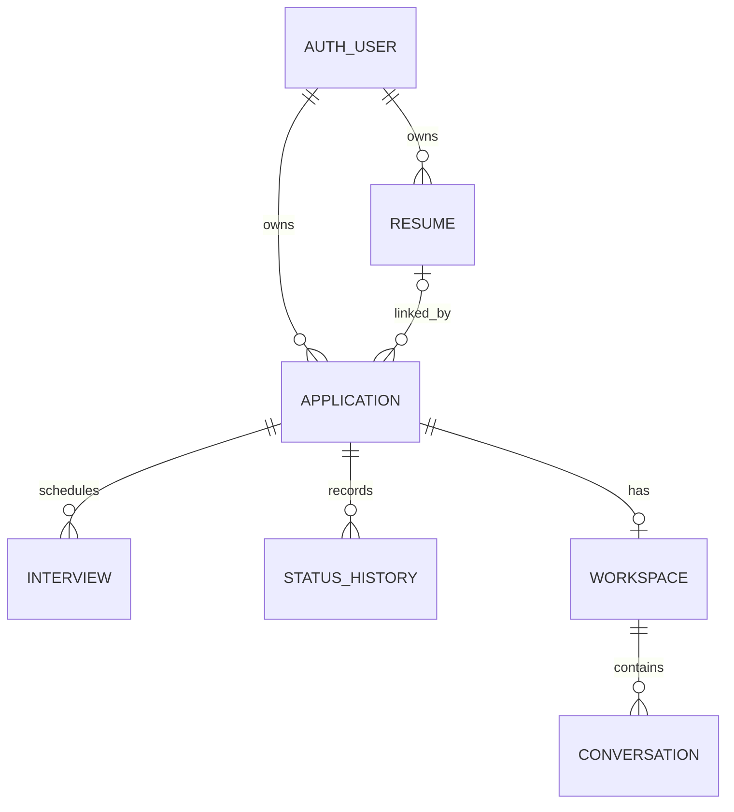
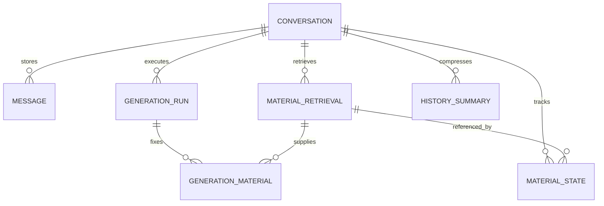

# JobFlow AI Database Design

## 1. Purpose, Sources, and Decision Status

This document defines the proposed PostgreSQL schema, relationships, constraints, transaction boundaries, query patterns, and migration plan for JobFlow AI. It is a design deliverable, not a claim that the database or features have been implemented.

### 1.1 Requirements Baseline

This revision was prepared against the repository files reviewed on 2026-11-09:

- [PRD.md, version 1.2](https://github.com/ECE1724-Team/ECE_1724_finalproject/blob/main/PRD.md): authoritative product requirements, including confirmed authentication rules and database responsibilities.
- [endpoints.json, version 1.2.0](https://github.com/ECE1724-Team/ECE_1724_finalproject/blob/main/endpoints.json): current API contract; remaining business-schema differences are listed in §9.
- The previous database design supplied for review: retained business and AI storage proposals, rechecked against the current PRD. Its references to earlier Proposal/AI Design inspections do not imply a fresh inspection of those files in this revision.

Repository links point to mutable `main` files. Versions above identify the reviewed baseline, not a claim that later edits have been checked. If documents conflict, coordinate the discrepancy and align implementation with the confirmed PRD.

### 1.2 Scope and Responsibility

This deliverable documents schema, relationships, constraints, access patterns, transaction boundaries, and a migration plan. It contains no executed migrations, implementation code, or test results.

| Area | Responsibility / integration contract |
|---|---|
| Business database | Rongxin Bi: business tables, SQL design and migrations; coordinate API and AI integration |
| Authentication database | Authentication/authorization owner: Better Auth schema, credential issuance/replacement state, verification, sessions, authentication migrations and associated atomic flows |
| Shared identity | Authentication owner supplies the actual user table/key type and migration dependency; business tables reference that identity |
| Application APIs | Coordinate field names, update semantics and ownership checks with Zishi Yang |
| Storage, parsing and AI | Coordinate persisted records and lifecycle contracts with Jianye Zhou |

### 1.3 Requirement Versus Design Decision

Confirmed product rules are treated as requirements. Table names, revision columns, generation records, cleanup outbox and transaction mechanisms below are proposed database solutions, not additional product features or uniquely required implementations. AI persistence details require agreement with the AI owner. Remaining PRD decisions stay explicitly open and block only dependent work.

**Stack:** PostgreSQL; parameterized SQL through `pg`; versioned business migrations through `node-pg-migrate`; no business ORM. Authentication uses Better Auth with PostgreSQL-backed sessions, with physical schema determined by the selected configuration. Original PDFs reside in private S3-compatible storage; extracted text and metadata reside in PostgreSQL. The actual storage provider remains open.

## 2. Design Rules

1. All protected business access requires a valid session, currently verified email, and resource ownership. All business data belongs to one authenticated user. A foreign key proves relationship integrity; backend ownership checks prove authorization. Both are required.
2. An application links to zero or one usable resume. A resume belongs to the user's personal library and may serve multiple applications. Deleting an application never deletes its resume.
3. One application has at most one persisted workspace, created/reused on entry. Entering a workspace does not create a conversation or call the model.
4. A conversation is permanently bound to its workspace. Messages, retrieval records, and summaries stay within that conversation.
5. Current AI materials remain in application fields and parsed resume records. Retrieval snapshots are historical evidence and reusable per-conversation retrieval results, not another authoritative workspace-memory store.
6. Material revisions are explicit, independent counters. Timestamps alone do not identify material versions.
7. Every generation fixes its material identities and revisions at its start. Later edits apply on the next turn.
8. Dashboard totals are derived from current application/interview records. They are not separately maintained counters.
9. Personal notes, application status, interviews, applied date, and job-posting URL are not automatically included in AI base materials. The approved list is resume text, JD, company, position, company website URL, and company notes.
10. No RAG/vector index, mock-interview session state machine, feedback table, or separate report table is introduced.

## 3. Entities and Relationships

| Entity | Purpose | Cardinality |
|---|---|---|
| Better Auth user | Account identity and verification state | User owns many applications and resumes |
| Better Auth session/account/verification records | Sessions, credentials, verification and password-reset support | Managed by the configured auth adapter |
| `resumes` | Library item, private object identity, parsing result and extracted text | One resume may be linked by many applications |
| `applications` | Current application fields and individual material revisions | Belongs to one user; links to 0–1 resume |
| `application_status_history` | Actual chronological status transitions | Many per application |
| `interviews` | Individual interview arrangements | Many per application |
| `ai_workspaces` | Unique AI entry for an application | 0–1 persisted row per application, created lazily |
| `conversations` | Independent chat thread | Many per workspace |
| `generation_runs` | A generation attempt, its fixed material manifest, execution state | Many per conversation; at most one active |
| `messages` | Ordered user, assistant, and tool messages | Many per conversation |
| `material_retrievals` | Saved result of retrieving one material revision | Many per conversation |
| `conversation_material_state` | Latest successfully saved retrieval for each material kind | At most six rows per conversation |
| `generation_materials` | Exactly which saved retrievals supplied a generation | Six rows per started generation, including unavailable materials |
| `conversation_summaries` | Internal compressed history and coverage boundary | Many per conversation; full messages retained |
| `storage_cleanup_jobs` | Reliable cleanup after DB/object-store boundary failures | Internal operational records |

Relationship diagram for business data:



Conversation persistence:



## 4. Shared Conventions

| Convention | Design |
|---|---|
| Business primary keys | UUID, generated by backend or agreed DB mechanism; do not prescribe an extension/version yet |
| Auth primary keys | Preserve the exact type produced by Better Auth; proposed business `user_id` uses matching type, normally `TEXT`; never assume auth IDs are UUIDs |
| Time | `TIMESTAMPTZ` for instants; serialize ISO 8601 with offset/UTC |
| Applied date | Nullable `DATE`; represents the user's actual submission date, not creation time |
| Audit timestamps | `created_at`, `updated_at` non-null where applicable; update explicitly in SQL |
| Revision counters | `BIGINT NOT NULL DEFAULT 1 CHECK (> 0)`; increment on actual changes only |
| Nullable text | Missing optional materials are `NULL`; normalize empty optional input consistently before comparison |
| Required text | `TEXT NOT NULL CHECK (length(btrim(column)) > 0)` for company, position, and upload-time resume name |
| Flexible structured content | `JSONB` for SDK message parts, version manifests and tool metadata; not for applications or interview arrays |
| SQL safety | Bind values with `$1`, `$2`, etc.; allowlist sort expressions and identifiers |
| BIGINT API boundary | Serialize revisions/sequence numbers losslessly, preferably decimal strings; do not silently exceed JavaScript safe integers |

No detailed field-length, URL-length, or pagination limit is established here. Those remain PRD decisions. Validation must not invent new required application fields.

## 5. Data Dictionary

Legend: **NN** = NOT NULL; **PK** = primary key; **FK** = foreign key. All child foreign-key columns receive appropriate indexes. Physical auth names are resolved during integration.

### 5.1 Authentication Boundary — Owned by Authentication/Authorization

The authentication owner designs and maintains the schema generated for the installed Better Auth version, selected adapter and plugins, together with project-specific state required by the confirmed credential rules. Business migrations must not introduce a competing password/session/token system or independently modify auth tables.

| Logical record / state | Required database responsibility |
|---|---|
| User | Stable identity, email and persistent verified state |
| Account/credential | Supported email/password credential storage linked to the user |
| Session | Server-side session identity, expiry and authoritative revocation |
| Verification/reset credential | User, purpose, issuance/expiry, current/replaced state and consumption semantics, using supported library integration |
| Current issuance state | Enforce the latest credential separately for each `(user, purpose)` under concurrent issuance/use; exact physical representation belongs to the auth owner |

Confirmed authentication contract:

1. Registration sends a verification email, returns `token: null`, and creates neither a login session nor a login-session cookie.
2. Unverified users cannot sign in, even with the correct password, or use protected business features.
3. First successful email verification persists verified state and automatically establishes a session. The frontend loads that session and navigates to Dashboard. Reopening a current link for an already verified account does not guarantee another session.
4. Verification and password-reset credentials each expire 900 seconds after issuance. Session lifetime is a separate, unresolved setting.
5. Issuing a replacement invalidates every earlier credential for that user and purpose immediately. Verification and reset purposes are isolated. Default Better Auth link behavior must not be assumed to satisfy this rule without verification and necessary integration.
6. A reset-link GET only validates and redirects; it does not consume the credential or extend expiry. Password submission rechecks latest issuance, expiry and unused state authoritatively.
7. Successful reset atomically updates the password, consumes the reset credential and revokes every existing user session before success is reported. It creates no new session. Concurrent submissions cannot both succeed. Requesting/resending a reset email alone does not revoke sessions.
8. Protected business APIs check valid session, current verified status and ownership. Session caching must not allow revoked sessions to remain usable. Logout invalidates the relevant server-side session.

The business database consumes a trusted, verified-user identity from the authorization layer. It preserves the generated auth key type, normally `TEXT`, and references the exact provided user PK. It does not determine verification by a client-supplied flag. Passwords and raw email credentials never enter business tables or logs.

Remaining auth decisions: email provider, session lifetime, resend cooldown/rate limits, and issuance/retry behavior when email delivery fails. The authentication owner provides the physical user-table/key contract and ordered auth migrations before dependent business FKs are finalized.

### 5.2 `resumes`

| Column | Type / nullability | Purpose |
|---|---|---|
| `id` | UUID PK | Immutable library-file identity |
| `user_id` | Auth ID type NN FK | Owner |
| `name` | TEXT NN, nonblank | User's upload-time name; no later rename |
| `original_filename` | TEXT NN | Original filename; never use as a storage path |
| `object_key` | TEXT nullable, unique when present | Private object identity; no public or signed URL persisted |
| `mime_type` | TEXT NN | Accepted type is `application/pdf` |
| `size_bytes` | BIGINT NN | Actual size, positive and at most 2,097,152 for an accepted upload |
| `page_count` | INTEGER nullable | Parsed page count; successful file has 1–2 pages |
| `extracted_text` | TEXT nullable | Saved parsed text used by AI |
| `non_whitespace_chars` | INTEGER nullable | Extraction validation evidence; at least 100 for success |
| `parse_status` | TEXT NN | Proposed internal values `pending`, `processing`, `succeeded`, `failed` |
| `parse_error_code` | TEXT nullable | Stable parse/validation failure reason for UI mapping |
| `content_version` | BIGINT NN default 1 | Explicit extraction-content revision |
| `deleted_at` | TIMESTAMPTZ nullable | Access tombstone during deletion/cleanup; not a recovery feature |
| `created_at`, `updated_at` | TIMESTAMPTZ NN | Upload/processing audit |

Use `UNIQUE(id, user_id)` for ownership-safe resume links. A new resume version is a new row with a new UUID; a V1→V2 link change is detected by application resume revision and identity, even if both rows have `content_version = 1`.

For a live row (`deleted_at IS NULL`) with `parse_status = succeeded`, require a non-null object key/text, 1–2 pages and at least 100 non-whitespace characters. Express conditional CHECKs with explicit `IS NOT NULL` terms so SQL NULL does not accidentally satisfy validation. Deleted rows are exempt from live-success completeness requirements, allowing extracted text to be cleared while retaining historical parse status. File-size and basic metadata-domain checks still apply. The parser must also validate every page has extractable nonblank text, a genuine readable PDF, and exact size limits. DB metadata checks cannot establish those content properties. Reject oversize bodies before accepting a library item. Failed items may retain error metadata for the upload result, but their object/text must be cleaned up and they cannot be selected. Reprocessing policy is not a user-facing feature; if internal re-extraction changes saved usable text, increment `content_version` atomically.

### 5.3 `applications`

| Column | Type / nullability | Purpose |
|---|---|---|
| `id` | UUID PK | Application identity |
| `user_id` | Auth ID type NN FK | Owner |
| `company_name` | TEXT NN, nonblank | Required company |
| `position_title` | TEXT NN, nonblank | Required position |
| `status` | TEXT NN default `saved` | Six-value CHECK below |
| `applied_date` | DATE nullable | No automatic default |
| `job_description` | TEXT nullable | Shared AI material |
| `resume_id` | UUID nullable | Selected valid library item |
| `job_url` | TEXT nullable | Original job posting, separate from company website |
| `company_website_url` | TEXT nullable | URL only; not proof of a website read |
| `company_notes` | TEXT nullable | Shared AI material |
| `personal_notes` | TEXT nullable | Excluded from automatic AI context |
| `offer_received` | BOOLEAN NN default false | Correctable historical receipt flag |
| `company_revision` | BIGINT NN default 1 | Company material version |
| `position_revision` | BIGINT NN default 1 | Position material version |
| `jd_revision` | BIGINT NN default 1 | JD material version |
| `website_revision` | BIGINT NN default 1 | Company website URL material version |
| `company_notes_revision` | BIGINT NN default 1 | Company notes material version |
| `resume_revision` | BIGINT NN default 1 | Resume selection version; advances on link/unlink/delete |
| `row_version` | BIGINT NN default 1 | Optimistic update conflict detection |
| `created_at`, `updated_at` | TIMESTAMPTZ NN | Audit and newest-first sorting |

Status mapping:

| UI label | DB/API canonical value |
|---|---|
| Saved | `saved` |
| Applied | `applied` |
| OA / Online assessment | `oa` |
| Interview | `interview` |
| Offer | `offer` |
| Rejected | `rejected` |

No stage-transition restriction. Creating in Offer or transitioning into Offer sets `offer_received = true`. Leaving Offer preserves the flag. The flag can be explicitly corrected independently; it must not be permanently constrained to match current status. If a request combines a transition into Offer with a conflicting false flag, the transition sets it true; coordinate this contract with the API owner.

Use `FOREIGN KEY (resume_id, user_id) REFERENCES resumes(id, user_id)` and a single nullable resume column, rather than a many-to-many link table. A transaction must additionally check parse success and non-deleted state; a normal FK cannot enforce those conditions. Use `RESTRICT`/`NO ACTION` for physical resume removal and explicitly unlink first, so deletion cannot bypass revision increments. Same-owner links are enforced by the composite FK.

Do not deduplicate by company/position: users may legitimately keep several applications for the same role/company. A company is stored directly on an application; a separate company entity would add sharing behavior not required by the PRD.

**Deletion policy gate:** The final hard/soft deletion and chat retention strategy is unresolved. Query examples below assume the set of current applications. If soft deletion is approved, add `deleted_at`, filter it in every list/count/access path, and exclude associated interviews/workspaces from active access. If hard deletion is approved, decide child-history retention/cascades before enabling it. Neither option authorizes resume deletion.

### 5.4 `application_status_history`

| Column | Type / nullability | Purpose |
|---|---|---|
| `id` | UUID PK | Timeline event |
| `application_id` | UUID NN FK | Parent |
| `sequence_no` | BIGINT NN | Stable per-application chronology |
| `old_status` | TEXT NN | Previous status |
| `new_status` | TEXT NN | New status |
| `changed_at` | TIMESTAMPTZ NN | Event instant |

CHECK both values against the six statuses and `old_status <> new_status`. UNIQUE `(application_id, sequence_no)`. Lock the application when allocating the next sequence and changing status. Insert a history row only for an actual transition, in the same transaction as the application update. Creating an application is not a fabricated transition. A separate creation event can be added only after timeline scope is agreed. Actor identity is derived through the application owner; no admin/collaborator roles are added.

### 5.5 `interviews`

| Column | Type / nullability | Purpose |
|---|---|---|
| `id` | UUID PK | Individual interview identity |
| `application_id` | UUID NN FK | Parent |
| `interview_name` | TEXT nullable pending validation decision | Type/name shown in schedule |
| `starts_at` | TIMESTAMPTZ nullable pending validation decision | Scheduled instant |
| `created_at`, `updated_at` | TIMESTAMPTZ NN | Audit |

Use independent rows for add/edit/delete. Do not store the interview schedule as an application JSON array or maintain a conflicting single interview date. Until the PRD's required-field decision is made, nullability is provisional, not permission to expose incomplete scheduling behavior. Unscheduled rows are excluded from the upcoming list. Cancellation/completion states, their effects on counts, and extra interview fields are not invented here.

### 5.6 `ai_workspaces` and `conversations`

| Table | Columns | Constraints / behavior |
|---|---|---|
| `ai_workspaces` | `id UUID PK`, `application_id UUID NN FK`, `created_at TIMESTAMPTZ NN` | UNIQUE application; contains no copied materials |
| `conversations` | `id UUID PK`, `workspace_id UUID NN FK`, `title TEXT nullable`, `next_sequence_no BIGINT NN DEFAULT 1`, `created_at`, `updated_at` | Workspace is mandatory and immutable; sequence allocation under row lock |

A title supports the conversation list but does not authorize rename/delete controls; those remain open. Ownership is obtained through workspace→application→user. Do not duplicate `user_id` on every chat table without a consistency constraint.

Create/reuse workspace with an ownership-scoped insert and conflict handling on `application_id`. Repeated entry must return the existing row without inserting a conversation. Only an explicit New conversation action inserts the thread, initially with no messages, summaries, or material state.

### 5.7 `generation_runs`

| Column | Type / nullability | Purpose |
|---|---|---|
| `id` | UUID PK | One generation attempt |
| `conversation_id` | UUID NN FK | Parent conversation |
| `status` | TEXT NN | `preparing`, `streaming`, `completed`, `failed`, `interrupted` |
| `material_manifest` | JSONB NN | Immutable six-material identity/revision/availability manifest fixed at start |
| `request_key` | TEXT nullable | Reserved retry/idempotency key; exact semantics pending |
| `lease_expires_at` | TIMESTAMPTZ nullable | Operational recovery from crashed workers |
| `model_metadata` | JSONB nullable | Actual provider/model/configuration identifiers; no secrets |
| `error_code` | TEXT nullable | Failure metadata |
| `started_at` | TIMESTAMPTZ NN | Start |
| `completed_at` | TIMESTAMPTZ nullable | Terminal state time |

The manifest records each kind and revision, plus resume identity/content version where relevant. It is small provenance metadata, not another copy of all base material text. Once initialization succeeds, it is immutable. Final output must be associated with a complete set of six `generation_materials` rows.

Enforce a partial unique index on conversation for status in `('preparing','streaming')`. The lease is not itself a second lock: recovery must atomically mark an expired run terminal before creating another, cancel the old worker, and prevent stale callbacks from committing results. Lease duration/heartbeat parameters remain implementation decisions. Do not hold a DB transaction open during a model request or stream.

### 5.8 `messages`

| Column | Type / nullability | Purpose |
|---|---|---|
| `id` | UUID PK | Message identity |
| `conversation_id` | UUID NN FK | Scope |
| `generation_id` | UUID nullable | Generation/attempt association |
| `sequence_no` | BIGINT NN | Stable conversation order |
| `role` | TEXT NN | `user`, `assistant`, or `tool` |
| `parts` | JSONB NN | Ordered text/tool-call/tool-result parts compatible with the selected SDK integration |
| `created_at` | TIMESTAMPTZ NN | Persisted time |

UNIQUE `(conversation_id, sequence_no)` and `(id, conversation_id)`. Use a composite FK `(generation_id, conversation_id)` to the corresponding unique pair in `generation_runs`; no message can refer to a different conversation's generation. Validate the parts structure in backend code against the installed SDK adapter. Do not assume a provider's raw response is directly replayable UI JSON.

User input is saved before model work. Complete assistant responses are saved after streaming finishes. Tool calls/results retain ordering, call identifiers, arguments, success/failure and retrieval references. Feedback and user-requested summaries are ordinary assistant messages. Internal compression summaries go in `conversation_summaries`.

System prompts are server configuration, not user-editable message rows. Partial assistant-output persistence, retries reusing versus replacing a user message, and exactly-once/idempotency behavior remain open; do not implement a user-visible policy from the presence of `request_key` alone.

### 5.9 Material Retrieval and Per-Generation Provenance

The six material kinds are `resume`, `jd`, `company`, `position`, `company_website`, `company_notes`.

`material_retrievals`:

| Column | Type / nullability | Purpose |
|---|---|---|
| `id` | UUID PK | Saved retrieval result |
| `conversation_id` | UUID NN FK | Independent conversation scope |
| `kind` | TEXT NN | One of six material kinds |
| `material_revision` | BIGINT NN | Application field/link revision read |
| `source_resume_id` | UUID nullable | Historical identity value, deliberately not a live FK |
| `source_content_version` | BIGINT nullable | Resume extraction version |
| `availability` | TEXT NN | `available` or `unavailable` |
| `content_text` | TEXT nullable | Exact retrieved content when available |
| `reason_code` | TEXT nullable | E.g. not linked or field missing |
| `tool_message_id` | UUID NN | Tool record referencing this result |
| `retrieved_at` | TIMESTAMPTZ NN | Retrieval time |

CHECK availability/content coherence: available has content; unavailable has no content. A retrieval failure is not a successful unavailable-material record: record the failure as a tool error and do not advance the successful material state.

Use UNIQUE `(id, conversation_id, kind)` and ownership-preserving composite FK `(tool_message_id, conversation_id)` to `messages`. A successful tool message's parts reference this row rather than duplicating its entire text in another field. The backend can reconstruct the saved result for context and history rendering. Historical resume identity must survive file deletion; never use it as permission to download or relink a deleted file.

`conversation_material_state`:

| Column | Type / nullability | Purpose |
|---|---|---|
| `conversation_id` | UUID NN FK | Parent |
| `kind` | TEXT NN | Material kind |
| `retrieval_id` | UUID NN | Most recent successfully saved retrieval |
| `synced_at` | TIMESTAMPTZ NN | Sync audit |

PK `(conversation_id, kind)`. Composite FK `(retrieval_id, conversation_id, kind)` references `material_retrievals(id, conversation_id, kind)`. Revisions/content are read through that FK; they are not maintained as duplicate cache fields. No state rows exist before a conversation's first message.

`generation_materials`:

| Column | Type / nullability | Purpose |
|---|---|---|
| `generation_id` | UUID NN | Generation |
| `conversation_id` | UUID NN | Scope for composite constraints |
| `kind` | TEXT NN | One of six material kinds |
| `retrieval_id` | UUID NN | Saved result actually supplied as base material |

PK `(generation_id, kind)`. Composite FKs to generation `(id, conversation_id)` and retrieval `(id, conversation_id, kind)`. Reuse the same retrieval for unchanged materials across turns. Include unavailable-material results too, so absence is explicit and versioned. Require exactly six kinds before marking the run streaming/completed; ordinary row checks cannot enforce a six-row set, so use one initialization transaction and validate the count there.

These associations preserve the versions behind each historical answer without copying every material on every turn. Old retrievals remain historical after deletion/unlinking and must not be selected as current when the current manifest differs.

### 5.10 `conversation_summaries`

| Column | Type / nullability | Purpose |
|---|---|---|
| `id` | UUID PK | Internal summary identity |
| `conversation_id` | UUID NN FK | Isolated conversation |
| `through_sequence_no` | BIGINT NN | Inclusive history boundary already summarized |
| `summary_text` | TEXT NN | Compressed historical discussion |
| `previous_summary_id` | UUID nullable | Optional incremental predecessor |
| `created_at` | TIMESTAMPTZ NN | Audit |

UNIQUE `(conversation_id, through_sequence_no)` and `(id, conversation_id)`; predecessor uses a same-conversation composite FK. Summarize only a stable, fully persisted history prefix and do not split an unfinished tool exchange. An incremental summary must incorporate the previous summary plus the newly covered history. Select the latest usable summary and messages strictly after its boundary to avoid double inclusion. Full messages and retrievals are never deleted by compression.

Current materials are assembled separately every turn. Summaries must label historical content as historical; they cannot overwrite current materials. Compression thresholds, recent-message window, and oversized-base-material handling remain open.

### 5.11 `storage_cleanup_jobs`

Proposed minimal operational outbox: `id UUID PK`, `object_key TEXT NN`, `reason TEXT NN`, `status TEXT NN`, `attempt_count INTEGER NN DEFAULT 0`, `next_attempt_at TIMESTAMPTZ NN`, `last_error_code TEXT nullable`, `created_at`, `updated_at`. Add a unique deduplication key for the same object cleanup action.

This is a retry mechanism for object cleanup, not a user recovery feature. The object key is opaque and is never returned as a download credential. Exact retry timing and terminal-failure alerting are deployment decisions.

## 6. Ownership, Constraints, and Indexes

### 6.1 Ownership Enforcement

A conversation authorization query must join conversation→workspace→application and filter `applications.user_id = authenticated user`. Tool handlers derive the workspace from the authorized conversation; they do not trust a model-supplied workspace/application ID. A retrieval tool cannot widen scope by changing its arguments.

All application reads/updates/deletes filter by owner. Resume link changes prove both same-owner integrity through the composite FK and current usability under a transaction lock. Download/view endpoints authorize the current resume row and its non-deleted state before streaming private bytes. Prefer a backend-authorized stream for this release: it can reject new downloads immediately after deletion without an already-issued signed URL remaining usable. Do not log extracted text, password/reset tokens, or private object credentials.

Authentication tables and authoritative checks are accessed through supported auth integration owned by the authentication/authorization owner. Protected business access requires valid session and current email verification before resource-ownership checks. Business authorization remains explicit even when using the auth library. DB row-level security may be considered later but is not assumed to protect pooled requests in this design.

### 6.2 Proposed Indexes

| Table | Index / constraint | Main use |
|---|---|---|
| `applications` | `(user_id, created_at DESC, id DESC)` | Default list and recent applications |
| `applications` | `(user_id, status)` | Status counts/filter |
| `applications` | `(user_id, lower(company_name), id)` | Company A–Z stable ordering |
| `applications` | `(resume_id)` | Link count and delete/unlink fan-out |
| `resumes` | `(user_id, created_at DESC, id)` | Personal library |
| `resumes` | UNIQUE `(id, user_id)`, unique non-null `object_key` | Same-owner FK and object identity |
| `interviews` | `(application_id, starts_at, id)`; `(starts_at, application_id)` if useful | Per-application schedule/upcoming range |
| `application_status_history` | UNIQUE `(application_id, sequence_no)` | Ordered actual transitions |
| `ai_workspaces` | UNIQUE `(application_id)` | Race-safe workspace reuse |
| `conversations` | `(workspace_id, updated_at DESC, id)` | Conversation list |
| `messages` | UNIQUE `(conversation_id, sequence_no)` | History loading/order |
| `generation_runs` | UNIQUE `(id, conversation_id)`; partial UNIQUE `(conversation_id)` for active states | Composite FK; one active generation |
| `material_retrievals` | `(conversation_id, kind, material_revision)` plus composite unique above | Version history |
| `conversation_material_state` | PK `(conversation_id, kind)` | Per-conversation sync |
| `generation_materials` | PK `(generation_id, kind)` | Exact per-turn materials |
| `conversation_summaries` | UNIQUE `(conversation_id, through_sequence_no)` | Latest summary boundary |
| `storage_cleanup_jobs` | `(status, next_attempt_at)` | Retry worker |

These are initial access-path proposals, not performance claims. Case-insensitive substring search works with parameterized `ILIKE`; ordinary B-tree indexes do not accelerate arbitrary `%keyword%` matching. A trigram index is optional only if measured need justifies an extension. No vector index is needed.

Review FK indexes for join, parent-delete/update and lifecycle access paths; use an appropriate leading-column index when needed, and avoid duplicating an existing covering index. PostgreSQL does not automatically create child-side FK indexes, and an FK does not by itself make an index mandatory. Add the composite unique targets explicitly during migration; PostgreSQL does not infer them from a different uniqueness definition.

## 7. Transactions and Lifecycle Rules

### 7.1 Create and Edit Applications

Create in one transaction: validate only company/position as mandatory, select default Saved if omitted, validate any selected resume, insert application, and set the offer flag if the initial status is Offer. No workspace or conversation is required at creation.

For updates:

1. Authorize and read the target application and candidate resume identities without taking an application write lock. For link changes, lock the required resume rows first in sorted identity order, then lock the application; revalidate its current link and submitted `row_version`. Restart or report a conflict if the preliminary state changed. For updates without resume interaction, lock the application directly.
2. If linking a resume, verify the locked resume owner, successful parsing, non-deleted state, and storage availability metadata. Do not acquire resume locks after an application lock; if revalidation reveals that further resume locks are needed, restart in the agreed order.
3. Compare normalized values using null-safe comparisons (`IS DISTINCT FROM`). Increment only changed shared-material counters; personal notes/status/date/job URL edits do not bump AI material revisions.
4. Increment `resume_revision` on link/unlink/replacement. Resume text also has its own `content_version`.
5. Apply status/offer rules; add a history event only if status changes.
6. Update `row_version`, `updated_at`, and commit all related changes together.

Use a consistent lock order for resume-link changes and deletion: resume rows first in sorted identity order when needed, then affected application rows in sorted identity order. A link-changing operation may read the candidate first, then lock and revalidate application state; retry on stale state. Coordinate all writers to avoid application→resume versus resume→application deadlocks. No parser or external storage/model call runs inside this transaction.

### 7.2 Upload and Parsing

1. Authenticate; validate name, upload limit and server-side PDF content. Temporary uploads use random private keys.
2. Create pending metadata only for an accepted-size upload; parse outside a long-lived DB transaction.
3. Check maximum two pages, at least 100 non-whitespace characters across the file, and extractable text on every page. No OCR.
4. On success, atomically save extracted text, page/character metadata, version and succeeded state after the private object is available.
5. On failure, save a safe error reason; the item is unusable. Remove temporary bytes and any saved extracted text. Enqueue cleanup if immediate deletion fails.
6. Uploading never changes application links. Explicitly selecting a successful file changes only that application.

Object storage and PostgreSQL do not share a transaction. Use compensating cleanup for objects uploaded before DB failure and a periodic reconciliation/temporary-key expiry process for crashes before an outbox row can be committed. Cleanup timing does not create a user-facing restoration promise.

### 7.3 Delete a Resume

Within one DB transaction:

1. Lock and authorize the resume; make repeated delete handling consistent with the agreed API contract.
2. Mark it inaccessible (`deleted_at`) so no new link/download/parser completion can revive it.
3. Lock affected applications in stable order. Set each `resume_id = NULL`, increment `resume_revision`, `row_version`, and update timestamps. Return the number of links actually removed.
4. Clear the deleted row's live extracted text and insert a cleanup job for the object key. The live-success CHECK is conditional on `deleted_at IS NULL`, so this update does not conflict with a retained `succeeded` parse status. Retain the opaque object identity until cleanup bookkeeping no longer requires it.
5. Commit; the worker removes private bytes with retry. A late parser must recheck the tombstone before marking success.

This tombstone supports immediate access removal and reliable cleanup; long-term metadata retention is not defined. Historical messages and material-retrieval results remain unchanged per FR-16/FR-34. A generation already initialized may finish using its fixed historical snapshot. Subsequent turns observe the new unlinked revision and use an unavailable-material result. Deletion does not delete applications or other resumes.

### 7.4 Initialize a Turn and Fix Material Versions

The backend, not the model, performs the following:

1. Resolve and authorize the conversation's parent chain. Acquire the per-conversation generation slot using the active-run constraint.
2. In a short consistent-snapshot transaction, read all current shared application fields, resume link, parsed text/version, and this conversation's saved material state. Revalidate ownership/current access in this transaction. Use repeatable-read semantics or equivalent lock/version checks so a manifest cannot combine fields from inconsistent snapshots.
3. Construct the six-kind manifest. For each unchanged material identity/revision/availability, reuse its saved retrieval. For new or changed material states, create a successful saved retrieval (including an explicit unavailable result where appropriate) and a tool record. An unchanged known absence reuses its saved unavailable result. All persisted tool messages must correspond to actual tool execution and use the selected SDK’s valid tool-call/result identifiers and ordering; a database read alone does not justify fabricating a provider tool message. Store only changed material content anew.
4. Save retrievals, tool messages, six generation associations, and the conversation state pointer changes atomically. A failure rolls back the sync state; never mark unsaved content as synced. Persist the accepted user input with defined ordering.
5. Commit before streaming. Assemble base context from the run's fixed retrieval IDs, that conversation's summary and recent history, and current input. Include change/unavailability notices; exclude current input from the history selection to avoid sending it twice.
6. Stream without DB locks. Save the complete final message only if this run still owns the active generation slot; then mark completed. Stale/cancelled workers cannot publish a second final answer.

Snapshot acquisition is the logical generation-start boundary. Changes committed afterward are observed next turn. Unchanged materials remain included in every model request; reuse means reusing saved content, not omitting it because it appeared in old history. Historical tool results must not be replayed as competing current base materials.

If material refresh fails, persist/report a failure and leave successful state unchanged. The PRD has not selected the fallback; implement independent storage mechanics now and resolve fallback before exposing that failure path. Missing materials are a successful known absence and allow limited assistance; they are different from an infrastructure retrieval error.

### 7.5 Application Deletion — Unresolved Policy

The observable result is fixed: remove from current list, Dashboard totals and normal AI entry; keep library resumes and other applications' links intact. Physical hard/soft deletion and treatment of child chats remain undecided. Use restrictive child FKs while drafting migrations so a generic cascade cannot silently destroy conversation history. Before implementing deletion, agree on the policy and write the corresponding explicit transaction, access filters, cascade/restrict actions and acceptance checks. Do not expose restore/recovery controls without authorization.

## 8. Query Patterns

The following examples illustrate bound SQL and counting semantics. They assume `applications` contains current records only. Add an agreed active-record predicate everywhere if soft deletion is selected. Auth IDs and time boundaries come from trusted server context, never model input.

### 8.1 List and Search

```sql
SELECT a.id, a.company_name, a.position_title, a.status,
       a.applied_date, a.resume_id, r.name AS resume_name,
       a.row_version, a.created_at
FROM applications a
LEFT JOIN resumes r ON r.id = a.resume_id
                   AND r.user_id = a.user_id
                   AND r.deleted_at IS NULL
WHERE a.user_id = $1
  AND ($2::text IS NULL OR a.status = $2)
  AND ($3::text IS NULL OR
       a.company_name ILIKE $3 ESCAPE '!' OR
       a.position_title ILIKE $3 ESCAPE '!')
ORDER BY a.created_at DESC, a.id DESC;
```

For a literal substring, escape `!`, `%`, and `_` in the keyword with `!` before adding `%` on each side. Parameters prevent injection but do not turn SQL wildcard characters into literal characters. Company sorting uses an allowlisted alternative `ORDER BY lower(a.company_name), a.id`; never interpolate a client-supplied SQL expression. Pagination style/limits remain open; add them only once the API contract is agreed.

### 8.2 Status Counts and Dashboard Totals

```sql
-- Counts ignore the keyword search and selected status filter.
SELECT status, COUNT(*) AS count
FROM applications
WHERE user_id = $1
GROUP BY status;

SELECT COUNT(*) AS total_applications,
       COUNT(*) FILTER (WHERE offer_received) AS offers_ever_received
FROM applications
WHERE user_id = $1;

SELECT COUNT(*) AS interview_sessions
FROM interviews i
JOIN applications a ON a.id = i.application_id
WHERE a.user_id = $1;
```

Fill absent status groups with zero in the response. All is the total across six statuses. Do not join interviews into the application-count query without controlling multiplicity: three interviews must not turn one application into three applications/offers. Interview counts are not chat/mock-interview counts. Use a consistent read transaction for a multi-query Dashboard response if concurrent edits could otherwise produce contradictory cards.

### 8.3 Upcoming Interviews

```sql
SELECT i.id, i.interview_name, i.starts_at,
       a.id AS application_id, a.company_name, a.position_title
FROM interviews i
JOIN applications a ON a.id = i.application_id
WHERE a.user_id = $1
  AND i.starts_at >= $2::timestamptz
  AND i.starts_at <  $3::timestamptz
ORDER BY i.starts_at ASC, i.id ASC;
```

Compute `$2` as local midnight today and `$3` as local midnight seven calendar dates later using a validated display timezone. Convert both boundaries to instants. Do not add a fixed 168 hours across daylight-saving changes. No interview-state exclusion is invented while states remain undecided.

### 8.4 Authorized Conversation and Material State

```sql
SELECT c.id, w.application_id
FROM conversations c
JOIN ai_workspaces w ON w.id = c.workspace_id
JOIN applications a ON a.id = w.application_id
WHERE c.id = $1 AND a.user_id = $2;

SELECT s.kind, r.id AS retrieval_id, r.material_revision,
       r.source_resume_id, r.source_content_version,
       r.availability, r.content_text
FROM conversation_material_state s
JOIN material_retrievals r
  ON r.id = s.retrieval_id
 AND r.conversation_id = s.conversation_id
 AND r.kind = s.kind
WHERE s.conversation_id = $1;
```

The state query runs only after authorization within the scoped turn workflow. It is not a public arbitrary-conversation read. The current material query explicitly selects the six approved materials and their revisions; avoid `SELECT *` when constructing model context.

### 8.5 Library Link Counts

Count links from current applications only, scoped to the same owner. Use a LEFT JOIN so unused resumes have zero links; exclude tombstoned files. Resume deletion reports affected link rows from its transaction rather than trusting a cached count. No `linked_application_count` column is maintained.

## 9. API Alignment Required

The reviewed `endpoints.json` is version 1.2.0. Its authentication contract already documents the updated confirmed flows. Its business schemas still differ from PRD 1.2 in the areas below. Coordinate changes with the API owner; this document does not modify the API file or assert that documented endpoints are implemented.

| Existing definition / gap | Required alignment |
|---|---|
| Status values include `interviewing`, `offered`, `withdrawn`, `accepted`; OA absent | Use the six approved values/mapping in §5.3; decide migration mappings for any real legacy rows rather than silently dropping them |
| PDF and DOCX accepted | PDF only, with actual size/page/text validation and parsing-state contract |
| `appliedAt` is a date-time | Represent the approved applied-date field as a nullable date; agree the API spelling/format |
| Interview objects have no persistent ID and full replacement is described | Preserve individual interview identity and actual add/edit/delete semantics; agree compatible endpoint/payload updates |
| Interview required fields and length limits already specified | Reconcile with PRD's still-open validation decisions before enforcing them |
| Company website, company notes, historical offer flag, status history missing from application schema | Add distinct fields/read models; keep personal notes and job URL separate |
| Resume parsing state, private view/download/deletion and affected-link count incomplete | Add actual lifecycle/error/ownership responses |
| AI workspace, independent chat, material revisions and generation lifecycle absent | Define contracts using the relationships and per-turn provenance above |
| Pagination limits and extra application fields such as location appear | Reconcile with confirmed scope; do not treat an older contract as new product approval |
| Business ownership schema and auth integration | Preserve the actual auth user key type; require session validity, current verified email and ownership for every protected business operation |
| Authentication contract already updated in 1.2.0 | Retain the confirmed flows; auth owner supplies schema/migrations and evidence for expiry, replacement and revocation behavior |

## 10. Migration and Setup Plan

These are planned migration groups, not files already implemented:

| Order | Migration scope | Readiness |
|---|---|---|
| Prerequisite A | Auth-owner migrations: reviewed Better Auth schema and project-specific current-credential state | Maintained by authentication owner; business owner consumes user-key contract and migration order |
| 002 | Resumes, applications, composite ownership FK, revision checks and list indexes | Core agreed structure |
| 003 | Status history and individual interviews | Final interview nullability/validation needs confirmation |
| 004 | Unique workspace and independent conversations | Core agreed structure |
| 005 | Generation runs, ordered messages, retrievals, sync pointers, generation materials, summaries | Resolve retry/fallback behavior before corresponding execution paths |
| 006 | Cleanup outbox and private-file lifecycle support | Core cleanup requirement; deployment parameters TBD |
| 007 | Explicit application deletion policy and any required access indexes/filters | Blocked on retention/hard-versus-soft decision |

Implementation procedure:

1. Configure the project's PostgreSQL connection through `DATABASE_URL`; keep actual credentials outside git. Use an isolated development/test database.
2. Pin business dependencies through the project's normal package/lock files. Obtain the authentication owner's reviewed migrations for the exact auth configuration; agree user-table identifiers, key types and execution order before defining business FKs. Do not independently generate a competing auth migration history.
3. Translate this dictionary into ordered `node-pg-migrate` migrations, with transaction-safe schema changes, explicit CHECKs/FKs/indexes and reverse dependency order for development rollback.
4. Define the migration script names and startup commands in README once the backend package structure exists; do not document nonexistent runnable commands as completed setup.
5. Apply to an empty database, inspect constraints/indexes, seed fictional data, and run the acceptance cases below.
6. Commit migrations and schema/API updates together when dependent changes land. Never rewrite an already-applied shared migration; add a new migration.
7. Data-destroying rollback on populated databases requires a separate backup/recovery decision. A `down` function is not evidence that user data can be restored.

No production database, deployed storage bucket, or actual migration execution was inspected for this document.

## 11. Database Acceptance Checklist

These are proposed checks to execute during implementation; none is claimed passed by this document.

| Case | Expected evidence |
|---|---|
| Minimal create | Company+position succeeds; status Saved; applied date NULL; no implicit conversation |
| Required text | NULL/blank company or position fails; optional fields can remain absent |
| Status edits | Six statuses allowed; arbitrary transitions work; unchanged status creates no history |
| Offer receipt | Offer marks receipt; later Rejected preserves receipt; explicit correction is persisted; count once per application |
| Three interviews | One application contributes 1 application, 3 interview sessions, at most 1 offer |
| Search/counts | Literal case-insensitive company/position substring; combined status filter; status buttons ignore keyword |
| Time boundaries | Include local midnight today; exclude midnight seven dates later; verify a DST-crossing window |
| Shared resume | Link one successful file to two owned applications; replace one link without changing the other |
| Cross-user resume | Composite FK/transaction rejects another user's file; forged resource IDs fail authorization |
| Upload rejection | Above 2 MiB, >2 pages, textless/blank-page/damaged/encrypted-unreadable PDF rejected; exact size limit accepted when other checks pass |
| Failed replacement | Original valid link/version remains; failed item cannot be linked; temporary object cleanup recorded |
| Resume deletion | All links removed with revisions advanced; application fields retained; new downloads denied; cleanup retries safely |
| Concurrent delete/link/parse | No new link to tombstoned file; late parser cannot revive it; no partially updated fan-out |
| Workspace races | Simultaneous entry creates one workspace and no conversation; explicit New conversation creates an empty bound thread |
| Conversation isolation | Same workspace shares materials but never another thread's messages/summary; different application materials excluded |
| Selective refresh | Resume-only/JD-only/other-field/no-change cases create only required retrievals; every run references all six kinds |
| Clear/re-add materials | Missing/cleared material revisions invalidate previous state, including unlink then re-link of the same file |
| Mid-generation edit | Current run retains original manifest/retrieval IDs; next run observes updates |
| Failed sync write | Retrieval/message/state transaction rolls back together; successful-sync pointer never advances alone |
| Concurrent generation | One active run per conversation, independent conversations/users can generate concurrently |
| Worker crash | Expired run is fenced before retry; stale callback cannot append a second final answer |
| History compression | Full messages retained, exact coverage boundary respected, base materials included separately |
| Auth integration | Registration returns token:null with no login session; unverified access denied; first verification auto-signs in; credentials expire at 900 seconds; replacements invalidate older same-purpose links only; reset GET does not consume; reset submission revalidates and atomically consumes/updates/revokes all sessions without auto-login; old sessions fail authoritatively; logout invalidates session. Auth owner provides flow evidence; business integration verifies protected access. |
| Application delete | Execute after policy decision; current counts and access update, library resumes remain |
| Clean setup | Empty-database migration succeeds; teammate can reproduce schema and run flows from documented setup |

## 12. Decisions Still Required Before Dependent Implementation

| Decision | Already confirmed | Remaining choice / owner coordination |
|---|---|---|
| Application deletion | Removed from active lists/counts; resumes retained | Hard/soft deletion, chat retention/cascade/recovery; requester with Zishi Yang and Rongxin Bi |
| Interview validation | Multiple individually editable records | Required name/time, states and count rules; requester/API owner |
| Timeline | Actual status transitions retained | Extra event types; requester |
| Account configuration | All flows and 900-second credential rules in §5.1; no session after registration; verified-only access; reset revokes all old sessions | Email provider, session lifetime, resend cooldown/rate limits, and email-delivery-failure issuance/retry semantics; auth owner/requester |
| AI failures/retries | Visible errors, retry, one active run per thread | Partial-output persistence, deduplication and refresh-error fallback; AI owner/requester |
| Context sizing | Current materials outside history compression | Thresholds, recent window, oversized-material handling; AI owner/requester |
| Conversation controls | Persistent independent conversations | Rename/delete requirements; requester |
| Validation/pagination | Company+position only required; literal substring search | Detailed limits, URL rules, pagination; requester/API owner |
| Infrastructure and identity integration | PostgreSQL, private S3-compatible storage; auth schema owned by authentication owner | Actual providers/configuration; authentication owner supplies generated physical schema, user PK type and migration dependency; technical owners |

Resolve these within their affected implementation areas. They do not block writing migrations or queries for already confirmed independent behavior, and they do not authorize changing the established scope.

## 13. Review Status and Revision Notes

This document is ready for team design review, subject to the explicit open items in §12. It is not evidence of a deployed schema, running backend, successful migrations or passed acceptance checks.

Compared with the previous design, this revision aligns authentication with PRD 1.2/endpoints 1.2.0; separates auth-owned migrations from business work; makes resume deletion compatible with live-success checks; unifies resume-before-application locking; qualifies FK indexing; and distinguishes proposed AI persistence mechanics from confirmed product behavior.

The current scope is documentation only. SQL examples describe intended access behavior; migration grouping describes future work. No implementation is required to claim completion of this design deliverable.
