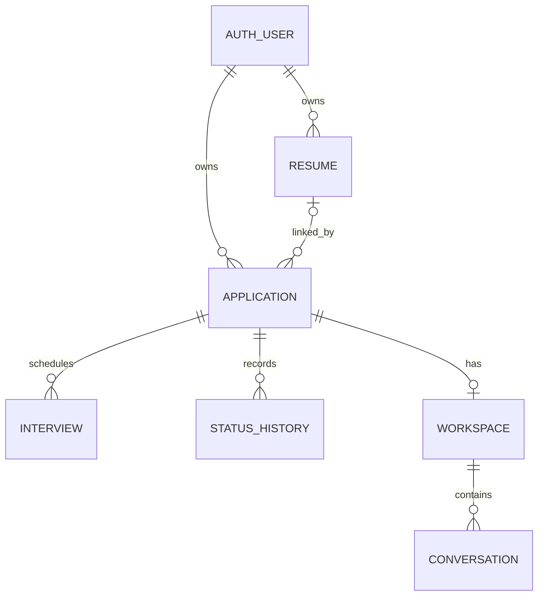
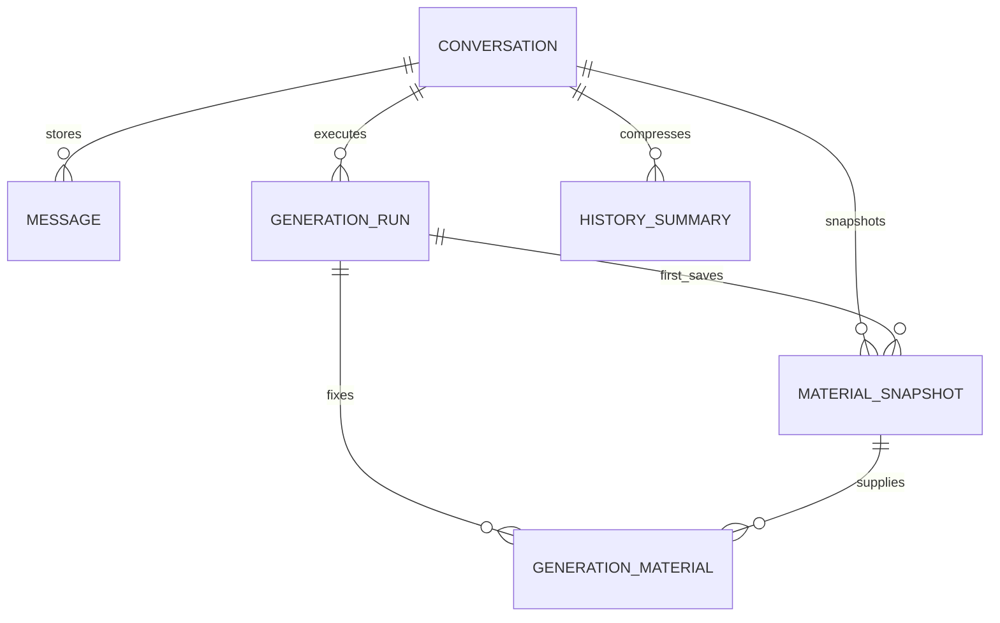

# JobFlow AI Database Design

<a id="reading-guide"></a>

## Added Reading Guide

The reading paths and supplements carry forward the relevant integration guidance from `backup/database-design-local`. This revision synchronizes the authentication identity, schema and migration handoff with the current implementation while retaining the business/AI design and section structure.

**Identity contract updated 2026-11-13:** the authoritative user key is **`public.auth_user.id UUID`**. Business owner columns use matching UUID foreign keys; HTTP/TypeScript IDs are UUID strings. The configuration, migration files and trusted-user interface are linked in [Appendix D](#shared-identity), [Appendix E](#auth-schema) and [Appendix F](#auth-integration-handoff). This records the selected project contract and current source implementation, not shared-database deployment or completed team review.

**Current API snapshot:** GitHub `main` has `endpoints.json` version **1.11.0** and this revision includes its documented business/AI policies. The original §9 preserves the earlier 1.2.0 review. Read [Appendix A](#current-integration-status) before treating a historical gap as still outstanding. Product requirements continue to follow the original source precedence.

**AI context revision (v1.3, 2026-11-11):** Following the requester's confirmation recorded in PRD 1.3, base materials are loaded by backend code on every turn rather than through model function calling. Material retrievals are now backend-saved snapshots linked to the generation that first saved them, `conversation_material_state` is removed, and a conversation's comparison baseline is derived from its latest completed generation. Message tool parts are reserved for the optional website tool. Snapshots of a deleted resume's text are retained as read-only history. `endpoints.json` 1.4.0 aligns the AI contract with these changes; see Appendix A.

**Material versioning revision (v1.4, 2026-11-11):** Material versions are now identified by a content fingerprint computed during turn preparation, not by revision counters maintained on `applications`. The six `*_revision` columns are removed, so application and resume writers take no part in AI versioning. `material_retrievals` is renamed `material_snapshots`, the set of material kinds is defined by a backend registry rather than by schema structure, and `generation_runs.material_manifest` is replaced by a `baseline_generation_id` column. `endpoints.json` 1.5.0 carries the matching contract. These changes remove work from `applications` and its update paths; the business database and application API owners should review them before migrations 002 and 005 are written.

**Deletion revision (v1.5, 2026-11-13):** Application deletion is confirmed as a permanent hard delete of the application and all of its child records, including the AI workspace and conversations; it is rejected while a generation is active (§7.5). Resume deletion behavior is unchanged; its API now returns the number of applications unlinked. `endpoints.json` 1.6.0 carries both contracts.

**Retry and interruption revision (v1.6, 2026-11-14):** The retry contract in §5.7 is confirmed. Only the latest user message can be retried, and only when its most recent attempt failed or was interrupted. There is no request-key deduplication, so `request_key` is removed. A client disconnect aborts the generation and no partial output is saved (PRD FR-29).

**Crash recovery revision (v1.8, 2026-11-16):** The project runs a single backend instance. On startup, the backend marks every `preparing` or `streaming` run as `interrupted` before accepting requests, which replaces lease-based recovery. `lease_expires_at` and the lease rules are moved to a deferred subsection of §5.7. They are kept for a possible upgrade to multiple backend instances and are not enabled now.

**Resume module revision (v1.13, 2026-11-17):** Jianye owns the `/api/v1/resumes` routes. The resume module now defines the `ResumeRepository` and `StorageCleanupRepository` interfaces in `backend/src/modules/resumes/repository.ts`; Rongxin implements them in SQL (Appendix C.4). §5.11 adds the job status values, what `claim` and `fail` change, and `requeueProcessing`, which the single-instance cleanup worker calls before every pass. `endpoints.json` 1.11.0 adds 413, 500 and 503 responses and the error codes for the resume routes, pending Justin's review.

**Application-delete lock revision (v1.13, 2026-11-18):** Application deletion locks the workspace row before the conversations, so a conversation created during deletion cannot start a generation that the active-run check misses (§7.5 step 2).

**Database service contract revision (v1.12, 2026-11-17):** Jianye and Rongxin agreed the repository function shape, startup pool creation, resume insert inputs, resume list and 404 behavior, and storage-cleanup ownership and reasons (Appendix C.4, §5.11). `endpoints.json` 1.10.0 adds `linkedApplicationCount` to `Resume` and removes resume-list pagination.

**Migration status revision (v1.11, 2026-11-17):** Business migration groups 002–005 are merged into `main` (§10). Group 006 is not yet written. The auth source files referenced in Appendices D–E are not yet in the repository; their links are replaced by plain paths.

**Text-unavailable and owner-FK revision (v1.10, 2026-11-17):** The `text_unavailable` resume state (PRD §5.2) is confirmed and no longer proposed. Business owner FKs to `public.auth_user(id)` use `ON DELETE RESTRICT`; there is no account-deletion feature. Internal same-conversation FKs, including `generation_materials` → `generation_runs`, are `NO ACTION`, and `generation_materials` cascades from `conversations` directly (§7.5). `endpoints.json` 1.9.0 marks the `textStatus` contract confirmed. Rejected uploads no longer create a row, so `parse_status` has only `succeeded` and `text_unavailable` and `parse_error_code` is removed (§7.2).

**Interview field revision (v1.9, 2026-11-16):** PRD 1.8 FR-07 confirms that `interview_name` and `starts_at` are both required and that `interviews` has no other business columns and no state column (§5.5). The provisional nullability is removed.

| Reader | Start here | Original implementation reference |
|---|---|---|
| Justin Smith — non-AI frontend and OpenAPI | [Current API status](#current-integration-status), [Justin guide](#justin-guide), [shared identity](#shared-identity) | §5.1–5.5, §7.1–7.3, §8.1–8.3/8.5, and relevant §11–12 cases |
| Jianye Zhou — storage/PDF, resume API and AI frontend/backend | [Current API status](#current-integration-status), [Jianye guide](#jianye-guide), [shared identity](#shared-identity) | §5.2–5.3, §5.6–5.11, §6.1, §7.2–7.4, §8.4, and relevant §11–12 cases |
| Rongxin Bi — business database, SQL and migrations | Role guides, [identity contract](#shared-identity), [auth migration handoff](#auth-integration-handoff) | Full schema, constraints, lifecycle, SQL, migration and acceptance sections |
| Authentication/authorization owner | [Confirmed auth flows](#authentication-boundary), [identity contract](#shared-identity), [auth schema](#auth-schema), [handoff](#auth-integration-handoff) | §5.1 and the protected-access/auth checks in §11 |
| Zishi Yang — application APIs | Justin guide, shared identity, current API status | Application/resume schema, ownership, update transactions and counting semantics |

**Status convention for additions:** **CONFIRMED** identifies product requirements and the selected shared-identity contract; **IMPLEMENTED** identifies behavior/schema present in the current source; **PROPOSED** identifies candidate business/AI storage mechanisms; **OPEN** identifies unresolved decisions. Source implementation does not establish team review, shared-database migration execution or passed acceptance checks. Jianye retains AI frontend/backend ownership; Justin coordinates non-AI pages, resume controls, AI entry points and OpenAPI.

## 1. Purpose, Sources, and Decision Status

This document defines the PostgreSQL schema, relationships, constraints, transaction boundaries, query patterns, and migration plan for JobFlow AI. Business/AI mechanisms remain proposed where marked; the authentication sections reference the current source implementation. This document does not establish that a shared or production database has been migrated.

### 1.1 Requirements Baseline

The requirements baseline is:

- [PRD.md, version 1.7](https://github.com/ECE1724-Team/ECE_1724_finalproject/blob/main/PRD.md): authoritative product requirements, including confirmed authentication rules, database responsibilities, and the 2026-11-11 AI context and material fingerprint policies, and the 2026-11-13 deletion rules.
- [AI_Design.md](https://github.com/ECE1724-Team/ECE_1724_finalproject/blob/main/AI_Design.md): workspace isolation, backend material loading and versioning, the fixed context structure, and conversation persistence. Its §7 recommendations are confirmed requirements through the PRD.
- [endpoints.json, version 1.2.0](https://github.com/ECE1724-Team/ECE_1724_finalproject/blob/main/endpoints.json): API integration reference from the 2026-11-09 review. The alignment notes in §9 retain that review's scope; the API contract is not a requirements override.

Repository links point to mutable `main` files. The original AI review used PRD 1.2 on 2026-11-10; this integration follows PRD 1.6 and the later confirmed material, deletion, retry and interruption policies from GitHub commit `f136368`. Apply PRD §8.1 precedence: the requester's latest explicit confirmation, confirmed PRD requirements, then AI Design details. Database and API designs implement those requirements. Unresolved product choices remain open; implementation details must not silently decide them.

### 1.2 Scope and Responsibility

This deliverable documents schema, relationships, constraints, access patterns, transaction boundaries, and a migration plan. It contains no executed migrations, implementation code, or test results.

| Area | Responsibility / integration contract |
|---|---|
| Business database | Rongxin Bi: business tables, SQL design and migrations; coordinate API and AI integration |
| Authentication database | Authentication/authorization owner: Better Auth schema, credential issuance/replacement state, verification, sessions, authentication migrations and associated atomic flows |
| Shared identity | Fixed contract: `public.auth_user.id UUID`; business owner FKs use UUID and depend on the auth migrations in Appendix F |
| Application APIs | Coordinate field names, update semantics and ownership checks with Zishi Yang |
| Storage, parsing and AI | Coordinate persisted records and lifecycle contracts with Jianye Zhou |

### 1.3 Requirement Versus Design Decision

Confirmed product rules are treated as requirements. Business/AI table names, fingerprint columns, generation records, cleanup outbox and transaction mechanisms below remain proposed database solutions unless explicitly confirmed. The auth identity, physical table mappings and trusted context in Appendices D–F describe the selected implementation contract. AI persistence details require agreement with the AI owner. Remaining PRD decisions stay explicitly open and block only dependent work.

**Stack:** PostgreSQL; parameterized SQL through `pg`; one versioned `node-pg-migrate` history for auth and business migrations; no ORM. Authentication uses Better Auth 1.7.20 with PostgreSQL-backed sessions, the project `pg` adapter and explicit `auth_` table mappings. Original PDFs reside in private S3-compatible storage; extracted text and metadata reside in PostgreSQL. The actual storage provider remains open.

<a id="design-rules"></a>

## 2. Design Rules

1. All protected business access requires a valid session, currently verified email, and resource ownership. All business data belongs to one authenticated user. A foreign key proves relationship integrity; backend ownership checks prove authorization. Both are required.
2. An application links to zero or one usable resume. A resume belongs to the user's personal library and may serve multiple applications. Deleting an application never deletes its resume.
3. One application has at most one persisted workspace, created/reused on entry. Entering a workspace does not create a conversation or call the model.
4. A conversation is permanently bound to its workspace. Messages, material snapshots, and summaries stay within that conversation.
5. Current AI materials remain in application fields and parsed resume records. Material snapshots are historical evidence and reusable per-conversation copies of supplied content, not another authoritative workspace-memory store.
6. A material version is identified by a fingerprint of the material's identity and exact content, computed by the AI module during turn preparation (§5.9). Timestamps do not identify material versions, and application or resume writers maintain no version counters for the AI.
7. Every generation fixes its material snapshots at its start. Later edits apply on the next turn.
8. Dashboard totals are derived from current application/interview records. They are not separately maintained counters.
9. Personal notes, application status, interviews, applied date, and job-posting URL are not automatically included in AI base materials. The approved list is resume text, JD, company, position, company website URL, and company notes.
10. No RAG/vector index, mock-interview session state machine, feedback table, or separate report table is introduced.
11. Base materials are read by backend code, never by a model-invoked tool. Tool records exist only for the optional website-reading tool.
12. The set of material kinds is a backend registry. No column set, CHECK or row count in the schema fixes it at the current six kinds.

<a id="entity-map"></a>

## 3. Entities and Relationships

| Entity | Purpose | Cardinality |
|---|---|---|
| `public.auth_user` | Account identity and verification state; UUID `id` | User owns many applications and resumes |
| Better Auth session/account/verification records | Sessions, credentials, verification and password-reset support | Managed by the configured auth adapter |
| `resumes` | Library item, private object identity, parsing result and extracted text | One resume may be linked by many applications |
| `applications` | Current application fields | Belongs to one user; links to 0–1 resume |
| `application_status_history` | Actual chronological status transitions | Many per application |
| `interviews` | Individual interview arrangements | Many per application |
| `ai_workspaces` | Unique AI entry for an application | 0–1 persisted row per application, created lazily |
| `conversations` | Independent chat thread | Many per workspace |
| `generation_runs` | A generation attempt, its baseline reference and execution state; the latest completed run is the conversation's material baseline | Many per conversation; at most one active |
| `messages` | Ordered user, assistant, and optional website-tool messages | Many per conversation |
| `material_snapshots` | Backend-saved, fingerprinted snapshot of one material version supplied to the model | Many per conversation; one per kind and distinct fingerprint |
| `generation_materials` | Exactly which saved snapshots supplied a generation | One row per registered material kind after successful material preparation, including unavailable materials; none required for an attempt that fails before preparation commits |
| `conversation_summaries` | Internal compressed history and coverage boundary | Many per conversation; full messages retained |
| `storage_cleanup_jobs` | Reliable cleanup after DB/object-store boundary failures | Internal operational records |

Relationship diagram for business data (`AUTH_USER` represents `public.auth_user`):



Conversation persistence:



<a id="shared-conventions"></a>

## 4. Shared Conventions

**Confirmed identity contract:** use `public.auth_user.id UUID` as the single user identity. This is explicit in the current Better Auth configuration and auth migration; it is not inferred from an API string. See [Appendix D](#shared-identity) for the shared context and migration dependencies.

| Convention | Design |
|---|---|
| Business primary keys | UUID, generated by backend or agreed DB mechanism; do not prescribe an extension/version yet |
| Auth user primary key | `public.auth_user.id UUID`; explicit UUID configuration and database-generated UUID default |
| Business owner columns | `resumes.user_id` and `applications.user_id`: `UUID NOT NULL`, FK to `public.auth_user(id)`; `ON DELETE RESTRICT` on user-account deletion (confirmed 2026-11-17; no account-deletion feature exists) |
| API/TypeScript user identity | UUID serialized as an opaque `string`; never use client-supplied identity as authorization evidence |
| Time | `TIMESTAMPTZ` for instants; serialize ISO 8601 with offset/UTC |
| Applied date | Nullable `DATE`; represents the user's actual submission date, not creation time |
| Audit timestamps | `created_at`, `updated_at` non-null where applicable; update explicitly in SQL |
| Version counters | `BIGINT NOT NULL DEFAULT 1 CHECK (> 0)` for `row_version` and `resumes.content_version`; increment on actual changes only. AI material versions use fingerprints (§5.9), not counters |
| Nullable text | Missing optional materials are `NULL`; normalize empty optional input consistently before comparison |
| Required text | `TEXT NOT NULL CHECK (length(btrim(column)) > 0)` for company, position, and upload-time resume name |
| Flexible structured content | `JSONB` for application message parts and optional website-tool metadata, with explicit SDK/UI adapters; not for applications or interview arrays |
| SQL safety | Bind values with `$1`, `$2`, etc.; allowlist sort expressions and identifiers |
| BIGINT API boundary | Serialize row versions/sequence numbers losslessly, preferably decimal strings; do not silently exceed JavaScript safe integers |

No detailed field-length, URL-length, or pagination limit is established here. Those remain PRD decisions. Validation must not invent new required application fields.

## 5. Data Dictionary

Legend: **NN** = NOT NULL; **PK** = primary key; **FK** = foreign key. All child foreign-key columns receive appropriate indexes. Physical auth names and UUID types are fixed in [Appendix E](#auth-schema).

<a id="authentication-boundary"></a>

### 5.1 Authentication Boundary — Owned by Authentication/Authorization

The authentication owner maintains the Better Auth 1.7.20 schema, project adapter and credential state in the current [auth core migration](../backend/migrations/20261111000100_auth_core.cjs) and [credential migration](../backend/migrations/20261111000200_auth_credentials.cjs). The authoritative user key is `public.auth_user.id UUID`. Business migrations must not introduce a competing password/session/token system or independently modify auth tables.

| Logical record / state | Required database responsibility |
|---|---|
| User | Stable identity, email and persistent verified state |
| Account/credential | Supported email/password credential storage linked to the user |
| Session | Server-side session identity, expiry and authoritative revocation |
| Verification/reset credential | User, purpose, issuance/expiry, current/replaced state and consumption semantics, using supported library integration |
| Current issuance state | `public.auth_credential_state` enforces the latest active credential separately for each `(user_id, purpose)` under concurrent issuance/use |

Confirmed authentication contract:

1. Registration sends a verification email, returns `token: null`, and creates neither a login session nor a login-session cookie.
2. Unverified users cannot sign in, even with the correct password, or use protected business features.
3. First successful email verification persists verified state and automatically establishes a session. The frontend loads that session and navigates to Dashboard. Reopening a current link for an already verified account does not guarantee another session.
4. Verification and password-reset credentials each expire 900 seconds after generation. The configured default Session lifetime is 604800 seconds (seven days); the current Better Auth sign-in path uses a one-day Session when `rememberMe: false`. Enforcing seven days for every login would require a separate code change.
5. A replacement becomes active only after the SMTP service accepts its message and the activation transaction commits; that activation immediately invalidates earlier credentials for the same user/purpose. Preparation and failed sends preserve the previous active link. Verification and reset purposes are isolated; waiting for SMTP does not extend expiry.
6. A reset-link GET only validates and redirects; it does not consume the credential or extend expiry. Password submission rechecks latest issuance, expiry and unused state authoritatively.
7. Successful reset atomically updates the password, consumes the reset credential and revokes every existing user session before success is reported. It creates no new session. Concurrent submissions cannot both succeed. Requesting/resending a reset email alone does not revoke sessions.
8. Protected business APIs check valid session, current verified status and ownership. Session caching must not allow revoked sessions to remain usable. Logout invalidates the relevant server-side session.

The business database consumes a trusted, verified-user identity from `requireVerifiedUser(authentication)` through `res.locals.auth`. Owner columns use `UUID` FKs to `public.auth_user(id)`; the API/TypeScript representation is `string`. Verification is not determined by a client-supplied flag. Passwords and raw email credentials never enter business tables or logs.

The requester also confirmed a 60-second same-recipient/purpose email cooldown, at most five requests per 900-second window, and SMTP-acceptance-gated activation with failed sends preserving the old active link. The actual email provider/deployment configuration remains open; business owner FKs use `ON DELETE RESTRICT` (Appendix D). The identity contract and ordered auth migration files are available in Appendices D–F; their presence does not establish that they have been applied to the shared database.

<a id="resume-schema"></a>

### 5.2 `resumes`

| Column | Type / nullability | Purpose |
|---|---|---|
| `id` | UUID PK | Immutable library-file identity |
| `user_id` | UUID NN FK → `public.auth_user(id)` ON DELETE RESTRICT | Owner from the trusted auth context |
| `name` | TEXT NN, nonblank | User's upload-time name; no later rename |
| `original_filename` | TEXT NN | Original filename; never use as a storage path |
| `object_key` | TEXT nullable, unique when present | Private object identity; no public or signed URL persisted |
| `mime_type` | TEXT NN | Accepted type is `application/pdf` |
| `size_bytes` | BIGINT NN | Actual size, positive and at most 2,097,152 for an accepted upload |
| `page_count` | INTEGER nullable | Parsed page count; an accepted file (`succeeded` or `text_unavailable`) has 1–2 pages |
| `extracted_text` | TEXT nullable | Saved parsed text used by AI; NULL for `text_unavailable` |
| `non_whitespace_chars` | INTEGER nullable | Extraction validation evidence; at least 100 for success |
| `parse_status` | TEXT NN, no default | `succeeded` or `text_unavailable`; `text_unavailable` is an accepted and linkable PDF without usable text (confirmed 2026-11-17, PRD §5.2). Rejected uploads (over 2 MiB, not a PDF, damaged, password-protected, more than 2 pages) and processing failures create no row and leave no stored object. |
| `content_version` | BIGINT NN default 1 | Explicit extraction-content revision for audit; AI change detection does not depend on it |
| `deleted_at` | TIMESTAMPTZ nullable | Access tombstone during deletion/cleanup; not a recovery feature |
| `created_at`, `updated_at` | TIMESTAMPTZ NN | Upload/processing audit |

Use `UNIQUE(id, user_id)` for ownership-safe resume links. A new resume version is a new row with a new UUID; a V1→V2 link change is detected because the resume fingerprint includes the resume identity (§5.9), even if both files contain identical text.

For a live row (`deleted_at IS NULL`) with `parse_status = succeeded`, require a non-null object key/text, 1–2 pages and at least 100 non-whitespace characters. Express conditional CHECKs with explicit `IS NOT NULL` terms so SQL NULL does not accidentally satisfy validation. Deleted rows are exempt from live-success completeness requirements, allowing extracted text to be cleared while retaining historical parse status. File-size and basic metadata-domain checks still apply. The parser must also validate every page has extractable nonblank text, a genuine readable PDF, and exact size limits. DB metadata checks cannot establish those content properties. Reject oversize bodies before accepting a library item. A rejected upload is reported in the HTTP response only; it creates no row and no stored object. Reprocessing policy is not a user-facing feature; if internal re-extraction changes saved usable text, increment `content_version` atomically.

**`text_unavailable` state (confirmed 2026-11-17; PRD §5.2):** a live row with `parse_status = text_unavailable` requires a non-null object key, 1–2 pages and NULL `extracted_text`; `non_whitespace_chars` may record the measured count as evidence. It is selectable for application links like `succeeded`, so the link-usability check becomes `parse_status IN ('succeeded', 'text_unavailable')`. Only `succeeded` rows supply resume text to the AI.

<a id="application-schema"></a>

### 5.3 `applications`

| Column | Type / nullability | Purpose |
|---|---|---|
| `id` | UUID PK | Application identity |
| `user_id` | UUID NN FK → `public.auth_user(id)` ON DELETE RESTRICT | Owner from the trusted auth context |
| `company_name` | TEXT NN, nonblank | Required company |
| `position_title` | TEXT NN, nonblank | Required position |
| `status` | TEXT NN default `saved` | Six-value CHECK below |
| `applied_date` | DATE nullable | No automatic default |
| `job_description` | TEXT nullable | Shared AI material |
| `resume_id` | UUID nullable | Selected valid library item |
| `job_url` | TEXT nullable | Original job posting, separate from company website |
| `company_website_url` | TEXT nullable | URL only; not proof of a website read |
| `company_notes` | TEXT nullable | Shared AI material |
| `personal_notes` | TEXT nullable | Excluded from automatic AI context |
| `offer_received` | BOOLEAN NN default false | Correctable historical receipt flag |
| `row_version` | BIGINT NN default 1 | Optimistic update conflict detection |
| `created_at`, `updated_at` | TIMESTAMPTZ NN | Audit and newest-first sorting |

Status mapping:

| UI label | DB/API canonical value |
|---|---|
| Saved | `saved` |
| Applied | `applied` |
| OA / Online assessment | `oa` |
| Interview | `interview` |
| Offer | `offer` |
| Rejected | `rejected` |

No stage-transition restriction. Creating in Offer or transitioning into Offer sets `offer_received = true`. Leaving Offer preserves the flag. The flag can be explicitly corrected independently; it must not be permanently constrained to match current status. If a request combines a transition into Offer with a conflicting false flag, the transition sets it true; coordinate this contract with the API owner.

Use `FOREIGN KEY (resume_id, user_id) REFERENCES resumes(id, user_id)` and a single nullable resume column, rather than a many-to-many link table. A transaction must additionally check parse success and non-deleted state; a normal FK cannot enforce those conditions. Use `RESTRICT`/`NO ACTION` for physical resume removal and explicitly unlink first, so deletion cannot bypass the unlink bookkeeping in §7.3. Same-owner links are enforced by the composite FK.

Do not deduplicate by company/position: users may legitimately keep several applications for the same role/company. A company is stored directly on an application; a separate company entity would add sharing behavior not required by the PRD.

**Deletion policy (confirmed 2026-11-13):** Applications are hard-deleted together with all child records; there is no `deleted_at` column and no recovery. Query examples below therefore need no active-record filter. Deleting an application never deletes a library resume. See [§7.5](#application-delete).

### 5.4 `application_status_history`

| Column | Type / nullability | Purpose |
|---|---|---|
| `id` | UUID PK | Timeline event |
| `application_id` | UUID NN FK | Parent |
| `sequence_no` | BIGINT NN | Stable per-application chronology |
| `old_status` | TEXT NN | Previous status |
| `new_status` | TEXT NN | New status |
| `changed_at` | TIMESTAMPTZ NN | Event instant |

CHECK both values against the six statuses and `old_status <> new_status`. UNIQUE `(application_id, sequence_no)`. Lock the application when allocating the next sequence and changing status. Insert a history row only for an actual transition, in the same transaction as the application update. Creating an application is not a fabricated transition. A separate creation event can be added only after timeline scope is agreed. Actor identity is derived through the application owner; no admin/collaborator roles are added.

### 5.5 `interviews`

| Column | Type / nullability | Purpose |
|---|---|---|
| `id` | UUID PK | Individual interview identity |
| `application_id` | UUID NN FK | Parent |
| `interview_name` | TEXT NN | Type/name shown in schedule; free text, not an enum |
| `starts_at` | TIMESTAMPTZ NN | Scheduled instant; past values allowed |
| `created_at`, `updated_at` | TIMESTAMPTZ NN | Audit |

Use independent rows for add/edit/delete. Do not store the interview schedule as an application JSON array or maintain a conflicting single interview date. Confirmed 2026-11-16 (PRD FR-07): both fields are required. CHECK `interview_name = btrim(interview_name)` and `char_length(interview_name) BETWEEN 1 AND 100`; the backend trims the submitted name before validating and storing it. `starts_at` has no past/future CHECK, so completed rounds can be recorded. An interview without a known time is not stored as a row. The table has no location, meeting-link, interviewer, duration, notes or outcome column and no cancelled/completed state: a cancelled interview is deleted, and every row counts as one interview session.

<a id="ai-schema"></a>

### 5.6 `ai_workspaces` and `conversations`

| Table | Columns | Constraints / behavior |
|---|---|---|
| `ai_workspaces` | `id UUID PK`, `application_id UUID NN FK`, `created_at TIMESTAMPTZ NN` | UNIQUE application; contains no copied materials |
| `conversations` | `id UUID PK`, `workspace_id UUID NN FK`, `title TEXT nullable`, `next_sequence_no BIGINT NN DEFAULT 1`, `created_at`, `updated_at` | Workspace is mandatory and immutable; sequence allocation under row lock |

A title supports the conversation list but does not authorize rename/delete controls; those remain open. Ownership is obtained through workspace→application→user. Do not duplicate `user_id` on every chat table without a consistency constraint.

Create/reuse workspace with an ownership-scoped insert and conflict handling on `application_id`. Repeated entry must return the existing row without inserting a conversation. Only an explicit New conversation action inserts the thread, initially with no messages, summaries, or material state.

### 5.7 `generation_runs`

| Column | Type / nullability | Purpose |
|---|---|---|
| `id` | UUID PK | One generation attempt |
| `conversation_id` | UUID NN FK | Parent conversation |
| `input_message_id` | UUID NN | User message that this attempt answers; same-conversation FK to `messages` |
| `status` | TEXT NN | `preparing`, `streaming`, `completed`, `failed`, `interrupted` |
| `baseline_generation_id` | UUID nullable | Latest completed generation used as the comparison baseline when preparation committed; NULL before preparation and when the conversation had no completed answer; same-conversation FK |
| `model_metadata` | JSONB nullable | Actual provider/model/configuration identifiers; no secrets |
| `error_code` | TEXT nullable | Failure metadata |
| `started_at` | TIMESTAMPTZ NN | Request acceptance and attempt creation |
| `snapshot_at` | TIMESTAMPTZ nullable until preparation commits | Audit time of the logical material-snapshot boundary; versions remain authoritative |
| `completed_at` | TIMESTAMPTZ nullable | Terminal state time |

Use a composite FK `(input_message_id, conversation_id)` to `messages(id, conversation_id)`; the backend also verifies that the referenced message has role `user`. One user message can support multiple attempts without changing the identity or history of earlier attempts.

`generation_materials` and its referenced snapshots are authoritative for the materials actually supplied. No separate manifest is stored: a run's materials and fingerprints are read through these associations, and `changed_kinds` is derived by comparing them with the baseline run's associations. `baseline_generation_id` is recorded in the preparation transaction so that the comparison an attempt actually used stays reproducible after later answers complete. It uses a composite FK `(baseline_generation_id, conversation_id)` to `generation_runs(id, conversation_id)`. The associations and the baseline reference become immutable when preparation commits.

| Lifecycle stage | Material and persistence requirements |
|---|---|
| `preparing` | The attempt owns the conversation slot; material associations and snapshot time are absent until preparation commits |
| `streaming` | Preparation has committed a snapshot time and one material association per registered kind before any answer generation begins |
| `completed` | Complete material associations and the final assistant answer are saved; final answer and terminal transition commit atomically. The latest completed run becomes the conversation's material baseline |
| `failed` / `interrupted` | May terminate before or after preparation; preserve any successfully committed material snapshots and website-tool records; never becomes the baseline |

Apply row CHECKs for required snapshot fields in `streaming`/`completed`. Validate in the preparation transaction that the association set matches the backend registry exactly, since a row CHECK cannot inspect child rows. A failure before preparation commits leaves no partial material associations.

Enforce a partial unique index on conversation for status in `('preparing','streaming')`. Do not hold a DB transaction open during a model request or stream.

**Crash recovery (single backend instance).** The project runs exactly one backend instance. That one process can serve many users and conversations concurrently. If the process crashes or restarts mid-generation, its runs would stay `preparing` or `streaming` and block their conversations. Therefore, on startup and before accepting requests, the backend runs one statement that marks every `preparing` or `streaming` run `interrupted` and sets `completed_at` and an error code such as `GENERATION_INTERRUPTED`. The user then sees the interruption notice and can retry under the contract below. While the process is running, it owns all of its active runs. Preparation commits and final-answer writes still use conditional updates that require the run to be in the expected active status, so a run already marked terminal cannot be revived. This rule assumes a single instance; running several instances at once requires the deferred lease design below.

#### Deferred: Lease-Based Recovery for Multiple Backend Instances

**Not enabled in the current project plan.** The project runs a single backend instance and uses startup recovery (above). The lease design below is kept for a possible later upgrade and should be enabled only if the backend runs as more than one instance at the same time (for example, several containers behind a load balancer or a PM2 cluster). In that setup, startup recovery is unsafe: a restarting instance would mark other instances' live generations as interrupted.

If enabled, it adds:

| Column | Type / nullability | Purpose |
|---|---|---|
| `lease_expires_at` | TIMESTAMPTZ nullable, required while active | Operational recovery from crashed workers |

with a row CHECK requiring a non-null lease while the run is `preparing` or `streaming`, and these rules:

- **Renewal.** The worker renews the lease only for its own active attempt while preparing or generating. Lease duration and heartbeat interval are implementation parameters. A lease-only update may lock the run alone but must not then acquire the conversation lock.
- **Recovery.** Recovery atomically marks an expired run terminal before another attempt can acquire the slot, and requests cancellation of the old worker. Cancellation is best-effort; conditional database writes enforce ownership.
- **Fencing.** Preparation commits (§7.4 step 4) and final-answer writes (§7.4 step 6) must lock and recheck that the run is still active and its lease unexpired. A recovered or replaced worker that returns late is rejected by these checks and cannot publish an answer or advance the baseline. If storage is unavailable while a failure is recorded, lease expiry later terminates the abandoned run.
- **Application deletion.** §7.5 step 3 treats only runs with an unexpired lease as active; runs whose lease has expired are abandoned and are deleted with the rest.
- **Acceptance.** Active leases are maintained; recovery terminalizes expired runs before replacement; stale callbacks cannot commit preparation or append another final answer.

Enabling it requires a migration adding the column and CHECK, plus the renewal and fencing code paths; the rest of the schema does not change.

**Retry, duplicate-request, and interruption contract (confirmed 2026-11-14, PRD FR-29):**

- **Retry.** An explicit retry keeps the original user message and creates a new attempt with the same `input_message_id`, reading current materials again. It is allowed only when the target is the conversation's latest user message and that message's most recent attempt is `failed` or `interrupted`; check this under the conversation lock. Earlier attempts stay as internal records and are never shown as messages. Regenerating a completed answer is out of scope.
- **Duplicate requests.** There is no request-key deduplication. The active-run partial unique index rejects a concurrent send or retry with `GENERATION_ACTIVE` and saves nothing. A send after the previous answer completed is a new user message.
- **Interruption.** When the client disconnects or the stream fails, the server aborts the model request, marks the still-owned attempt `interrupted`, and releases the slot. Partial output is never persisted, so the only assistant messages are complete answers.

### 5.8 `messages`

| Column | Type / nullability | Purpose |
|---|---|---|
| `id` | UUID PK | Message identity |
| `conversation_id` | UUID NN FK | Scope |
| `generation_id` | UUID nullable | Attempt for generated assistant/tool records; user input is referenced by `generation_runs.input_message_id` |
| `sequence_no` | BIGINT NN | Stable conversation order |
| `role` | TEXT NN | `user`, `assistant`, or `tool`; `tool` is used only by the optional website tool |
| `parts` | JSONB NN | Validated application text parts and optional website-tool parts; converted to SDK and UI formats by explicit adapters |
| `created_at` | TIMESTAMPTZ NN | Persisted time |

UNIQUE `(conversation_id, sequence_no)` and `(id, conversation_id)`. Use a composite FK `(generation_id, conversation_id)` to the corresponding unique pair in `generation_runs`; no message can refer to a different conversation's generation. User input has a NULL `generation_id`, allowing it to be inserted before its attempt and referenced by later retries. Validate the internal parts structure in backend code and test its SDK/UI adapters. Do not assume a provider's raw response is directly replayable UI JSON.

User input is saved before model work. Complete assistant responses are saved after streaming finishes. Feedback and user-requested summaries are ordinary assistant messages. Internal compression summaries go in `conversation_summaries`.

Base-material loading creates no messages. The materials behind an answer are recorded through `generation_materials` (§5.9), not through tool parts, and the core chat request carries no tool definitions.

Tool parts exist only if the optional website-reading tool is implemented. They use a stable internal envelope containing `tool_name`, `provider_call_id`, `arguments`, `status`, and a validated inline result (page content, source URL, retrieval time) or a safe `error_code`. Every tool part corresponds to a genuine provider tool call, with its actual call ID and ordering, and belongs to the same generation as the assistant answer that used it. The tool's host comes from the authorized application's saved website URL, never from model arguments. No additional tool-execution table is required.

System prompts are server configuration, not user-editable message rows. Retry, duplicate-request, and interruption behavior follow the confirmed contract in §5.7.

### 5.9 Material Snapshots and Per-Generation Provenance

**Material registry.** Material kinds are defined in one backend registry. Each entry names the kind, how its current value and identity are read from the authorized application, and how it is labeled in the model context. The current registry contains `resume`, `jd`, `company`, `position`, `company_website_url` and `company_notes`. `kind` columns are nonblank TEXT validated against the registry in backend code; no CHECK, row count or column set in the schema enumerates the kinds. Adding a kind is a registry change plus whatever source field it reads, with no change to the tables in this section. The website material contains only the saved URL, not retrieved page content. Every registered material is read by backend code during turn preparation (§7.4); the model never requests them.

**Fingerprint.** A material version is identified by its fingerprint: `v1:` followed by the lowercase hex SHA-256 of a canonical serialization of the kind, availability, reason code, source identity (the resume row ID for `resume`), and the exact text that would be supplied. The prefix names the serialization scheme, so a later scheme change is explicit rather than a silent mismatch. Hash the stored values, not rendered prompt text, so prompt formatting changes do not alter fingerprints. A known absence has a fingerprint too, so absences are versioned and reused like content. Two consequences are intended:

- A value that is edited and then restored before the next turn has the same fingerprint as before. It produces no new snapshot and no change notice.
- Two resume files with identical text have different fingerprints, because the resume identity is part of the input.

**Baseline.** A conversation's material baseline is the set of snapshots referenced by its latest `completed` generation. A conversation with no completed generation has no baseline. Failed and interrupted attempts never become the baseline, so a change notice they could not deliver is repeated on the next attempt.

For each registered kind, compute the current fingerprint and compare it with the fingerprint of the baseline snapshot for that kind. This is a plain string equality; no revision counters, tuple comparisons or null-safe identity checks are involved. Read the current values and compute the fingerprints within one consistent database snapshot.

`material_snapshots` (each row is a backend-saved snapshot of one material version):

| Column | Type / nullability | Purpose |
|---|---|---|
| `id` | UUID PK | Saved snapshot |
| `conversation_id` | UUID NN FK | Independent conversation scope |
| `kind` | TEXT NN, nonblank | Registered material kind |
| `fingerprint` | TEXT NN | Version identifier defined above |
| `source_resume_id` | UUID nullable | Historical identity value, deliberately not a live FK |
| `source_label` | TEXT nullable | Label of the source at snapshot time, such as the resume's upload-time name; kept so history stays readable after the source row is cleaned up |
| `availability` | TEXT NN | `available` or `unavailable` |
| `content_text` | TEXT nullable | Exact supplied content when available |
| `reason_code` | TEXT nullable | E.g. not linked or field missing |
| `generation_id` | UUID NN | Attempt whose preparation first saved this snapshot |
| `created_at` | TIMESTAMPTZ NN | Snapshot time |

CHECK availability/content coherence: available has content; unavailable has no content. A read failure is not a successful unavailable-material record: it fails preparation (§7.4) and saves no snapshot.

Use UNIQUE `(id, conversation_id, kind)`, UNIQUE `(conversation_id, kind, fingerprint)`, and an ownership-preserving composite FK `(generation_id, conversation_id)` to `generation_runs(id, conversation_id)`. Later generations reuse a snapshot by referencing it from `generation_materials`; they do not copy its text again. Historical resume identity must survive file deletion; never use it as permission to download or relink a deleted file.

**Reuse rule.** During preparation, for each kind, look up this conversation's snapshot with the current fingerprint. If one exists, reference it. This includes a snapshot first saved by a failed attempt and one from an earlier state that the material has since returned to. Otherwise insert a new snapshot. The unique constraint on `(conversation_id, kind, fingerprint)` makes this an insert-or-reuse, and because the conversation lock is held during preparation, the lookup cannot race with another writer in the same conversation.

**Retention.** Snapshots are immutable and are never deleted by material updates, resume deletion, or history compression. After a resume is deleted, its text remains in the snapshots of conversations that used it, as read-only history for rendering what earlier answers were based on (confirmed 2026-11-11). Such snapshots are never selected as current material and never authorize download or relinking.

`generation_materials`:

| Column | Type / nullability | Purpose |
|---|---|---|
| `generation_id` | UUID NN | Generation |
| `conversation_id` | UUID NN | Scope for composite constraints |
| `kind` | TEXT NN, nonblank | Registered material kind |
| `snapshot_id` | UUID NN | Saved snapshot actually supplied as base material |

PK `(generation_id, kind)`. Composite FKs to generation `(id, conversation_id)` and snapshot `(id, conversation_id, kind)`. Reuse the same snapshot for unchanged materials across turns. Include unavailable-material snapshots too, so absence is explicit and versioned. Require one association for every kind in the registry before marking the run streaming/completed; ordinary row checks cannot enforce that set, so use one preparation transaction and validate it there. Runs prepared under an earlier registry keep the set they were prepared with.

These associations preserve the versions behind each historical answer without copying every material on every turn. Old snapshots remain historical after deletion/unlinking and must not be selected as current when the current state differs.

**Change detection and notices.** `changed_kinds` are the kinds whose snapshot differs from the baseline's snapshot for that kind; within one conversation, different snapshots of a kind always have different fingerprints. A kind missing from the baseline because the registry gained it later is first-time for that conversation. With no baseline, every kind is first-time: the sync event reports them, but the model context carries no change notice because nothing earlier exists to contrast. The run records the baseline generation ID, and `changed_kinds` is derived by comparing the two association sets. Context assembly turns them into the change notice and also annotates any included recent assistant message whose own generation used a different snapshot for a kind (AI Design §4.2). Both are derived from these associations; no extra table or flag is stored. Version labels in the context use `source_label` where present (the resume name) and a short form of the fingerprint otherwise.

Every model request includes all current material content from the run's fixed snapshots, independently of history selection and compression. Only superseded or unavailable former materials are historical-only; an unavailable snapshot explicitly identifies an absence rather than restoring an older copy.

Optional website reading stores page content, source URL, retrieval time, and access errors as conversation tool results (§5.8). These results are not material snapshots and do not replace the URL material. A stable URL is not evidence of fresh page content; a request for current information may require another website read. This extension requires neither a website cache table nor implementation before the core AI flows.

### 5.10 `conversation_summaries`

| Column | Type / nullability | Purpose |
|---|---|---|
| `id` | UUID PK | Internal summary identity |
| `conversation_id` | UUID NN FK | Isolated conversation |
| `through_sequence_no` | BIGINT NN | Inclusive history boundary already summarized |
| `summary_text` | TEXT NN | Compressed historical discussion |
| `previous_summary_id` | UUID nullable | Optional incremental predecessor |
| `created_at` | TIMESTAMPTZ NN | Audit |

UNIQUE `(conversation_id, through_sequence_no)` and `(id, conversation_id)`; predecessor uses a same-conversation composite FK. Summarize only a stable, fully persisted history prefix and do not split an unfinished tool exchange. An incremental summary must incorporate the previous summary plus the newly covered history. Select the latest usable summary and messages strictly after its boundary to avoid double inclusion. Full messages and snapshots are never deleted by compression.

Capture the history prefix and predecessor identity before compression, generate the summary outside a database transaction, then validate and save the result in a short transaction. The new boundary must advance beyond its predecessor and cover only the captured complete prefix. Handle a competing summary for the same boundary without overwriting an existing summary. Compression failure leaves the last usable summary and its coverage unchanged; it must not advance a boundary without saved summary text. Choose a summary whose boundary precedes the current input and the intended recent-message window, including when retrying an earlier input.

Current materials are assembled separately every turn and are never replaced by a summary. The summarization input includes the material versions behind each covered answer, so the summary can tag version-specific points (for example, "based on resume V1"). Summaries may retain historical discussion of materials but must identify superseded content as historical; they cannot overwrite current materials. Base materials still consume model context capacity. Compression thresholds, recent-message window, and oversized-base-material handling remain open; do not silently drop materials or uncovered history when context cannot fit.

### 5.11 `storage_cleanup_jobs`

Operational outbox (migration group 006): `id UUID PK`, `object_key TEXT NN`, `reason TEXT NN`, `status TEXT NN`, `attempt_count INTEGER NN DEFAULT 0`, `next_attempt_at TIMESTAMPTZ NN`, `last_error_code TEXT nullable`, `created_at`, `updated_at`. Add a unique deduplication key for the same object cleanup action. `reason` is `resume_deleted` (§7.3) or `upload_rollback` (§7.2 step 6); it has no CHECK, so a later reason such as `orphan` needs no migration (agreed 2026-11-17).

This is a retry mechanism for object cleanup, not a user recovery feature. The object key is opaque and is never returned as a download credential. `status` is `pending`, `processing` or `done`. Rongxin implements the `StorageCleanupRepository` interface in `backend/src/modules/resumes/repository.ts`:

| Function | Effect |
|---|---|
| `enqueue` | Insert a `pending` job due now |
| `claimDue` | Take up to N `pending` jobs with `next_attempt_at <= now()` using `FOR UPDATE SKIP LOCKED`, set them `processing`, return them |
| `complete` | Set `done` |
| `fail` | Set `pending`, `attempt_count + 1`, the given `last_error_code` and `next_attempt_at` |
| `requeueProcessing` | Set every `processing` job back to `pending`; return the count |

Jianye writes the worker (`cleanup-worker.ts`) and chooses the retry timing: every 30 s it calls `requeueProcessing`, then claims up to 10 jobs; retries come after 1 min, 5 min, 30 min, 2 h, then every 6 h. Calling `requeueProcessing` before every pass is safe only because the project runs one backend instance and passes never overlap (as for AI runs, §5.7); with several instances, a job could be processed twice, which is harmless because R2 deletes are idempotent and the worker skips keys that still belong to a live resume. Reconciliation of R2 objects without a database row is deferred. Terminal-failure alerting is a deployment decision.

## 6. Ownership, Constraints, and Indexes

<a id="ownership"></a>

### 6.1 Ownership Enforcement

A conversation authorization query must join conversation→workspace→application and filter `applications.user_id = authenticated user`. Material preparation derives the application from the authorized conversation; the model supplies no workspace/application ID and has no material tool. The optional website tool derives its host from the same authorized application, so its arguments cannot widen scope.

All application reads/updates/deletes filter by owner. Resume link changes prove both same-owner integrity through the composite FK and current usability under a transaction lock. Download/view endpoints authorize the current resume row and its non-deleted state before streaming private bytes. Prefer a backend-authorized stream for this release: it can reject new downloads immediately after deletion without an already-issued signed URL remaining usable. Do not log extracted text, password/reset tokens, or private object credentials.

Authentication tables and authoritative checks are accessed through supported auth integration owned by the authentication/authorization owner. Protected business access requires valid session and current email verification before resource-ownership checks. Business authorization remains explicit even when using the auth library. DB row-level security may be considered later but is not assumed to protect pooled requests in this design.

<a id="indexes"></a>

### 6.2 Proposed Indexes

| Table | Index / constraint | Main use |
|---|---|---|
| `applications` | `(user_id, created_at DESC, id DESC)` | Default list and recent applications |
| `applications` | `(user_id, status)` | Status counts/filter |
| `applications` | `(user_id, lower(company_name), id)` | Company A–Z stable ordering |
| `applications` | `(resume_id)` | Link count and delete/unlink fan-out |
| `resumes` | `(user_id, created_at DESC, id)` | Personal library |
| `resumes` | UNIQUE `(id, user_id)`, unique non-null `object_key` | Same-owner FK and object identity |
| `interviews` | `(application_id, starts_at, id)`; `(starts_at, application_id)` if useful | Per-application schedule/upcoming range |
| `application_status_history` | UNIQUE `(application_id, sequence_no)` | Ordered actual transitions |
| `ai_workspaces` | UNIQUE `(application_id)` | Race-safe workspace reuse |
| `conversations` | `(workspace_id, updated_at DESC, id)` | Conversation list |
| `messages` | UNIQUE `(conversation_id, sequence_no)` | History loading/order |
| `generation_runs` | UNIQUE `(id, conversation_id)`; partial UNIQUE `(conversation_id)` for active states; `(input_message_id, conversation_id)`; `(conversation_id, completed_at DESC, id DESC) WHERE status = 'completed'` | Composite FK; one active generation; attempts for an input message; baseline lookup |
| `material_snapshots` | UNIQUE `(conversation_id, kind, fingerprint)` plus composite unique above | Snapshot reuse and version history |
| `generation_materials` | PK `(generation_id, kind)` | Exact per-turn materials |
| `conversation_summaries` | UNIQUE `(conversation_id, through_sequence_no)` | Latest summary boundary |
| `storage_cleanup_jobs` | `(status, next_attempt_at)` | Retry worker |

These are initial access-path proposals, not performance claims. Case-insensitive substring search works with parameterized `ILIKE`; ordinary B-tree indexes do not accelerate arbitrary `%keyword%` matching. A trigram index is optional only if measured need justifies an extension. No vector index is needed.

Review FK indexes for join, parent-delete/update and lifecycle access paths; use an appropriate leading-column index when needed, and avoid duplicating an existing covering index. PostgreSQL does not automatically create child-side FK indexes, and an FK does not by itself make an index mandatory. Add the composite unique targets explicitly during migration; PostgreSQL does not infer them from a different uniqueness definition.

<a id="lifecycle"></a>

## 7. Transactions and Lifecycle Rules

### 7.1 Create and Edit Applications

Create in one transaction: validate only company/position as mandatory, select default Saved if omitted, validate any selected resume, insert application, and set the offer flag if the initial status is Offer. No workspace or conversation is required at creation.

For updates:

1. Authorize and read the target application and candidate resume identities without taking an application write lock. For link changes, lock the required resume rows first in sorted identity order, then lock the application; revalidate its current link and submitted `row_version`. Restart or report a conflict if the preliminary state changed. For updates without resume interaction, lock the application directly.
2. If linking a resume, verify the locked resume owner, successful parsing, non-deleted state, and storage availability metadata. Do not acquire resume locks after an application lock; if revalidation reveals that further resume locks are needed, restart in the agreed order.
3. Compare normalized values using null-safe comparisons (`IS DISTINCT FROM`) and write only actual changes. No AI version counter is maintained here: the AI module detects material changes from content fingerprints at turn preparation (§5.9).
4. A link, unlink or replacement changes only `resume_id`; it needs no further version bookkeeping.
5. Apply status/offer rules; add a history event only if status changes.
6. Update `row_version`, `updated_at`, and commit all related changes together.

Use a consistent lock order for resume-link changes and deletion: resume rows first in sorted identity order when needed, then affected application rows in sorted identity order. A link-changing operation may read the candidate first, then lock and revalidate application state; retry on stale state. Coordinate all writers to avoid application→resume versus resume→application deadlocks. No parser or external storage/model call runs inside this transaction.

<a id="file-upload"></a>

### 7.2 Upload and Parsing

1. Authenticate; validate the name and receive at most 2 MiB, rejecting larger bodies before parsing.
2. Parse and validate the PDF in memory, outside any DB transaction: a genuine readable PDF, not password-protected, at most two pages. No OCR.
3. On a hard failure (over 2 MiB, not a PDF, damaged, password-protected, more than 2 pages) or a processing failure (timeout, busy, cancelled, parser error), return the error. Nothing is written to object storage or the database.
4. Otherwise generate a random private object key on the server and store the original PDF in object storage.
5. In one short transaction, insert the resume row: `succeeded` with extracted text and page/character metadata when the file has at least 100 non-whitespace characters and text on every page; otherwise `text_unavailable` with page/character metadata and no extracted text, and the upload result carries a warning.
6. If the insert fails, delete the stored object, or enqueue cleanup with reason `upload_rollback` (§5.11) if immediate deletion fails. If the insert outcome is unknown, look the row up by `object_key` first; never delete the object of a committed row. Uploading never changes application links. Explicitly selecting a successful file (or a `text_unavailable` file) changes only that application.

Object storage and PostgreSQL do not share a transaction. Use compensating cleanup for objects uploaded before DB failure and a periodic reconciliation/temporary-key expiry process for crashes before an outbox row can be committed. Cleanup timing does not create a user-facing restoration promise.

<a id="resume-delete"></a>

### 7.3 Delete a Resume

Within one DB transaction:

1. Lock and authorize the resume. A missing, foreign or already deleted resume is not found (HTTP 404).
2. Mark it inaccessible (`deleted_at`) so no new link or download can revive it.
3. Lock affected applications in stable order. Set each `resume_id = NULL`, increment `row_version`, and update timestamps. Return the number of links actually removed.
4. Clear the deleted row's live extracted text and insert a cleanup job for the object key with reason `resume_deleted`. The live-success CHECK is conditional on `deleted_at IS NULL`, so this update does not conflict with a retained `succeeded` parse status. Retain the opaque object identity until cleanup bookkeeping no longer requires it.
5. Commit; the worker removes private bytes with retry.

This tombstone supports immediate access removal and reliable cleanup; long-term retention of the library row's metadata is not defined. Historical messages and material snapshots, including snapshots of the deleted resume's text, remain unchanged and readable as history per FR-16/FR-34 and the 2026-11-11 retention decision. A generation already initialized may finish using its fixed historical snapshot. Subsequent turns observe the unlinked state, use an unavailable-material snapshot, and receive a change notice that the resume is no longer available. Deletion does not delete applications or other resumes.

<a id="turn-initialization"></a>

### 7.4 Initialize a Turn and Fix Material Versions

Backend code reads and fixes all materials deterministically; the model does not decide whether a version check or refresh occurs and is offered no material tool.

1. **Accept input and acquire the slot.** Resolve and authorize the conversation's parent chain. In a short transaction, lock the conversation to allocate message order, save the accepted user input, and create its `preparing` run with `input_message_id`. For an explicit retry, check §5.7 eligibility and reference the existing input rather than inserting it again. The active-run constraint rejects concurrent attempts without leaving an extra accepted message from the rejected transaction. Commit before material preparation.
2. **Fix the material snapshot.** Open a short consistent-snapshot transaction, revalidate access, and lock the conversation before locking/checking the active run. Read the current value, source identity and availability of every registered material, compute their fingerprints, and read this conversation's baseline (§5.9, query in §8.4). Use repeatable-read semantics or equivalent lock/version checks. Establish `snapshot_at` for the logical boundary; this timestamp is audit metadata, not a replacement for version identities.
3. **Resolve snapshots.** For each kind, apply §5.9's reuse rule: reference a matching saved snapshot, including known absences, or read the current content or explicit absence within that same database snapshot and insert a new snapshot linked to this run. This is ordinary backend code performing local PostgreSQL operations only; no model call, website request, PDF parsing, or object-storage access occurs inside this transaction.
4. **Commit preparation atomically.** Save new snapshots, insert one generation association per registered kind, and record `baseline_generation_id`. Validate the association set against the registry, reference ownership, and that the run is still `preparing` before marking it `streaming` and committing. Only then report successful sync. A preparation failure rolls back these changes; the accepted input and attempt from step 1 remain available for failure reporting and retry. Preparation does not advance the baseline.
5. **Assemble and generate outside transactions.** Build the fixed structure in AI Design §4.2: system rules; base materials with version labels from the run's fixed snapshots; a change notice when a baseline exists and `changed_kinds` is non-empty; the usable conversation summary; recent history, annotating assistant messages whose generation used a superseded snapshot; and the input referenced by `input_message_id` exactly once. Resolve historical provenance from saved snapshots; do not substitute current application fields into old records. The request defines no material tools. If the optional website tool is enabled, it is the only tool, with a fixed step limit; persist its genuine provider exchanges under §5.8. Keep the run's abort handle in process memory while assembling context and streaming, so a client disconnect can abort it.
6. **Save completion atomically.** After streaming finishes, use a short transaction to lock the conversation, then lock/recheck that the run is still `streaming`, allocate final-message order, insert the complete assistant answer with its `generation_id`, and mark the run `completed`. This commit is what makes the run the conversation's new baseline. A repeated or stale callback cannot publish another final answer. Report durable completion only after this transaction commits.

Any transaction requiring both conversation and run locks acquires them in that order, including failure recording. No conversation lock spans model generation or streaming.

Snapshot acquisition in step 2 is the logical material-version boundary, distinct from request acceptance. Changes committed afterward are observed on the next attempt's snapshot. Preparation saves the exact content from that boundary, so later live edits or deletion cannot change a response already in progress.

Unchanged base materials are included in every model request regardless of which messages remain in the history window. Only superseded or removed material versions are historical-only; they may explain earlier discussion but must not compete with current base materials. History compression never advances material versions or replaces the base-material block.

Failure handling separates successful material preparation from successful answer generation:

| Failure or absence | Persistence and execution behavior |
|---|---|
| Resume/JD or another optional material is absent | Save/reuse a successful `unavailable` snapshot and continue limited assistance with the remaining materials |
| Material read or preparation write fails | Roll back preparation; the baseline is unchanged; in a separate short transaction, record a safe error code and mark the still-owned attempt failed; retain accepted input |
| Preparation commits, then context assembly or model generation fails | Retain committed snapshots and associations; mark the attempt failed and report the error; the baseline is not advanced, so a later attempt reuses the snapshots and repeats any change notice |
| Streaming is interrupted or the client disconnects | Abort the model request, mark the still-owned attempt interrupted and release its slot; preserve committed preparation; the baseline is not advanced; discard partial output |
| The final answer cannot be saved | Do not mark completed or report durable success; reconcile by run identity if commit outcome is unknown before attempting another write; if the transaction did not commit, report the persistence failure and terminalize the attempt when storage is available |
| The backend crashes or restarts during a generation | Startup recovery marks the run interrupted before new requests are accepted; preserve committed preparation; the user can retry |
| Storage is unavailable during failure recording | Report failure to the client where possible; record the terminal state once storage is available, or let startup recovery mark the run interrupted after a restart |

The proposed refresh-error fallback is to fail that attempt visibly and allow retry, without generating from stale materials. This remains subject to PRD §11 resolution before the dependent path is exposed. A known missing material is not an infrastructure read error and must not block chat. Model failure after successful preparation does not roll the saved snapshots back.

<a id="application-delete"></a>

### 7.5 Application Deletion — Hard Delete

Confirmed 2026-11-13 (PRD FR-22): deleting an application permanently removes the application, its interviews, status history, AI workspace, and every conversation in that workspace with its messages, material snapshots, generation runs, generation materials, and summaries. Library resumes and other applications are untouched. No restore or recovery control exists.

**Foreign-key actions.** Child FKs on the deletion path use `ON DELETE CASCADE`: `interviews` and `application_status_history` → `applications`; `ai_workspaces` → `applications`; `conversations` → `ai_workspaces`; and `messages`, `generation_runs`, `material_snapshots`, `generation_materials`, `conversation_summaries` → `conversations`. Several of these tables also reference one another within the same conversation: messages ↔ generation runs, snapshots and generation materials → generation runs, generation materials → snapshots, the run's baseline and summary predecessors. Declare those internal FKs `NO ACTION`, not `RESTRICT`. `NO ACTION` is checked at the end of the statement, after the cascade has removed every row of the conversation, while `RESTRICT` would fail mid-cascade. Cover this path with a migration test. The `applications.resume_id` FK points from the application to the resume, so deleting an application never touches `resumes`.

Within one short transaction:

1. Authorize and lock the application (`FOR UPDATE`, filtered by owner); return not-found for a missing or foreign application.
2. Lock the application's workspace row (`FOR UPDATE`), then the workspace's conversations in sorted identity order. Creating a conversation inserts a row whose FK takes a key-share lock on the workspace, so it waits for this transaction and then fails as not found; without the workspace lock, a conversation created after this step could accept a generation that step 3 never sees. Generation acceptance locks a conversation before creating a run (§7.4 step 1), so after these locks no new attempt can start, and a conversation already deleted rejects new input as not found. No other path locks a conversation and then a workspace or application, so this application → workspace → conversation order cannot deadlock.
3. If any run in those conversations is `preparing` or `streaming`, roll back and report `GENERATION_ACTIVE` (HTTP 409); nothing is deleted. Startup recovery guarantees that no run from a crashed process remains active.
4. Delete the application row; the cascades remove the child records. Commit.

The deletion owns no object-storage data: resume files belong to the library, and website-tool results are stored in PostgreSQL. No cleanup job is enqueued. Because deletion is rejected while a run is active, no in-process generation can still be writing to a deleted conversation.

<a id="sql"></a>

## 8. Query Patterns

The following examples illustrate bound SQL and counting semantics. They assume `applications` contains current records only. Applications are hard-deleted (§7.5), so no active-record predicate is needed. Auth IDs and time boundaries come from trusted server context, never model input.

### 8.1 List and Search

```sql
SELECT a.id, a.company_name, a.position_title, a.status,
       a.applied_date, a.resume_id, r.name AS resume_name,
       a.row_version, a.created_at
FROM applications a
LEFT JOIN resumes r ON r.id = a.resume_id
                   AND r.user_id = a.user_id
                   AND r.deleted_at IS NULL
WHERE a.user_id = $1
  AND ($2::text IS NULL OR a.status = $2)
  AND ($3::text IS NULL OR
       a.company_name ILIKE $3 ESCAPE '!' OR
       a.position_title ILIKE $3 ESCAPE '!')
ORDER BY a.created_at DESC, a.id DESC;
```

For a literal substring, escape `!`, `%`, and `_` in the keyword with `!` before adding `%` on each side. Parameters prevent injection but do not turn SQL wildcard characters into literal characters. Company sorting uses an allowlisted alternative `ORDER BY lower(a.company_name), a.id`; never interpolate a client-supplied SQL expression. Pagination style/limits remain open; add them only once the API contract is agreed.

### 8.2 Status Counts and Dashboard Totals

```sql
-- Counts ignore the keyword search and selected status filter.
SELECT status, COUNT(*) AS count
FROM applications
WHERE user_id = $1
GROUP BY status;

SELECT COUNT(*) AS total_applications,
       COUNT(*) FILTER (WHERE offer_received) AS offers_ever_received
FROM applications
WHERE user_id = $1;

SELECT COUNT(*) AS interview_sessions
FROM interviews i
JOIN applications a ON a.id = i.application_id
WHERE a.user_id = $1;
```

Fill absent status groups with zero in the response. All is the total across six statuses. Do not join interviews into the application-count query without controlling multiplicity: three interviews must not turn one application into three applications/offers. Interview counts are not chat/mock-interview counts. Use a consistent read transaction for a multi-query Dashboard response if concurrent edits could otherwise produce contradictory cards.

### 8.3 Upcoming Interviews

```sql
SELECT i.id, i.interview_name, i.starts_at,
       a.id AS application_id, a.company_name, a.position_title
FROM interviews i
JOIN applications a ON a.id = i.application_id
WHERE a.user_id = $1
  AND i.starts_at >= $2::timestamptz
  AND i.starts_at <  $3::timestamptz
ORDER BY i.starts_at ASC, i.id ASC;
```

Compute `$2` as local midnight today and `$3` as local midnight seven calendar dates later using a validated display timezone. Convert both boundaries to instants. Do not add a fixed 168 hours across daylight-saving changes. No interview-state exclusion is invented while states remain undecided.

### 8.4 Authorized Conversation and Material State

```sql
SELECT c.id, w.application_id
FROM conversations c
JOIN ai_workspaces w ON w.id = c.workspace_id
JOIN applications a ON a.id = w.application_id
WHERE c.id = $1 AND a.user_id = $2;

-- Baseline: snapshots behind this conversation's latest completed answer.
SELECT gm.kind, s.id AS snapshot_id, s.fingerprint,
       s.source_resume_id, s.source_label, s.availability
FROM generation_materials gm
JOIN material_snapshots s
  ON s.id = gm.snapshot_id
 AND s.conversation_id = gm.conversation_id
 AND s.kind = gm.kind
WHERE gm.generation_id = (
  SELECT g.id
  FROM generation_runs g
  WHERE g.conversation_id = $1 AND g.status = 'completed'
  ORDER BY g.completed_at DESC, g.id DESC
  LIMIT 1);
```

No rows means the conversation has no baseline yet. The baseline query runs only after authorization within the scoped turn workflow. It is not a public arbitrary-conversation read. The current material query explicitly selects the source fields of the registered materials; avoid `SELECT *` when constructing model context.

### 8.5 Library Link Counts

Count links from current applications only, scoped to the same owner. Use a LEFT JOIN so unused resumes have zero links; exclude tombstoned files. Resume deletion reports affected link rows from its transaction rather than trusting a cached count. No `linked_application_count` column is maintained. The resume list returns this count as `linkedApplicationCount` and is not paginated (agreed 2026-11-17).

<a id="api-alignment"></a>

## 9. API Alignment Required

**Added historical-review context:** this section retains the API review against `endpoints.json` 1.2.0. It is not a complete statement of the current contract. The current API at GitHub commit `f136368` is version 1.7.0; it includes the subsequent AI context, fingerprint, deletion, retry and interruption updates. Consult [the supplemental current-API snapshot](#current-integration-status) before treating an item below as outstanding. Documented contracts do not establish implementation.

The reviewed `endpoints.json` is version 1.2.0. Its authentication contract already documents the updated confirmed flows. Its business schemas still differ from PRD 1.2 in the areas below. Coordinate changes with the API owner; this document does not modify the API file or assert that documented endpoints are implemented.

| Existing definition / gap | Required alignment |
|---|---|
| Status values include `interviewing`, `offered`, `withdrawn`, `accepted`; OA absent | Use the six approved values/mapping in §5.3; decide migration mappings for any real legacy rows rather than silently dropping them |
| PDF and DOCX accepted | PDF only, with actual size/page/text validation and parsing-state contract |
| `appliedAt` is a date-time | Represent the approved applied-date field as a nullable date; agree the API spelling/format |
| Interview objects have no persistent ID and full replacement is described | Preserve individual interview identity and actual add/edit/delete semantics; agree compatible endpoint/payload updates |
| Interview required fields and length limits already specified | Reconcile with PRD's still-open validation decisions before enforcing them |
| Company website, company notes, historical offer flag, status history missing from application schema | Add distinct fields/read models; keep personal notes and job URL separate |
| Resume parsing state, private view/download/deletion and affected-link count incomplete | Add actual lifecycle/error/ownership responses |
| AI workspace, independent chat, material revisions and generation lifecycle absent | Define contracts using the relationships and per-turn provenance above |
| Pagination limits and extra application fields such as location appear | Reconcile with confirmed scope; do not treat an older contract as new product approval |
| Business ownership schema and auth integration | Use the current `public.auth_user.id UUID` contract in Appendix D; require session validity, current verified email and ownership for every protected business operation |
| Authentication contract already updated in 1.2.0 | Retain the confirmed flows; use the current schema/migration handoff in Appendices D–F and obtain integration evidence for expiry, replacement and revocation behavior |

<a id="migrations"></a>

## 10. Migration and Setup Plan

Groups 002–005 are implemented in `backend/migrations` and merged into `main` (2026-11-17); 006 is still planned. Group labels are logical ordering; the filenames are listed in the Readiness column.

| Order | Migration scope | Readiness |
|---|---|---|
| Prerequisite A | `20261111000100_auth_core.cjs` → `20261111000200_auth_credentials.cjs`; Better Auth schema, current-credential state and request limits | Files exist; authoritative user key is `public.auth_user.id UUID`; apply before dependent business FKs, as detailed in Appendix F |
| 002 | Resumes, applications, composite ownership FK, row-version checks and list indexes | **Implemented:** `20261116000100_create_resumes_applications.ts` |
| 003 | Status history and individual interviews | **Implemented:** `20261116000200_create_status_history_interviews.ts` |
| 004 | Unique workspace and independent conversations | **Implemented:** `20261116000300_create_ai_workspaces_conversations.ts` |
| 005 | Generation runs and ordered messages with same-conversation input/attempt FKs; material snapshots linked to their first generation, generation materials, summaries; active-run, baseline-lookup and snapshot checks | **Implemented:** `20261116000400_create_ai_persistence.ts`. Resolve the refresh-failure fallback before exposing that path |
| 006 | Cleanup outbox and private-file lifecycle support | **Not yet written.** Needed before resume deletion and upload compensation (§7.2, §7.3). Columns, reasons and ownership are agreed in §5.11 and Appendix C.4 |
| 007 | Application hard delete: verify the `ON DELETE CASCADE` and internal `NO ACTION` actions declared in 002–005 and add the deletion-path migration test; no extra filters or indexes | FK actions are folded into 002–005 and were checked by hand on an empty database; the automated deletion-path test is not yet written |

Implementation procedure:

1. Configure the project's PostgreSQL connection through `DATABASE_URL`; keep actual credentials outside git. Use an isolated development/test database.
2. Pin business dependencies through the project's normal package/lock files. Use the auth migration files and fixed `public.auth_user.id UUID` contract in Appendix F; dependent business owner columns must be UUID. Business owner FKs use `ON DELETE RESTRICT`; coordinate subsequent migration filenames/order. Do not independently generate a competing auth migration history.
3. Translate this dictionary into ordered `node-pg-migrate` migrations, with transaction-safe schema changes, explicit CHECKs/FKs/indexes and reverse dependency order for development rollback.
4. Follow the existing [backend README](../backend/README.md) for `npm run migrate` and startup commands. Extend those instructions when business migrations are added; command availability is separate from evidence of successful execution.
5. Apply to an empty database, inspect constraints/indexes, seed fictional data, and run the acceptance cases below.
6. Commit migrations and schema/API updates together when dependent changes land. Never rewrite an already-applied shared migration; add a new migration.
7. Data-destroying rollback on populated databases requires a separate backup/recovery decision. A `down` function is not evidence that user data can be restored.

Migrations 002–005 were applied, rolled back and re-applied on an empty local database during review (2026-11-17). No shared or production database has been migrated.

<a id="acceptance"></a>

## 11. Database Acceptance Checklist

These are proposed checks to execute during implementation; none is claimed passed by this document.

| Case | Expected evidence |
|---|---|
| Minimal create | Company+position succeeds; status Saved; applied date NULL; no implicit conversation |
| Required text | NULL/blank company or position fails; optional fields can remain absent |
| Status edits | Six statuses allowed; arbitrary transitions work; unchanged status creates no history |
| Offer receipt | Offer marks receipt; later Rejected preserves receipt; explicit correction is persisted; count once per application |
| Three interviews | One application contributes 1 application, 3 interview sessions, at most 1 offer |
| Interview required fields | A NULL, blank, untrimmed or over-100-character `interview_name` and a NULL `starts_at` are rejected; a past `starts_at` is accepted |
| Search/counts | Literal case-insensitive company/position substring; combined status filter; status buttons ignore keyword |
| Time boundaries | Include local midnight today; exclude midnight seven dates later; verify a DST-crossing window |
| Shared resume | Link one successful file to two owned applications; replace one link without changing the other |
| Cross-user resume | Composite FK/transaction rejects another user's file; forged resource IDs fail authorization |
| Upload rejection | Above 2 MiB, >2 pages, damaged/encrypted-unreadable PDF rejected; a textless/blank-page PDF is stored as `text_unavailable` with no extracted text; exact size limit accepted when other checks pass; a rejected or failed upload leaves no resume row and no stored object |
| Failed replacement | When a replacement upload is rejected, the original valid link/version remains and the rejected file never appears in the library; if the row insert fails after the object was stored, the object is deleted or a cleanup job is recorded |
| Resume deletion | All links removed with `row_version` advanced; application fields retained; new downloads denied; cleanup retries safely |
| Concurrent delete/link | No new link to tombstoned file; no partially updated fan-out |
| Workspace races | Simultaneous entry creates one workspace and no conversation; explicit New conversation creates an empty bound thread |
| Conversation isolation | Same workspace shares materials but never another thread's messages/summary; different application materials excluded |
| Snapshot reuse | Backend code fingerprints materials each turn; unchanged snapshots are reused; only changed content is saved as new snapshots; every prepared run references every registered kind |
| Edit then revert | A value changed and restored before the next turn has the baseline's fingerprint: no new snapshot and no change notice |
| Registry extension | Adding a kind to the backend registry changes neither `material_snapshots` nor `generation_materials`; earlier runs keep their original set, and the new kind is first-time for existing conversations |
| No AI counters in CRUD | Application and resume writes maintain no material version columns; change detection is correct using only current values and saved snapshots |
| No material tools | Core chat requests define no tools; base-material loading creates no tool messages; if website reading is implemented, every tool part corresponds to a real provider call and is not a material snapshot |
| Resume identity | Two files with identical text remain distinct because the fingerprint includes the resume identity; re-extraction that changes saved text produces a new snapshot and a change notice |
| Preparation lifecycle | A newly accepted run may have no associations; streaming requires one association per registered kind and a snapshot time; preparation failure leaves no partial set |
| Historical provenance | Resolve saved snapshots within the same conversation after live materials change or are deleted; reject cross-conversation references and do not read current fields to reconstruct old results |
| Change notice and annotation | After V1→V2, the next turn's derived `changed_kinds` lists `resume` against the baseline and the context carries the notice; included V1-based assistant messages are annotated; an unchanged turn carries no notice; a first turn carries no notice |
| Deleted resume history | After deletion, earlier answers still resolve their V1 text snapshot as read-only history; the file cannot be downloaded or relinked; the next turn reports the resume as unavailable |
| Clear/re-add materials | Clearing a material produces an unavailable snapshot and restoring different content produces a new one; unlinking and relinking the same file across separate turns reuses the earlier snapshot while each turn still reports the change against its baseline |
| Mid-generation edit | Current run retains its original snapshot IDs; next run observes updates |
| Failed preparation write | New snapshots and associations roll back together; accepted input remains; the baseline is unchanged |
| Generation failure after preparation | Saved snapshots remain; the failed run releases its slot and does not become the baseline; the next attempt reuses the snapshots and repeats any change notice |
| Missing materials | Explicit unavailable results allow limited assistance; old copies are not restored as current and read errors are not misreported as absence |
| Final persistence failure | No completed state without a saved final answer; reconcile uncertain commits by run identity; retry/recovery cannot append a duplicate final answer |
| Concurrent sends and explicit retry | A concurrent send or retry returns `GENERATION_ACTIVE` and saves nothing. A retry of the latest failed/interrupted message creates a new attempt on the same input and rereads materials. Retry is rejected for older messages and completed answers. A disconnect leaves an `interrupted` attempt and no partial assistant message |
| Concurrent generation | One active run per conversation, independent conversations/users can generate concurrently |
| Backend crash/restart | After a restart, startup recovery marks every `preparing`/`streaming` run `interrupted` before requests are accepted; affected conversations accept new input and a retry; no partial answer exists |
| History compression | Full messages retained, exact complete-prefix boundary respected, current input included once, unchanged base materials remain complete regardless of the history window, and version-specific summary points are tagged |
| Summary failure and material updates | Failed compression does not advance coverage; a summary discussing V1 cannot override current V2 or an unavailable material state |
| Optional website reading | If implemented, page content has source/time metadata separate from the URL material; freshness is not inferred from an unchanged URL |
| Auth integration | User PK is `public.auth_user.id UUID` and business owner FKs match; trusted identity comes from `res.locals.auth`. Registration returns token:null with no login session; unverified access denied; first verification auto-signs in; credentials expire at 900 seconds; accepted replacement activation invalidates older same-purpose links only and SMTP failure preserves the previous link; reset GET does not consume; reset submission revalidates and atomically consumes/updates/revokes all sessions without auto-login; old sessions fail authoritatively; logout invalidates session. Auth owner provides flow evidence; business integration verifies protected access. |
| Application delete | Application, interviews, status history, workspace, conversations and all conversation records are gone after one delete; library resumes and other applications are unchanged; current counts update; deletion during an active generation returns 409 and removes nothing; a generation cannot start on a conversation of a deleted application |
| Clean setup | Empty-database migration succeeds; teammate can reproduce schema and run flows from documented setup |

<a id="open-decisions"></a>

## 12. Decisions Still Required Before Dependent Implementation

| Decision | Already confirmed | Remaining choice / owner coordination |
|---|---|---|
| Application deletion | Hard delete of the application and all child records including chats, no recovery, 409 during an active generation, resumes retained (confirmed 2026-11-13, §7.5) | None |
| Interview validation | Multiple individually editable records; name and time required, name at most 100 characters, no other fields or states (confirmed 2026-11-16, §5.5) | Individual interview identity and edit operations in the API; API owner |
| Timeline | Actual status transitions retained | Extra event types; requester |
| Account configuration | §5.1 flows; 900-second links; default seven-day Sessions; 60-second email cooldown and five requests per 900-second window; SMTP acceptance gates activation and failed sends preserve the old link | Actual SMTP provider and deployment configuration; any future durable-mail/recovery policy requires separate agreement; auth owner/requester |
| AI failures/retries | Visible errors, retry, one active run per thread; committed material preparation is separate from answer completion, and only completion advances the baseline | Retry, duplicate-request, and partial-output rules confirmed 2026-11-14 (§5.7). Remaining: §7.4's proposed fail-and-retry refresh fallback; AI owner/requester |
| Context sizing | Current materials outside history compression | Thresholds, recent window, oversized-material handling; AI owner/requester |
| Conversation controls | Persistent independent conversations | Rename/delete requirements; requester |
| Validation/pagination | Company+position only required; literal substring search | Detailed limits, URL rules, pagination; requester/API owner |
| Infrastructure and identity integration | PostgreSQL, private S3-compatible storage; `public.auth_user.id UUID`, UUID business owner FKs, trusted auth context and auth migration files in Appendices D–F | Actual providers/configuration and shared-environment migration verification; technical owners. Business owner FKs use `ON DELETE RESTRICT` (confirmed 2026-11-17) |

Resolve these within their affected implementation areas. They do not block writing migrations or queries for already confirmed independent behavior, and they do not authorize changing the established scope.

## 13. Review Status and Revision Notes

This document is ready for team design review, subject to the explicit open items in §12. Business migrations 002–005 implement §5; it is not evidence of a deployed schema, running backend or passed acceptance checks.

Version 1.1 aligned authentication with PRD 1.2/endpoints 1.2.0, separated auth-owned migrations from business work, made resume deletion compatible with live-success checks, unified resume-before-application locking, and qualified FK indexing. Version 1.2 specifies AI input/attempt associations, material-snapshot initialization, tool-result persistence, context-compression boundaries, and failure recovery against PRD 1.2 and AI Design. At those earlier revisions, retry and refresh-fallback mechanisms were tracked as proposals; the later confirmations are recorded below. Version 1.3 applies the PRD 1.3 AI context policy. Base materials are loaded by backend code instead of model tools. `material_retrievals` becomes a generation-linked snapshot table, `conversation_material_state` is removed in favor of a baseline derived from the latest completed generation, and tool parts are limited to the optional website tool. It also adds change-notice and history-annotation derivation, and retains deleted-resume text snapshots as read-only history. The business database owner should review these schema changes before migration 005 is written. Version 1.4 replaces revision counters with content fingerprints computed at turn preparation, removes the six `*_revision` columns from `applications`, renames `material_retrievals` to `material_snapshots`, moves the set of material kinds into a backend registry, and replaces `material_manifest` with `baseline_generation_id`. Version 1.5 records the confirmed application hard-delete policy (§5.3, §7.5): cascading child FKs with internal `NO ACTION` constraints, a delete transaction that rejects active generations, and unblocked migration 007. Version 1.6 confirms the retry contract with latest-message eligibility, removes `request_key` and request deduplication, and specifies abort-on-disconnect with no partial-output persistence; `endpoints.json` 1.7.0 carries the matching contract. Version 1.7 integrates the current authentication implementation: `public.auth_user.id UUID`, UUID owner FKs, the trusted user context, concrete auth migrations and the confirmed email/Session configuration. The business/AI rules from versions 1.3–1.6 remain in force. Version 1.8 replaces lease-based crash recovery with startup recovery for the single-instance deployment and keeps the lease design as a deferred, not-enabled subsection of §5.7 for a possible multi-instance upgrade.

Version 1.13 records Jianye's ownership of the resume routes, the repository interfaces defined in the resume module, the cleanup job status values and `requeueProcessing` (§5.11), and `endpoints.json` 1.11.0.

Version 1.13 adds the workspace lock to application deletion (§7.5 step 2): the lock order is application → workspace → conversations.

Version 1.12 records the agreed database service contract (Appendix C.4): repository interfaces and transaction ownership, startup pool creation, backend-generated resume IDs, an unpaginated resume list with `linkedApplicationCount`, 404 for deleted resumes, and storage-cleanup reasons and ownership (§5.11).

Version 1.11 records that migration groups 002–005 are merged and 006 is still pending, and marks the auth source files referenced in Appendices D–E as not yet in the repository.

Version 1.10 confirms the `text_unavailable` resume state, records `ON DELETE RESTRICT` for business owner FKs on user-account deletion, aligns `generation_materials` with the §7.5 FK actions (direct cascade from `conversations`, `NO ACTION` to `generation_runs`), and stores only accepted uploads: rejected uploads create no row, `parse_status` is `succeeded` or `text_unavailable`, and `parse_error_code` is removed.

Version 1.9 records the confirmed interview field rules: `interview_name` and `starts_at` are NOT NULL, the name is trimmed and limited to 100 characters, and no other interview columns or states are added.

Business SQL examples in §8 describe intended work. Migration groups 002–005 exist as files; the authentication sections reference the two merged auth migrations and auth source files that are not yet in the repository.

<a id="current-integration-status"></a>

## Appendix A. Current API Integration Snapshot — Updated 2026-11-15

This snapshot reflects [endpoints.json 1.7.0](endpoints.json) at GitHub commit `f136368`, together with the current authentication implementation and identity contract. The local 1.8.0 revision (2026-11-16) changes only the `Interview` schema, as noted in the interviews row below. Documented business routes and schemas remain integration contracts, not evidence of running or tested endpoints. Retain [the original API review](#api-alignment) as historical context. The resume row is updated to `endpoints.json` 1.11.0 (2026-11-17).

**2026-11-13 identity update:** the authentication implementation, UUID identity contract and migration handoff are now recorded in Appendices D–F. The remaining rows retain this snapshot's business/API review scope.

| Area | Current documented status | Remaining integration work |
|---|---|---|
| Authentication | Identity and schema are fixed in the current source as `public.auth_user.id UUID`; signup/verification/reset/session policies remain documented | Review/apply auth migrations in the shared environment and verify dependent business integration; see Appendices D–F for current implementation details |
| Shared company materials | `companyWebsiteUrl` and `companyNotes` exist in `ApplicationFields`; `notes` is explicitly personal | Map to `company_website_url`, `company_notes` and `personal_notes`; saving a URL does not read its page |
| AI Copilot | Workspace, conversation, message history, generation/stream/status, confirmed retry and material-snapshot contracts are present. 1.3.0 described base materials as backend tool executions. 1.4.0 (2026-11-11) replaces `toolMessageId` with `generationId` on snapshots and removes material-tool parts, keeping website-tool parts only. It derives `materialState` from the latest completed generation, defines `changedKinds` against that baseline, and adds `baselineGenerationId`. 1.5.0 (2026-11-11) replaces `materialRevision` and `sourceContentVersion` with `fingerprint`, renames `retrievalId` to `snapshotId` and the route to `/material-snapshots/{snapshotId}`, and makes the material maps registry-keyed instead of six fixed properties | Implement against 1.7.0 and the SDK/UI adapters. 1.7.0 (2026-11-14) confirms the retry route, abort-on-disconnect with no partial output, and no request-key deduplication; only the refresh-failure fallback stays open |
| AI application selector | `GET /api/v1/ai/applications` describes `q` plus a six-status filter and no side effects on navigation | Coordinate with the non-AI listing while preserving the selector's documented behavior |
| Non-AI application list | Still documents `page`, `limit` and the older seven-value status enum | Align six statuses, keyword/sort options, complete counts and Dashboard read models |
| Applied date and interviews | `appliedAt` remains date-time; interview items lack persistent IDs; full-array replacement and full-application PUT remain documented | Agree date-only representation and individual interview identity/editing. Interview validation is confirmed (§5.5); 1.8.0 aligns the `Interview` schema with it |
| Offer and timeline | Full historical-offer/status-history API models are still incomplete | Agree read/write fields and response models before final UI integration |
| Resume library | PDF-only upload with `textStatus`; each resume has `linkedApplicationCount`; the list is not paginated; deletion returns 200 with `unlinkedApplicationCount`; deleted resumes return 404 (1.10.0). 1.11.0 adds 413, 500 and 503 and lists the error codes (`PDF_INVALID`, `PDF_BUSY`, `SERVICE_UNAVAILABLE`, …) | Routes are implemented and unit-tested with fakes; they still need the repository SQL, migration 006 and the auth middleware. Justin to review the 1.11.0 error codes |
| Concurrency and recovery | `row_version` has no agreed public non-AI contract; AI durable-attempt and stream-error contracts are described | Agree conflict handling if adopted; reconcile AI durable state after transport loss without assuming replay/resumption |
| Open product/configuration choices | §12 and current PRD §11 apply; application deletion and AI retry/interruption rules are confirmed | Resolve remaining interview/context/provider settings and the refresh-failure fallback without reopening confirmed deletion/retry policies |

When updating OpenAPI, distinguish the AI selector's status/query contract from the still-unreconciled non-AI list. Keep final methods, JSON, errors and stream events in `endpoints.json`; database proposals alone do not introduce additional public fields.


<a id="justin-guide"></a>

## Appendix B. Justin: Non-AI Frontend and OpenAPI Integration — Added

Justin owns non-AI pages and maintains OpenAPI with backend contributors. Jianye owns the AI frontend/backend, file processing and the resume API routes. Start with [the current API snapshot](#current-integration-status), then consult original schema/lifecycle sections for the page being integrated.

### B.1 Page and Field Mapping

| Page / control | Current API representation | Database mapping / alignment |
|---|---|---|
| Company and position | `companyName`, `jobTitle` | `company_name`, `position_title`; only required application-creation fields |
| Status and actual application date | `status`, nullable `appliedAt` | Confirmed six-status behavior and `applied_date DATE`; non-AI enum/date-time alignment remains |
| JD, posting and personal notes | `jobDescription`, `jobUrl`, `notes` | `job_description`, `job_url`, `personal_notes`; personal notes stay outside automatic AI materials |
| Company website/background | `companyWebsiteUrl`, `companyNotes` | `company_website_url`, `company_notes`; distinct from posting URL and personal notes |
| Historical offers and timeline | Complete public models still need alignment | `offer_received`, `application_status_history` |
| Interviews | `interviews[]` with required `type` and `scheduledAt` only (1.8.0); no stable item ID | Independent interview rows: `type` → `interview_name`, `scheduledAt` → `starts_at`; coordinate IDs and individual edits |
| Resume controls | Multipart `name`/`file`; each resume has id, name, file name, type, size, time, `textStatus` and `linkedApplicationCount`; the list is not paginated | DELETE returns 200 with `unlinkedApplicationCount`; a deleted resume returns 404, and a retried DELETE may treat 404 as already deleted |

The non-AI application list's current query model is not the complete Dashboard/search contract. Counts describe the complete owned set, not one page of results; use the original §8 explanations for counting, filtering and calendar boundaries. AI selection has its own documented `q`/six-status route.

### B.2 Observable Lifecycle

- **Authentication:** follow [§5.1](#authentication-boundary). Show the post-registration waiting/resend state; load Session after first verification even if verification JSON has `user:null`. Password-reset success requires sign-in again.
- **Application edits:** keep unsaved edits local. Save successfully before entering AI from details; refresh relevant page/list/count data after accepted edits. Current PUT clears omitted optional fields, including the company material fields; agree final update semantics rather than assuming PATCH.
- **Resume upload and selection:** uploading does not relink applications. A `succeeded` or `text_unavailable` file is selectable, and a rejected replacement preserves the previous valid link. Parsing finishes within the upload request, so the upload response is the final result.
- **Resume deletion:** refresh the library and affected application links and retain applications. The current API returns HTTP 200 with `unlinkedApplicationCount`; use that result for the affected-link message. A 404 on a retried DELETE means the resume is already gone.
- **AI entry:** pass the owned application/workspace context to Jianye's feature. Entry creates/reuses a workspace, without an implicit conversation or model call.

### B.3 Agreements Needed Before Final Integration

Coordinate the remaining non-AI enum/date/validation/read-model gaps, interview identity and save behavior, a review of the resume error codes in `endpoints.json` 1.11.0, and any adopted `row_version` submission/conflict contract. The existing AI routes should be implemented and reviewed against the current 1.7.0 contract rather than redesigned from database column names. Use the fixed UUID identity contract in Appendix D and the confirmed Session/email settings in E.4; the actual SMTP provider and deployment configuration still need to be supplied.

Layouts and mock-backed forms can proceed while dependent contracts are resolved. SQL, indexes, locks and AI storage details remain reference material; final client types and requests follow the aligned OpenAPI contract.


<a id="jianye-guide"></a>

## Appendix C. Jianye: Storage, PDF Processing, and AI Integration — Added

Jianye owns storage/PDF processing, the resume API routes and both AI frontend and backend. Rongxin supplies business SQL/migrations; the authentication owner supplies trusted identity and auth-schema dependencies. This guide carries forward the backup's workflow-first approach while following the newer input/attempt, tool and recovery details in the original §5.7–5.10 and §7.4.

### C.1 Workflows and Transaction Boundaries

| Workflow | Integration behavior / original reference |
|---|---|
| Upload and link | [§7.2](#file-upload): validate an accepted-size PDF, parse outside long DB transactions, then save text/version/validation evidence when the private object is available. A rejected upload leaves nothing behind; only an object stored before a failed insert needs cleanup. Files failing only the text checks are kept as `text_unavailable`. An explicit usable-file selection changes one application link; upload alone changes none. |
| Delete a resume | [§7.3](#resume-delete): authorize and lock the file, tombstone it, unlink all affected applications with `row_version` advances, clear current text and enqueue cleanup atomically; remove private bytes afterward. Retain historical messages and material snapshots, including the deleted resume's text, as read-only history. |
| Enter workspace / create conversation | §5.6: create/reuse the owned application's unique workspace. Only an explicit New conversation action creates an empty bound thread. Navigation performs no model call or conversation material synchronization. |
| Accept input | [§7.4 step 1](#turn-initialization): save user input and a `preparing` attempt in one short transaction. `input_message_id` references the user message; the user message has NULL `generation_id`. Preparation has not yet fixed materials. |
| Prepare materials | §7.4 steps 2–4: take a consistent snapshot, fingerprint every registered material, compare with the baseline, reuse snapshots with the same fingerprint or save new ones in backend code, and atomically save new snapshots, one association per kind and `baseline_generation_id`. No model tool is involved. A pre-preparation failure may have no associations while retaining accepted input/attempt. |
| Generate and save | §7.4 steps 5–6: assemble the fixed context structure (labeled materials, change notice, summary, annotated recent history, input) and stream outside transactions; keep the abort handle in memory. Save the complete assistant answer and `completed` state together after rechecking ownership; that commit advances the baseline. Resolve uncertain commits by run identity rather than blindly writing again. |

Preparation failure rolls back preparation state. Model/context failure after successful preparation retains the saved snapshots but does not advance the baseline. Original failure handling, conversation-before-run locking and conditional status updates apply to every participating writer; startup recovery handles crashes (§5.7). Do not collapse acceptance, preparation and completion into a single transaction.

### C.2 Understand the Material Records

| Record | Question it answers |
|---|---|
| `material_snapshots` | What exact content and fingerprint, or known absence, did this conversation save as a snapshot, and which attempt first saved it? |
| `generation_materials` and referenced snapshots | Which saved snapshots actually supplied this prepared attempt? These are authoritative for used materials. |
| Latest `completed` generation | What is this conversation's baseline for change detection? |
| `generation_runs.baseline_generation_id` | Which completed generation did this attempt compare against? `changed_kinds` is derived by comparing the two association sets. |

The registry uses the current `company_website_url` name. Its value is the saved URL; optional fetched page content/source/time is a separate tool result. Current application fields and the selected resume remain authoritative live materials.

**V1 → V2 example:** uploading V2 alone changes no link. After an application selects usable V2, each conversation independently compares it with its baseline at its next material snapshot. That turn saves a V2 snapshot, lists `resume` in `changed_kinds`, tells the model that the resume changed from V1 to V2, and annotates included V1-based answers. Once a V2 answer completes, later turns carry no notice. An attempt whose snapshot already fixed V1 keeps using that saved V1 content; request acceptance alone does not fix a material version. Retain earlier answers and their supporting snapshots, even if V1 is later deleted. Unchanged current materials remain in each model context regardless of the history window.

### C.3 Message, API and Recovery Boundaries

Base materials never appear as tool messages; the core chat request defines no tools. §5.8 tool parts apply only to the optional website tool and always correspond to genuine provider calls with their actual IDs and order. Test explicit application ↔ SDK ↔ UI adapters. Saved history resolves immutable same-conversation snapshots, not current live fields.

The current OpenAPI already describes workspace/conversation/history/generation/provenance routes and stream events. Reconcile durable attempt state after disconnects; transport EOF is not durable completion, and automatic POST replay or stream resumption is not guaranteed. The retry route follows the confirmed §5.7 contract; `endpoints.json` 1.7.0 documents its eligibility rule and 409 codes.

Database service inputs/outputs and transaction ownership are agreed in C.4. The retry, duplicate-request, and interruption contract in §5.7 is confirmed. The fail-and-retry refresh fallback remains a proposal; context thresholds/windows and oversized-material handling remain open. Compression captures a complete history prefix, runs outside a DB transaction and validates before saving; failed compression does not advance coverage or replace current base materials.

### C.4 Agreed Database Service Contract (2026-11-17)

Agreed between Jianye (storage, PDF and AI) and Rongxin (business SQL). These rules shape the repository code; table definitions stay in §5.

| Topic | Agreement |
|---|---|
| Function shape | Repository functions sit behind TypeScript interfaces so callers can test with fakes. For resumes and storage cleanup, the resume module defines the interfaces (`ResumeRepository`, `StorageCleanupRepository` in `backend/src/modules/resumes/repository.ts`, with in-memory fakes in `backend/tests/fakes/resumes.ts`) and Rongxin implements them in SQL (updated 2026-11-17). A single-statement read or write takes a database client parameter, so the caller can include it in a transaction. A workflow that must commit atomically is one repository function that opens and commits its own transaction: resume deletion (§7.3) and the AI turn transactions in §7.4 (accept input, commit preparation, save completion, record failure). Callers make object-storage and model calls between these calls, never inside them. |
| Connection pool | The pool is created explicitly at startup (`createPool()`) and passed to the modules that need it. No module reads `DATABASE_URL` or opens connections when it is imported. |
| Resume insert | The upload workflow generates the resume `id` (`randomUUID()`) and the object key (`createObjectKey()`) before storing the PDF, then passes the owner, id, name, original filename, size, object key and the `validateResumePdf` result. A `succeeded` row stores the extracted text, page count and non-whitespace count; a `text_unavailable` row stores the page count and non-whitespace count with no text. If the insert outcome is unknown, look the row up by `object_key` before deleting the object. |
| Resume reads and deletion | The list returns all of the owner's live resumes, newest first, not paginated, each with `linkedApplicationCount` (§8.5). A missing, foreign or already deleted resume is not found for get, download and delete (HTTP 404); a client may treat 404 on a retried DELETE as already deleted. Deletion returns `unlinkedApplicationCount`. |
| Storage cleanup | Rongxin writes migration 006 and the SQL to enqueue, claim (`FOR UPDATE SKIP LOCKED`), complete, fail and requeue jobs (§5.11). Jianye writes the worker that claims a job, deletes the R2 object and records the result, and chooses the retry schedule. Reasons are `resume_deleted` and `upload_rollback`; the column has no CHECK, so a later reason needs no migration. Reconciliation of R2 objects without a database row is deferred. |


<a id="shared-identity"></a>

## Appendix D. Shared User Identity — Confirmed Contract

**Repository status (2026-11-17):** only the two auth migrations are in this repository. The auth source files named in Appendices D–E (`backend/src/modules/auth/auth.ts`, `pg-adapter.ts`, `types.ts`, `backend/src/http/authorization.ts`, `backend/tests/helpers/auth-fixture.ts`) and `docs/Auth_Implementation.md` have not been merged, and `backend/src/app.ts` is still empty. Paths below give their expected locations; business routes cannot use `res.locals.auth` until that code lands.

**Status: CONFIRMED project integration contract, synchronized 2026-11-13.** The current configuration and migrations fix the table and type below. This status records the selected contract; it does not assert team approval, a merged branch or migration execution in the shared environment.

| Item | Contract / status |
|---|---|
| Authoritative identity | `public.auth_user.id`, shared by all modules |
| Physical user table, PK column, and type | **CONFIRMED:** schema `public`, table `auth_user`, PK column `id`, PostgreSQL type `UUID` |
| Business owner columns | **CONFIRMED:** `resumes.user_id` and `applications.user_id` are `UUID NOT NULL`, with FKs to `public.auth_user(id)`; `ON DELETE RESTRICT` on user-account deletion (confirmed 2026-11-17; no account-deletion feature exists) |
| API/TypeScript identity | `string` containing a UUID; treat it as an opaque identifier |
| Stable identity | Use the user ID for ownership; email and display name are attributes rather than relationship keys |
| Trusted source | Backend authorization validates the Session and current email verification before providing identity to business modules |
| Client input | Submitted user IDs, emails, verification flags, and model-supplied resource IDs are not authorization evidence |

The implementation uses the same PostgreSQL database as business data, the `public` schema, and `auth_`-prefixed authentication tables. The authentication configuration (`backend/src/modules/auth/auth.ts`) maps the user model to `auth_user` and sets `advanced.database.generateId: "uuid"`; the [core migration](../backend/migrations/20261111000100_auth_core.cjs) defines `id UUID PRIMARY KEY DEFAULT pg_catalog.gen_random_uuid()`. The physical UUID type follows those explicit definitions, not the API's string representation. Any future identity change must coordinate the auth schema, application code and dependent business FKs through new migrations.

| Integration item | Current contract / responsibility |
|---|---|
| User identity | `public.auth_user.id UUID`; immutable and shared by application, resume, storage and AI modules |
| Core auth tables | `public.auth_user`, `public.auth_account`, `public.auth_session`, `public.auth_verification`; configured through Better Auth model mappings |
| Project-specific state | `public.auth_credential_state`; one current active credential per user/purpose, plus request-limit tables in Appendix E |
| Business FKs | Same owner-ID type and authoritative parent key; `ON DELETE RESTRICT` on user-account deletion (confirmed 2026-11-17; no account-deletion feature exists) |
| HTTP / TypeScript IDs | UUID strings; application code treats them as opaque strings |
| Authorization | Valid Session, currently verified email, and ownership of the requested resource |

See [the current authentication schema](#auth-schema) and the implementation guide (`docs/Auth_Implementation.md`, not yet in the repository) for fields, library mappings, and transaction requirements. UUID applies to row IDs and matching user FKs; Session tokens, provider identifiers and email credentials keep their existing text semantics.

The planned trusted context interface (`backend/src/modules/auth/types.ts`) is:

```ts
interface VerifiedAuthContext {
  userId: string;
  sessionId: string;
  emailVerified: true;
}
```

The planned authorization middleware (`backend/src/http/authorization.ts`) exposes this context through `res.locals.auth` after `requireVerifiedUser(authentication)` succeeds. It constructs the context only after an authoritative Session read and current email-verification checks. `sessionId` identifies a Session record; it is not the Session token. Business reads/writes bind the trusted `userId`, for example in `WHERE id = $1 AND user_id = $2`, and still check resource ownership. Passwords and raw email credentials do not enter business tables or logs.

For conversations and other indirect resources, derive ownership through conversation → workspace → application → user. Use email/name only as user attributes; changing either does not create a new owner identity. Frontend route guards and database FKs complement the backend checks without replacing them.

The [application entry](../backend/src/app.ts) must apply `requireVerifiedUser` to `/api/v1`; it is currently empty. `requireOwnedResource(database, kind, paramName)` supports application, resume, workspace and conversation ownership checks and must be mounted by the corresponding business routes. The production entry currently supplies no business router; the identity contract does not imply that business CRUD routes are implemented.

The physical table/key/type and auth migration files are available; the trusted identity interface is specified above but its code is not yet merged. Rongxin coordinates dependent business migration order; Justin and Jianye consume the same API identity and server context. Follow the [backend setup guide](../backend/README.md) and test fixtures (`backend/tests/helpers/auth-fixture.ts`, not yet in the repository) when preparing isolated verified/unverified accounts. Auth-owned child FKs currently use `ON DELETE CASCADE`. Business owner FKs use `ON DELETE RESTRICT`, so a user with resumes or applications cannot be deleted at the database level; this adds no account-deletion feature. The confirmed application-to-child hard-delete cascades in §7.5 are a separate policy. Shared-environment execution and acceptance evidence remain separate integration work.

<a id="auth-schema"></a>

## Appendix E. Authentication Database — Current Implementation

**Status: migrations IMPLEMENTED; auth source code not yet in the repository (see Appendix D); shared identity contract CONFIRMED.** The auth owner maintains the two migration files linked in Appendix F. They use the same PostgreSQL database as business data, with `auth_` table prefixes in `public`, matching Better Auth and `@better-auth/core` 1.7.20, the project `pg` adapter and current configuration. The summaries below describe those files; they are not deployment or test evidence. The migration SQL is the complete DDL reference.

### E.1 Better Auth Core Tables

| Current table | Main fields / responsibilities | Constraints and integration notes |
|---|---|---|
| `public.auth_user` | UUID `id`; email, name, `emailVerified`, timestamps | Unique email; initial verification false; authoritative owner identity |
| `public.auth_account` | UUID `id`; UUID `userId`; text `providerId` / `accountId`; password hash and timestamps | Indexed UUID FK to `auth_user(id)` with `ON DELETE CASCADE`; password handling belongs to Better Auth |
| `public.auth_session` | UUID `id`; UUID `userId`; text `token`; expiry, timestamps, optional IP/user agent | Unique token; indexed UUID FK to `auth_user(id)` with `ON DELETE CASCADE`; multiple Sessions per user |
| `public.auth_verification` | UUID `id`; text `identifier` / `value`; expiry and timestamps | Preserve the library's generic record shape, semantics and indexes |
| `public.auth_rate_limit` | UUID `id`; text `key`; integer `count`; BIGINT `lastRequest` | Unique HMAC-derived key; native IP/path limits use a separate pool so failed auth transactions do not roll back these counters |

The current mapping excerpt below fixes table names and UUID generation. It omits the database adapter, email/password settings, mail callbacks and project-specific credential integration:

```ts
const authSchemaOptions = {
  user: { modelName: "auth_user" },
  account: { modelName: "auth_account" },
  session: { modelName: "auth_session" },
  verification: { modelName: "auth_verification" },
  advanced: {
    database: { generateId: "uuid" },
  },
} as const;
```

The current migrations preserve Better Auth camelCase columns, including `userId` and `emailVerified`; business/extension fields use snake_case. All five tables above have UUID row IDs with a database-generated UUID default. User FKs use UUID. Tokens, provider identifiers, and verification `identifier`/`value` retain their library-defined text semantics; in particular, the generic verification `value` column remains TEXT even when it holds a user UUID string.

Do not add a competing password column to business tables. The generic verification table has no `user_id` or `purpose` columns; email verification uses signed links rather than ordinary rows there. The extra current-credential table below provides the project's user/purpose mapping. Future auth schema/plugin changes require coordinated migrations.

The project-specific database contract is defined by the [core migration](../backend/migrations/20261111000100_auth_core.cjs), configured adapter (`backend/src/modules/auth/pg-adapter.ts`), auth configuration (`backend/src/modules/auth/auth.ts`) and [locked dependencies](../backend/package.json). Library defaults alone do not redefine this schema.

### E.2 Project Extension: `auth_credential_state`

This table tracks which credential is currently accepted for each user and purpose. It is not a second password store or an authentication-token history.

| Column | Current type / constraints | Purpose |
|---|---|---|
| `user_id` | UUID NN FK to `public.auth_user(id)`; `ON DELETE CASCADE` | Same type as the authoritative user PK |
| `purpose` | TEXT NN; CHECK in `('email_verification', 'password_reset')` | Separates verification from password recovery |
| `sequence` | BIGINT NN DEFAULT 0; CHECK >= 0 | Monotonically reserves the order of prepared sends |
| `active_sequence` | BIGINT nullable | Sequence of the current accepted link |
| `current_issuance_id` | UUID nullable | Random identity of the current activated issuance |
| `current_token_digest` | TEXT nullable | SHA-256 digest of the active credential; no plaintext token copy in this extension |
| `issued_at` | TIMESTAMPTZ nullable | Generation time of the active credential |
| `expires_at` | TIMESTAMPTZ nullable | The same generation time plus 900 seconds |

The primary key is `(user_id, purpose)`. A CHECK requires all active fields (`active_sequence`, issuance ID, digest, issue/expiry times) to be NULL together or populated together; populated state also requires `0 < active_sequence <= sequence` and `expires_at > issued_at`. Preparing a send reserves a sequence without replacing active fields. Only a later successful activation supersedes the previous link for that user/purpose. Token expiry and stored expiry describe the same generation; SMTP waiting and email-link GET never extend them.

Freshness is distinguishable even for two sends within one second: the signed verification token includes a random issuance identifier checked against current state. Hashing a token alone would not make otherwise identical tokens different. Purpose and user scope are checked by the server. Activation rejects expired prepared links and cannot let an older sequence overwrite a newer accepted link.

For password reset, the native reset record remains the authority for whether the credential has already been consumed. Both that check and the extension's latest-credential check must pass; no separate `consumed_at` flag is introduced. Email verification keeps the existing repeated-link behavior without promising another login for an already verified user.

The same [credential migration](../backend/migrations/20261111000200_auth_credentials.cjs) also creates `public.auth_email_rate_limit`: `key TEXT PRIMARY KEY`, `window_started_at TIMESTAMPTZ NOT NULL`, `request_count INTEGER NOT NULL DEFAULT 0 CHECK (request_count >= 0)`, and nullable `last_requested_at TIMESTAMPTZ`. Keys are HMAC-derived from recipient/purpose; existing and unknown recipients follow the same request limits without storing additional plaintext email addresses in this table.

### E.3 Issuance, Validation, and Transaction Boundaries

All signup/automatic/manual verification sends, verification callbacks, reset requests/resends, and reset callbacks/submissions must participate in the same credential rules. Library entry points must not bypass the project checks.

| Operation | Required handling |
|---|---|
| Prepare an issue/resend | Apply recipient/purpose request limits, resolve and lock the real user, generate a fresh credential, save any native reset record, and reserve a sequence with an upsert. Commit before queueing SMTP work; keep active fields unchanged. |
| Activate an accepted send | After SMTP acceptance, open a short transaction, lock the user, reject expired prepared links, and update active fields only when the accepted sequence is newer. Failed sends leave the previous active credential unchanged. |
| Verify email | Preserve signature, expiry and trusted-callback validation. Under the same serialization boundary, recheck current issuance/digest/expiry before changing verified state and establishing the first automatic-login Session. Commit successful database work before sending the Session cookie or success redirect. |
| Reset-link GET | Validate latest, expiry and native unused state, then redirect. Do not consume, renew, change the password or revoke Sessions. GET success does not authorize a later POST without rechecking. |
| Reset POST | In one real authentication transaction, recheck latest/unexpired/unused state, consume the native credential, save the new password and revoke every existing user Session. Any failure rolls back the whole operation; concurrent use cannot produce two successful resets. No automatic login follows. |

Use one consistent lock order across the participating auth writers, for example user → purpose state → native credential/Session operations. Serialize resend and use through the same state so that an old link cannot pass a check and mutate state after a replacement has taken effect.

The project [Database transaction context](../backend/src/db/transaction.ts), auth handler (`backend/src/modules/auth/auth.ts`) and pg adapter (`backend/src/modules/auth/pg-adapter.ts`) share the actual PoolClient for custom checks and Better Auth writes. Opening `BEGIN` through a separate client and calling an auth API backed by another connection would not be atomic. Nested/query failures mark the transaction rollback-only even if a library catches the exception. Rollback evidence remains part of the acceptance checks.

Preserve the existing cookie, error and redirect contracts. If wrapping a handler that signals a successful redirect through an exception, distinguish that successful control flow from a database failure when committing or rolling back.

Email-service network calls run outside held database locks through an in-process queue after commit. SMTP acceptance gates activation; rejection or pre-acceptance failure preserves the old link. SMTP acceptance and database activation are separate operations: a process/storage failure after acceptance can leave the prepared link inactive, and users may request another email. The implementation does not provide durable mail replay, automatic cross-system recovery or guaranteed inbox delivery.

### E.4 Sessions and Configuration Checklist

The implementation uses PostgreSQL as the authoritative Session store and disables `session.cookieCache`. Protected APIs and `get-session` must observe revocation immediately. The internal `Authentication.getSession(headers)` also disables refresh; the HTTP get-session endpoint retains normal library refresh behavior. Any later cache/secondary-store design must preserve the same authoritative behavior.

The current source applies these confirmed behaviors and configuration values; acceptance results must be reported separately:

| Confirmed behavior / implemented mechanism | Current configuration |
|---|---|
| Wait for verification after signup | `emailAndPassword`: `enabled=true`, `requireEmailVerification=true`, `autoSignIn=false`; `emailVerification.sendOnSignUp=true` |
| First verification establishes a Session | `emailVerification.autoSignInAfterVerification=true` |
| Both email credentials last 900 seconds | `emailVerification.expiresIn=900`; `emailAndPassword.resetPasswordTokenExpiresIn=900` |
| Reset revokes all old Sessions | `emailAndPassword.revokeSessionsOnPasswordReset=true`, integrated with latest-check/consumption/password writes |
| Immediate authoritative Session checks | `session.cookieCache.enabled=false`; authoritative reads and no stale application-level Session cache |
| Default Session lifetime | `AUTH_SESSION_SECONDS=604800`; current library sign-in with `rememberMe: false` uses 86400 seconds and a nonpersistent Cookie |
| Same-recipient/purpose request limits | `AUTH_EMAIL_COOLDOWN_SECONDS=60`, `AUTH_EMAIL_WINDOW_SECONDS=900`, `AUTH_EMAIL_MAX_PER_WINDOW=5` by default |
| Replacement activation | Activate only after SMTP acceptance; failure before acceptance retains the previous active link |

The project-specific state/transaction integration remains necessary beyond these settings. Session lifetime, request limits and activation policy were explicitly confirmed separately from the 900-second credential lifetime. The SMTP provider and deployment configuration remain open; the sample localhost SMTP configuration is a development placeholder.

### E.5 Migration and Handoff

The auth owner maintains the current core/extension migrations and user-key/context contract. Execute [the core migration](../backend/migrations/20261111000100_auth_core.cjs), then [the credential migration](../backend/migrations/20261111000200_auth_credentials.cjs), before dependent business FKs, using the same `node-pg-migrate` execution history. Business owner columns reference `public.auth_user(id)` as UUID with `ON DELETE RESTRICT`; coordinate actual migration ordering separately.

Different owners may maintain different migration files in that history. Avoid applying an independent Better Auth migration history to the same shared schema after it is managed by the agreed runner. Follow [the migration plan](#migrations) and execute [the authentication integration checks](#acceptance) before reporting implementation success.

<a id="auth-integration-handoff"></a>

## Appendix F. Authentication Migration Handoff and Additional Checks — Added

This supplement elaborates the original §10 prerequisite group without changing its planned business migrations or AI mutual-FK dependency. Keep one agreed `node-pg-migrate` execution history, with different contributors owning their files.

| Order within the original prerequisite | Current deliverable / next action | Owner / handoff |
|---|---|---|
| A1 — core authentication | [20261111000100_auth_core.cjs](../backend/migrations/20261111000100_auth_core.cjs): `auth_user`, `auth_account`, `auth_session`, `auth_verification`, `auth_rate_limit`; UUID user PK and matching auth FKs | Auth owner maintains the file; Rongxin consumes `public.auth_user.id UUID` |
| A2 — credential replacement | [20261111000200_auth_credentials.cjs](../backend/migrations/20261111000200_auth_credentials.cjs): `auth_credential_state` and `auth_email_rate_limit` | Auth owner maintains the file, shared-transaction integration and flow evidence |
| Then dependent business FKs | Apply the original business migration groups against the same authoritative identity | Rongxin; coordinate actual numbering and order with the auth owner |

Use [the backend README](../backend/README.md) for migration/startup commands. Do not establish an independent library migration history for this managed shared schema. The original group 005 still requires both message/run tables to exist before adding their mutual FKs. File and command availability do not establish applied migrations or successful runtime behavior in a shared environment.

In addition to every original §11 case, execute these during implementation:

| Added case | Expected evidence |
|---|---|
| Shared identity and auth schema | Verify `public.auth_user.id UUID`, UUID business owner FKs, the documented migration order and the same authoritative identity across modules. API identity is a UUID string; forged/unverified client identity cannot establish `res.locals.auth` or authorize access. |
| Credential issuance races | Concurrent prepare/activation/use serialize for the same user/purpose; same-second sends are distinct, SMTP failure preserves the old link, and only a newer accepted activation supersedes active state without affecting other purposes/users. |
| Reset atomic rollback | Inject failure during native consumption, password persistence or Session revocation and verify rollback of participating writes. Concurrent use cannot succeed twice; activation of a newer accepted resend between GET and POST rejects the old credential without password/Session mutation. |

The fixed user-table/key/type, ordered migration files and trusted context are now documented. Before dependent integration, coordinate migration ordering, configure the shared environment and prepare isolated verified/unverified test accounts. The SMTP provider/deployment settings remain open; the confirmed Session lifetime, request limits and activation policy are listed in E.4. None of these checks is reported passed by this documentation update.
